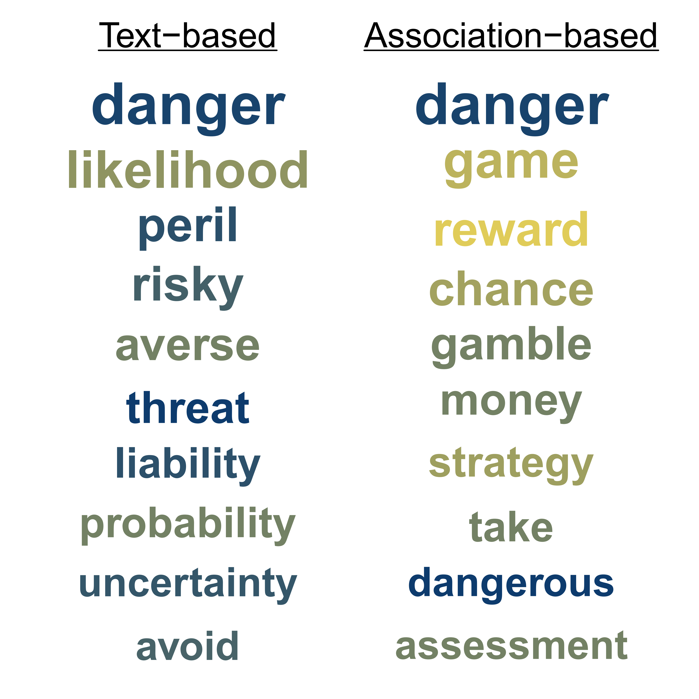
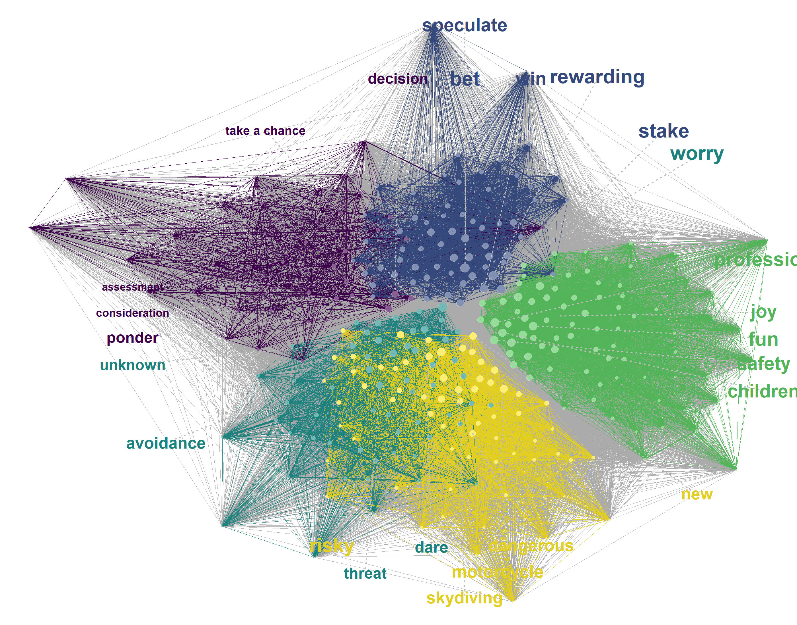
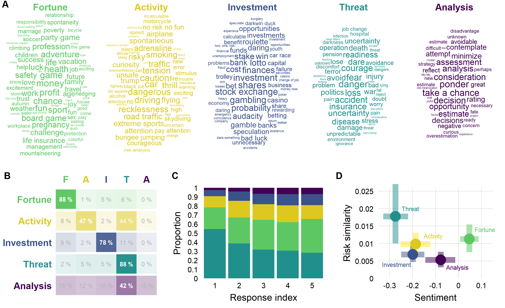
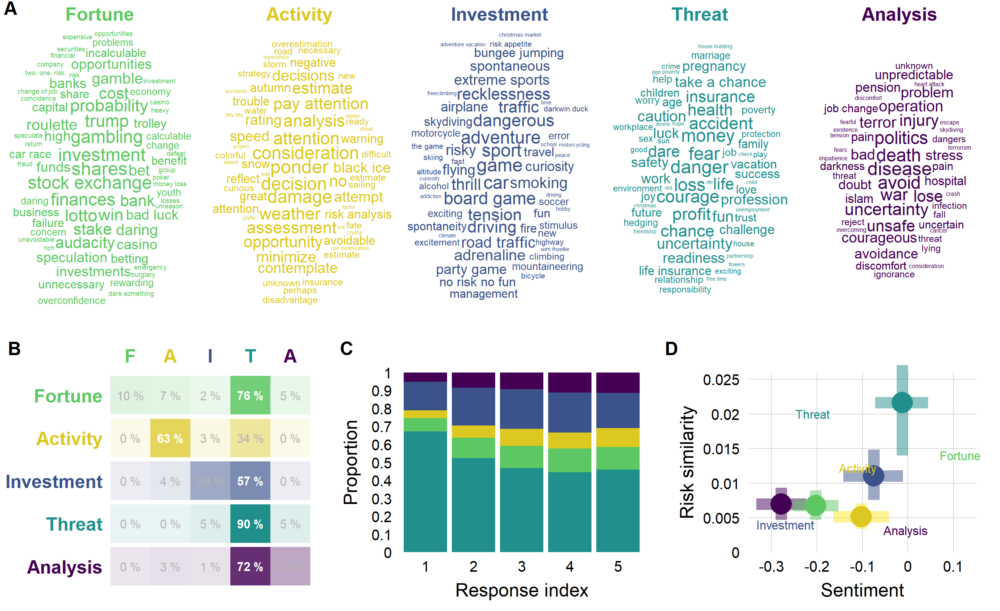
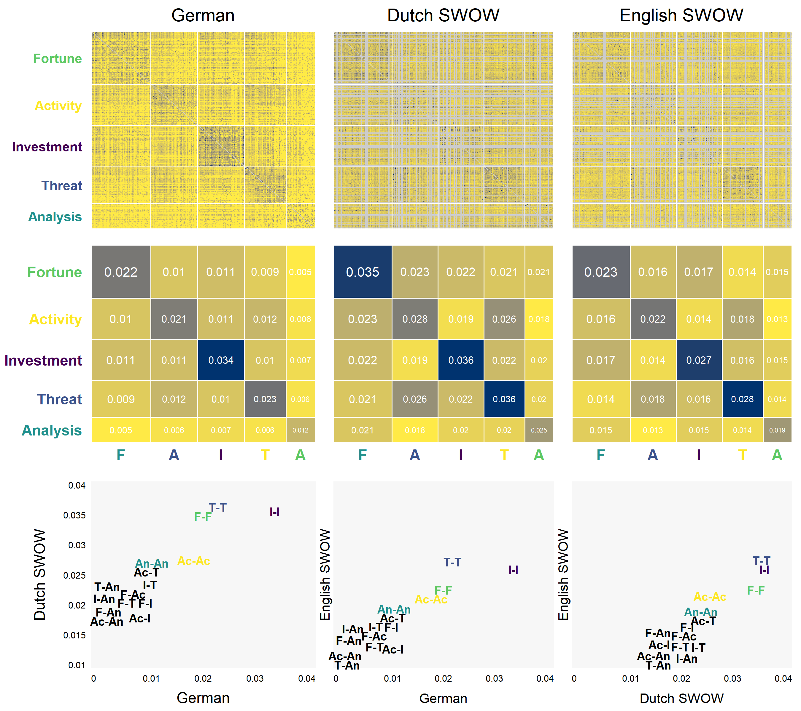
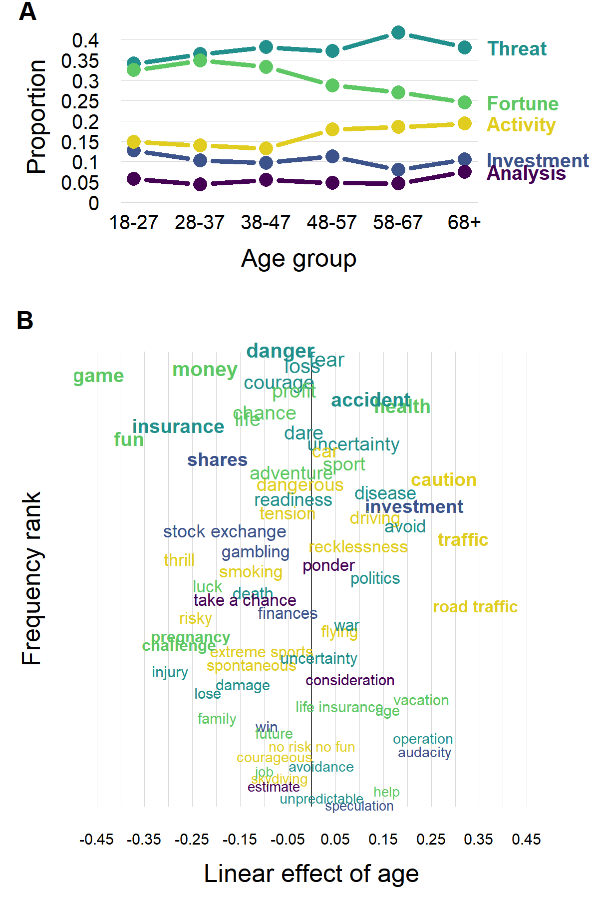
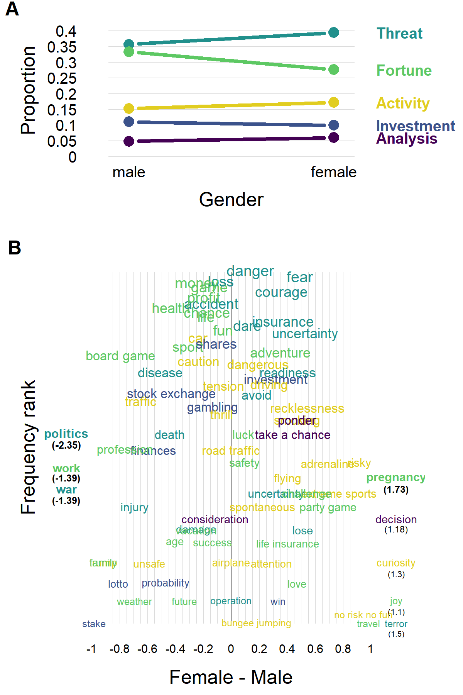
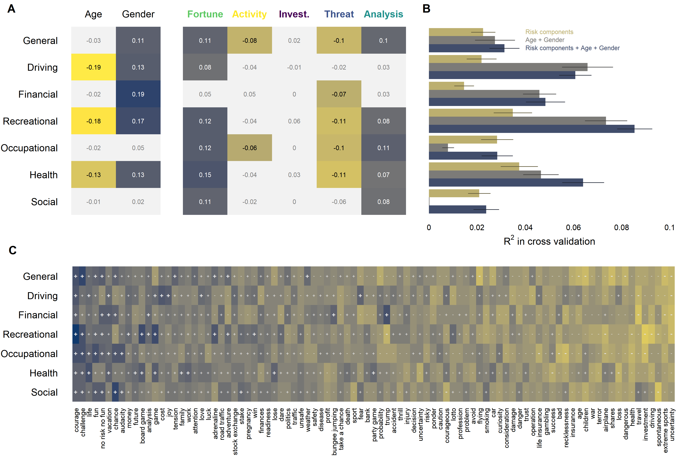
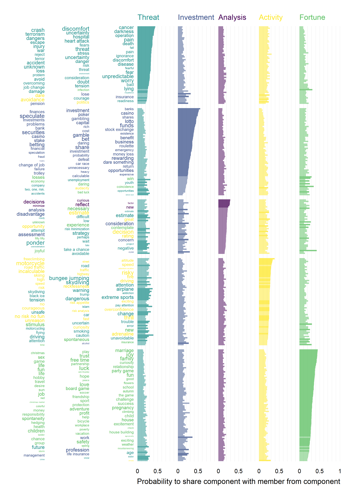
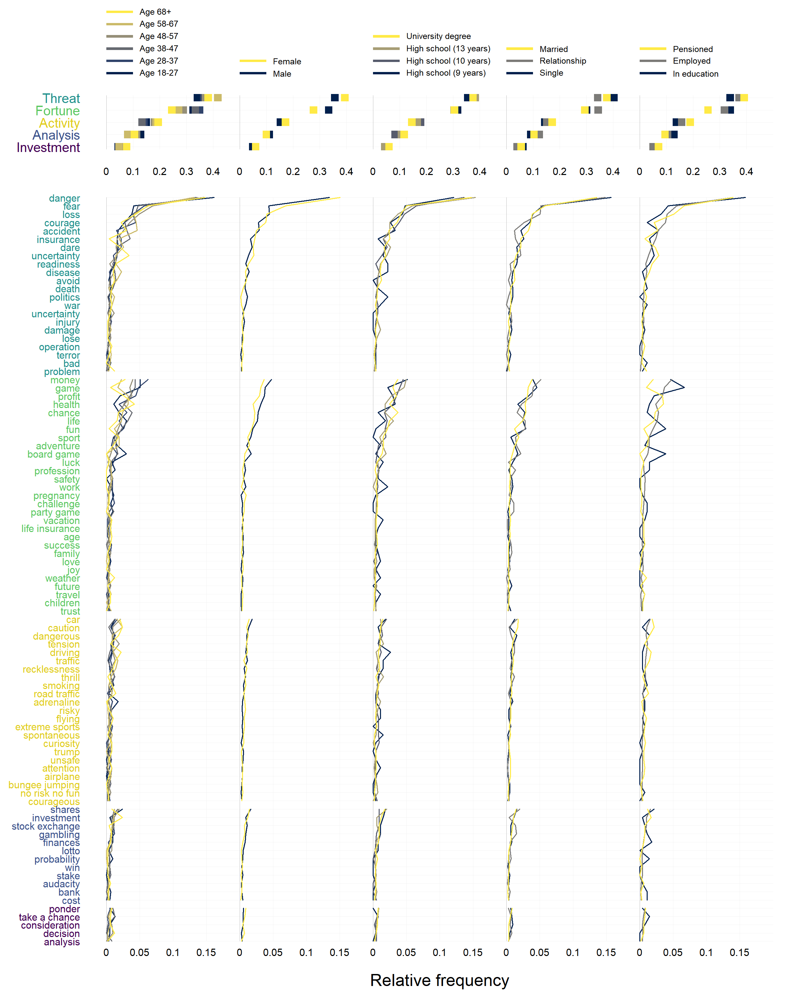

# 一、研究背景与复现目的
   本项目以 Wulff 和 Mata（2022）发表于 Science Advances 的论文 On the semantic representation of risk 为复现对象。原研究通过自由联想数据、加权 Jaccard 相似度、语义网络构建和Louvain社区检测，识别风险概念的语义成分，并进一步分析多语言一致性、年龄差异、性别差异、聚类稳定性以及语义信息对风险偏好的预测作用。
   
  原论文全文：<https://www.science.org/doi/10.1126/sciadv.abm1883>
  
  DOI：<https://doi.org/10.1126/sciadv.abm1883>
  
本项目采用两种计算方案：
 •方案 A：调用作者预先计算的数据。 读取作者提供的节点数据，并在后续分析中使用这些节点的社区标签及其他已计算属性。该方案主要用于检验后续分析代码能否基于作者数据重现论文中的图表和结论。
 •方案 B：自行计算数据。 从项目输入数据出发，重新计算相似度矩阵、构建网络并进行社区划分，再将自主生成的节点数据用于后续分析。该方案用于检验完整计算流程能否得到与作者结果及原论文相符的结果。

因此，本项目采用三层比较框架：

1. 方案 A 与原论文比较：
检查作者数据能否在当前项目中重现原论文的主要图表、关键数值与结论。

2. 方案 B 与原论文比较： 检查自主计算流程能否得到与论文一致或实质相符的结果。

3. 方案 A 与方案 B 比较： 定位两种方案之间的差异，并判断差异是否影响论文的实质性结论。

本项目的主要目标包括：
 1. 阅读并运行作者提供的分析代码，理解原研究的主要计算流程。
 2. 使用作者预先生成的节点数据，重新生成相应的分析结果和可视化图表。
 3. 自行执行节点网络构建和Louvain社区划分流程，考察自主生成的节点数据及其下游结果。
 4.对比作者节点数据方案与自行生成节点数据方案的结果，分析可能存在的差异。
 5. 按照可重复研究的基本原则整理数据、代码、分析输出和报告，并参考 TIER Protocol 4.0 组织项目材料。

# 二、研究数据与项目环境

## 2.1 数据来源
本次复现使用项目提供的输入数据与中间数据。项目中的部分数据文件包括：

 risk_associations.csv：词语联想相关数据。
 
 SWOW_EN.csv：英语词语联想数据。
 
 SWOW_DU.csv：荷兰语词语联想数据。
 
 risk_soep.csv：与风险相关的调查数据。
 
 translations.xlsx：词语翻译及多语言分析所需的数据。
 
此外，项目还使用节点数据、语义相似度矩阵及其他中间结果文件。

## 2.2 软件与运行环境
本次复现主要使用以下工具：

 R：数据处理、统计分析与图表生成。
 
 RStudio：编写和运行 R 脚本。
 
 Quarto：编写并渲染 HTML 报告。
 
 GitHub：用于整理和分享项目文件及复现材料。

## 2.3 项目文件组织
本项目按照数据、脚本、输出结果及文档分离的思路进行整理，主要包括：

 Data/InputData/：输入数据。

 Data/IntermediateData/：分析过程中生成或使用的中间数据。

 Scripts/：数据处理与分析脚本。

 Output/：分析输出及图表。

 Report.qmd：Quarto 报告源文件。

 Report.html：渲染生成的 HTML 报告。

 ReadMe.md：项目说明文件。

 TIER/：用于整理 TIER Protocol 4.0 相关材料的目录。

## 2.4 主要数据文件
本项目涉及的主要数据和中间文件包括：

risk_associations.csv-风险词语联想相关数据

SWOW_EN.csv-英语词语联想数据

SWOW_DU.csv-荷兰语词语联想数据

translations.xlsx-多语言词语翻译及相关处理

sentiment_de.csv-德语情绪相关数据

risk_soep.csv-风险相关调查数据

author_risk_nodes.csv-作者预先生成的节点数据

my_risk_nodes.csv-自行生成的节点数据

risk_similarity_mat.RDS-德语或默认语言流程中使用的语义相似度矩阵，具体以生成脚本为准

risk_similarity_mat_english.RDS-英语语义相似度矩阵

risk_similarity_mat_dutch.RDS-荷兰语语义相似度矩阵

component_stab.RDS-稳定性分析所需的中间结果

stability_confusion.RDS-稳定性分析中的混淆或比较结果

# 三、复现方法与分析流程

## 3.1 总体分析流程
本项目的复现过程可概括为以下步骤：

1. 读取输入数据和作者提供的相关材料。

2. 检查数据结构，并执行必要的数据处理。

3. 使用作者预生成的节点数据，或自行构建节点网络并执行社区划分。

4. 计算或读取后续分析所需的节点属性及语义相似度矩阵。

5. 运行语义网络、多语言、词云、生命周期、性别、预测和稳定性等分析。

6. 保存分析输出和图表。

7. 对照原论文核查结果，并将复现过程整理到 Quarto 报告中。

为了区分原始结果与自主计算结果，本项目保留了 AuthorNode 和 MyNode 两种方案。

## 3.2 方案A：加载作者预生成的节点文件（AuthorNode）
    使用author_risk_nodes.csv，并使用作者提供的相似度矩阵进行网络及后续分析。
本方案使用的文件应存放于Data/IntermediateData/AuthorNode/。矩阵文件包括德语、英语和荷兰语分析所需的预计算矩阵；实际使用哪些矩阵，应以相应脚本的读取语句和文件清单为准。
在网络分析过程中，脚本读取作者节点数据，依据相似度矩阵构建网络，并继续开展网络可视化、跨语言比较、词云、生命周期、性别、预测和稳定性等分析。已经包含在作者节点文件中的属性不再重复计算，以减少不必要的覆盖和数据差异。

该方案主要用于检验作者提供的中间数据能否支持后续分析，并比较复现结果与原论文结果之间的一致性。

代码如下：
```{r}
#| echo: true
 dir.create(
  "Output/Results/authornode/wordclouds",
  recursive = TRUE,
  showWarnings = FALSE
)
require(tidyverse)
require(igraph)
source("D:/PaperReplication/PaperReplication/Scripts/Shared/helper.R")
library(Rcpp)
Rcpp::sourceCpp('Scripts/Shared/helper.cpp')
#source('Scripts/Shared//helper.cpp')

# --------------------------------------------------------------------
#      READ & PROCESS DATA
# --------------------------------------------------------------------

# read assos
asso = read_csv('Data/InputData/risk_associations.csv')

# reduce to words that occur more than twice
from_tab = table(asso$from_correct)
asso = asso %>% 
  filter(from_correct %in% names(from_tab[from_tab > 10]))

# get all cues and responses
cues = unique(asso$from_correct)
resp = unique(asso$to_correct)

# create association matrix
asso_mat = matrix(0, nrow=length(cues), ncol = length(resp))
rownames(asso_mat) = cues
colnames(asso_mat) = resp

# fill matrix
for(i in 1:length(cues)){
  
  # keep track
  if(i %% 100 == 0) print(i)
  
  # fill matrix
  tab = table(asso[asso$from_correct == cues[i], "to_correct"])
  asso_mat[i, names(tab)] = as.numeric(tab)
  
}

# ---- compute weight between cues

# # get logarithm
# log_asso_mat = log(asso_mat + 1)
# 
# # determine jaccard matrix
# jacc_mat = jacc_abs_mat = matrix(nrow = length(cues), ncol = length(cues))
# rownames(jacc_mat) = colnames(jacc_mat) = rownames(jacc_abs_mat) = colnames(jacc_abs_mat) = cues
# for(i in 1:(length(cues)-1)){
#   print(i)
#   for(j in (i+1):length(cues)){
#     jacc = jaccard_cpp(log_asso_mat[i,], log_asso_mat[j,])
#     jacc_mat[i,j] = jacc_mat[j,i] = jacc
#     }
#   }
# saveRDS(jacc_mat,'Data/IntermediateData/AuthorNode/risk_similarity_mat.RDS')

# get co-occurrence and jaccard mat
jacc_mat = readRDS('Data/IntermediateData/AuthorNode/risk_similarity_mat.RDS')
edg_list = to_edge_list(jacc_mat)

# create graph
edges = cbind(cues[edg_list[,1]], cues[edg_list[,2]])
net = graph_from_edgelist(edges, directed = F)
net = set_edge_attr(net, "weight", value = edg_list[,3])

# cluste
# use author-provided node data
nodes = readr::read_csv(
  "Data/IntermediateData/AuthorNode/author_risk_nodes.csv",
  show_col_types = FALSE
)

nodes = nodes[match(cues, nodes$asso), ]

stopifnot(all(nodes$asso == cues))
# add frequency
#cue_freq = table(asso$to_correct[asso$from_correct == 'risiko'])
#nodes$frequency_wave_1 = as.numeric(cue_freq[nodes$asso])
#cue_freq = table(asso$to_correct[asso$from_correct != 'risiko'])
#nodes$frequency_wave_2 = as.numeric(cue_freq[nodes$asso])

# add centrality
page_rank = page_rank(net)$vec
nodes$page_rank = page_rank[nodes$asso]

# add subclusters
#nodes$page_rank_cluster = NA
#for(i in  1:max(nodes$cluster)){
#g = induced_subgraph(net, which(nodes$cluster == i))
#pg = page_rank(g)$vector
#nodes$page_rank_cluster[nodes$asso %in% names(pg)] = pg
#}

# read translations 
#trans = readxl::read_excel('1_data/translations.xlsx', col_names = F) %>% 
  # mutate_all(stringr::str_to_lower)
#nodes$eng = trans[[3]]

# load sentiment
#sent = read_csv('Data/InputData/sentiment_de.csv') %>% pull(sent, word)
# add sentiment to nodes
#nodes$sent = sent[nodes$asso]
# get composite
#get_sent = function(x) {v = mean(sent[x],na.rm=T);ifelse(length(v)==0,NA,v)}
#nodes = nodes %>% left_join(asso %>% 
#                              filter(from_correct %in% nodes$asso) %>% 
 #                             group_by(from_correct) %>% 
  #                            summarize(sent_2 = get_sent(to_correct)), by = c("asso" = "from_correct"))
#combine = function(x, y) ifelse(is.na(x), ifelse(is.na(y), NA, y), (x + y)/2)
#nodes = nodes %>% mutate(sent_comp = combine(sent, sent_2))


# add risk sim
#nodes$risk_sim = jacc_mat[nodes$asso, 'risiko']

# add average position
#pos = asso %>% 
#filter(to_correct %in% nodes$asso, trial <= 5) %>% 
#group_by(to_correct) %>% 
#summarize(pos = mean(trial))
#nodes = nodes %>% left_join(pos, by = c('asso' = 'to_correct'))

# save node data frame
#write_csv(nodes, 'Data/IntermediateData/AuthorNode/author_risk_nodes.csv')


# --------------------------------------------------------------------
#      Network plot
# --------------------------------------------------------------------

set.seed(8)

# within cluster amplifier
within_clique_weight = .006
edge_cex = c(1.5, .008, .06)


# colors
cols = viridis::viridis(5)[c(3,2,1,5,4)]

# get edges
edges = igraph::get.edgelist(net)

# set edge weights
cl_from = f.utils::replace_cn(edges[, 1], nodes$asso, nodes$cluster)
cl_to = f.utils::replace_cn(edges[, 2], nodes$asso, nodes$cluster)
cl_weight = E(net)$weight + ifelse(cl_from == cl_to, within_clique_weight, 0)

cl_weight[cl_weight <= 0] <- 1e-8

# ----- vertex settings

centr_id = rep(F, nrow(nodes))
for(i in 1:max(nodes$cluster)){
  cl_ind = which(nodes$cluster == i)
  centrs = nodes$page_rank[nodes$cluster == i]
  centr_ind = which(centrs >= centrs[order(centrs,decreasing = T)][5])
  centr_id[cl_ind][centr_ind] = T
}

vcol = f.utils:::colormixer(cols[nodes$cluster], 'white', rep(.1,nrow(nodes)),format = "hex")
vcex = nodes$page_rank * 800 + .5

# ----- edge settings

# edge pos indices
e_pos_from = f.utils::replace_cn(edges[,1], nodes$asso, 1:nrow(nodes))
e_pos_to = f.utils::replace_cn(edges[,2], nodes$asso, 1:nrow(nodes))

# edge colors
within = cl_from == cl_to
col_e = ifelse(within, cols[nodes$cluster[e_pos_from]], 'grey75')
col_e = f.utils:::colormixer(col_e,'black',
                             weight=rep(.1,length(col_e)),'hex')

# edge counts and size
lwd = E(net)$weight**edge_cex[1] / ifelse(within,edge_cex[2],edge_cex[3])


# layout
lyt = igraph::layout_with_fr(net, weights = cl_weight)

png('Output/Results/authornode/2_risknet.png',width = 2800, height = 2200)

par(mar=c(0,0,0,0));plot.new();plot.window(xlim=range(lyt[,1]),ylim=range(lyt[,2]))

# draw between edges
for(i in which(!within)){
  pos_from = lyt[e_pos_from[i], ]
  pos_to = lyt[e_pos_to[i], ]
  lines(c(pos_from[1],pos_to[1]),c(pos_from[2],pos_to[2]),
        lwd=lwd[i],col=col_e[i])
}

# draw within edges
for(i in which(within)){
  pos_from = lyt[e_pos_from[i],]
  pos_to = lyt[e_pos_to[i],]
  lines(c(pos_from[1],pos_to[1]),c(pos_from[2],pos_to[2]),
        lwd=lwd[i],col=col_e[i])
}


# plot points
for(i in which(!centr_id)) globe(lyt[i,1],lyt[i,2],col=vcol[i],prc=.3,cex=vcex[i],res=2,sh=.5,sh_bias=c(-.01,-.01))


grd_res = 25
grd_margin = 0
box = par()$usr
horiz_lim = 2
vert_lim = 2
cex_lab = c(1, 1)
lwd_labline = 4


# ------ create grid

grd    = expand.grid('x'=seq(box[1] + grd_margin, box[2] - grd_margin, length = grd_res),
                     'y'=seq(box[3] + grd_margin, box[4] - grd_margin, length = grd_res))
grd[,c('row','col')] = expand.grid('row' = 1:grd_res,'col' = 1:grd_res)
grd$id   = 1:nrow(grd)
grd$pos  = apply(expand.grid(1:grd_res,1:grd_res),1,paste0,collapse='_')
grd$free = rep(T,nrow(grd))


# ------ clear vertices space

# limits of vertex block
vert_lim = 5
horiz_lim = 5

# iterate over vertices
for(i in which(centr_id)){
  
  # find closest grid point
  pnt = lyt[i,]
  dif = sqrt((grd$x - pnt[1])**2 + (grd$y - pnt[2])**2)
  sel = which(dif==min(dif))[1]
  
  # clear rectangle around layout point
  pos = unlist(grd[sel,c('row','col')])
  rct = expand.grid(pos[1]+c(-horiz_lim : -1, 0, 1 : horiz_lim),
                    pos[2]+c(-vert_lim  : -1, 0, 1 : vert_lim))
  rem = apply(rct,1,paste0,collapse='_')
  grd$free[grd$pos %in% rem] <- F
}

# ------ place labels

# init
vert_lim = 1.4
txt.pos = lyt

# iterate over vertices
for(i in which(centr_id)){
  
  # determine horizontal space around label
  wid = (.025 *nchar(nodes$eng[i])**.92)/2
  horiz_lim  = ceiling(wid*grd_res)
  
  # find closes non-taken grid position
  pnt = lyt[i,]
  tst = subset(grd,free == T)
  dif = sqrt((tst$x - pnt[1])**2 + (tst$y - pnt[2])**2)
  sel = which(grd$free)[which.min(dif)]
  
  # clear space around label
  pos = unlist(grd[sel,c('row','col')])
  rct = expand.grid(pos[1]+c(-horiz_lim : -1, 0, 1 : horiz_lim),
                    pos[2]+c(-vert_lim  : -1, 0, 1 : vert_lim))
  rem = apply(rct,1,paste0,collapse='_')
  grd$free[ grd$pos %in% rem] = F
  
  # set text position
  txt.pos[i,] = c(grd[sel, 1], grd[sel, 2])
}

# ------ place labels

# draw label lines
lab_lines = cbind(lyt,txt.pos)[centr_id,]
apply(lab_lines,1,
      function(x) lines(c(x[1],x[3]),c(x[2],x[4]),lty=3,lwd=lwd_labline,col='grey75'))
#points(txt.pos,pch=16,lwd=1,col='white',cex=1.5)


# draw points
for(i in which(centr_id)[-1]) globe(lyt[i,1], lyt[i,2], col=vcol[i],
                                    prc=.3,cex=vcex[i],res=2,sh=.5,sh_bias=c(-.01,-.01))

# draw label background
for(i in which(centr_id)){
  nch = nchar(nodes$eng[i])
  rect(txt.pos[i,1]-.007*nch**.92,
       txt.pos[i,2]-.015,
       txt.pos[i,1]+.007*nch**.92,
       txt.pos[i,2]+.015,
       col=rgb(1,1,1,alpha=.3),border=NA)
}

# draw
text(txt.pos[centr_id,1],txt.pos[centr_id,2],nodes$eng[centr_id],
     font=2,cex=(1100*nodes$page_rank[centr_id])**.9,col=
       f.utils:::colormixer(cols[nodes$cluster[centr_id]],'black',rep(.1,length(cols[nodes$cluster[centr_id]])),format = 'hex'))

dev.off()

# --------------------------------------------------------------------
#      WORD CLOUDS
# --------------------------------------------------------------------

#col = memnet:::cmix(viridis::viridis(5)[c(3,2,1,5,4)],"black",.1)

cols = memnet:::cmix(viridis::viridis(5)[c(3,2,1,5,4)],"black",c(0,0,0,.13,0))
cols_a = viridis::viridis(5,alpha=.5)[c(3,2,1,5,4)]
labs = c('Threat','Investment','Analysis','Activity','Fortune')


png('Output/Results/authornode/4_wordclouds.png',width=9,height=5.5,res=300,unit='in')

ord = c(5, 4, 2, 1, 3)
tab = table(nodes$cluster)

layout(matrix(c(rep(1:5, rep(3, 5)), rep(6:8, rep(5, 3))), nrow=2, byrow = T), height = c(.55,.45))
par(mar=c(0,0,1.3,0))
for(i in ord){
  nodes_tmp = nodes %>% filter(cluster == i, asso != 'risiko')
  wordcloud::wordcloud(nodes_tmp$eng, freq = rank(nodes_tmp$frequency_wave_1), 
                       min.freq=0, col = cols[i],scale=c(1.5,.3),random.order=F,
                       fixed.asp = F,rot.per = 0)
  mtext(labs[i],cex=1,font=2,line=-.3,col=cols[i])
  if(i == 5) mtext('A',side=3,font=2,at=.02,line=.1)
}

corrs = readRDS('Data/IntermediateData/AuthorNode/stability_confusion.RDS')
ord = c(5, 4, 2, 1, 3)
corrs = corrs[ord, ord]
corrs = corrs / rowSums(corrs)

par(mar=c(1, 7, 2, 1))
plot.new();plot.window(xlim=c(.5, 5.5), ylim=c(.5, 5.5))
pos = 1:5
w = .5 ; h = .45
for(i in 1:5){
  v = corrs[i,]
  row_cols = "white" #grey(1-v/.9)
  row_cols = memnet::cmix(rep(cols[ord[i]],5), "white", weight = (1-corrs[i,]/.9)*.9)
  for(j in 1:5){
    rect(pos[j] - w, pos[6-i]-h, pos[j]+w, pos[6-i]+h, col = row_cols[j], border=NA)
  }
  text(pos, pos[6-i], labels = paste(round(v * 100), "%"), cex=1, 
       col = ifelse(v > .4,"white", 'grey70'), font = ifelse(which.max(v)==(1:5), 2, 1))
}
mtext(labs[ord], side=2, at = 5:1, adj=1, col = cols[ord], las=1, cex=1, font=2)
mtext(str_sub(labs[ord],1,1), side=3, at = 1:5, adj=.5, col = cols[ord], las=1, cex=1, font=2)
mtext('B',side=3,font=2,at=-1.9,line=.5)

get_max = function(x) {tab = table(x) ; names(tab)[which.max(tab)]}
nodes_agg = asso %>% 
  right_join(nodes, by=c("to_correct" = "asso")) %>% 
  filter(trial <= 5) %>%
  group_by(trial, cluster) %>% 
  summarize(n = n(),
            w = get_max(eng)) %>% 
  pivot_wider(names_from = trial, values_from = c(n,w)) %>% 
  ungroup() %>% 
  mutate_if(is.integer, function(x) x / sum(x))


par(mar=c(3.5,4,2,1))
plot.new();plot.window(xlim = c(.5,5.5), ylim=c(0,1))

s = c(1, 5, 4, 2, 3)
#s = ord
nodes_agg = nodes_agg[s,]

for(i in 1:5){
  rect(i - .45, c(0, cumsum(nodes_agg[[paste0("n_",i)]])[-5]), 
       i + .45, cumsum(nodes_agg[[paste0("n_",i)]]), col = cols[s], border=NA)
  pos = c(0, cumsum(nodes_agg[[paste0("n_",i)]])[-5]) + nodes_agg[[paste0("n_",i)]] / 2 + .002
  ws = nodes_agg[[paste0("w_",i)]]
  #text(rep(i,5), pos, labels = ws,cex = ifelse(8.5/nchar(ws) > 1.5,1.5,8.5/nchar(ws)),col='white')
}


mtext(seq(0,1,.1),at=seq(0,1,.1),side=2,las=1,cex=.8)
mtext(1:5, at = 1:5,side=1,las=1,cex=.8)
mtext(c('Response index','Proportion'),side=c(1,2),line=c(1.7,2.2),cex=1)
mtext('C',side=3,font=2,at=-.64,line=.5)


# stats
nodes_agg = nodes %>% 
  group_by(cluster) %>% 
  summarize(sent_m = mean(sent_comp, na.rm=T),
            sent_q025 = quantile(sapply(1:10000, function(x) mean(sample(sent_comp,replace=T),na.rm=T)),.025),
            sent_q975 = quantile(sapply(1:10000, function(x) mean(sample(sent_comp,replace=T),na.rm=T)),.975),
            risk_m = mean(risk_sim, na.rm=T),
            risk_q025 = quantile(sapply(1:10000, function(x) mean(sample(risk_sim,replace=T),na.rm=T)),.025),
            risk_q975 = quantile(sapply(1:10000, function(x) mean(sample(risk_sim,replace=T),na.rm=T)),.975),
            pg = mean(page_rank),
            key = asso[which.max(page_rank)],
            n = n())

par(mar=c(3.5,5,2,1))
plot.new();plot.window(xlim=c(-.35,.15),ylim=c(0,.026))

sapply(seq(-.3,.2,.1),function(x) lines(c(x,x),c(0,.026),lwd=.7, col = 'grey85',lty=1))
sapply(seq(.005,.025,.005),function(x) lines(c(-.35,.15),c(x,x),lwd=.7, col = 'grey85',lty=1))

for(i in 1:5) lines(nodes_agg[i,c('sent_q025','sent_q975')],rep(nodes_agg[i,'risk_m'],2),col=cols_a[i],lwd=10,lend=2,lty=1)
for(i in 1:5) lines(rep(nodes_agg[i,'sent_m'],2),nodes_agg[i,c('risk_q025','risk_q975')],col=cols_a[i],lwd=10,lend=2,lty=1)
points(nodes_agg %>% select(sent_m, risk_m), cex = 4, col = cols, pch=16,lwd=2)

mtext(seq(0,.025,.005),at=seq(0,.025,.005),side=2,las=1,cex=.8)
mtext(round(seq(-.3,.1,.1),2),at=seq(-.3,.1,.1),side=1,las=1,cex=.8)
mtext(c('Sentiment','Risk similarity'),side=c(1,2),line=c(1.7,3),cex=1)
mtext('D',side=3,font=2,at=-.52,line=.5)

ord = c(1, 4, 2, 3, 5)
text(c(-.21, -.11, -.27, -.005, .115), c(.02, .012, .004, .003, .014), 
     labels = labs[ord], col  = cols[ord], font=1)


dev.off()


# COMPONENT SIZE ------

asso %>% 
  right_join(nodes, by=c("to_correct" = "asso")) %>% 
  filter(trial <=5) %>%
  group_by(cluster) %>% 
  summarize(n = n()) %>% 
  ungroup() %>% 
  mutate(n = n/sum(n))

asso_v = asso %>% 
  right_join(nodes, by=c("to_correct" = "asso")) %>% 
  filter(trial <= 5) %>% 
  pull(to_correct) %>% 
  table()
asso_v = asso_v / sum(asso_v)
asso_v["gefahr"]

asso_v[nodes$asso[nodes$cluster == 2]] %>% sort()
asso_v[nodes$asso[nodes$cluster == 3]] %>% sort()
asso_v[nodes$asso[nodes$cluster == 4]] %>% sort()


asso %>% 
  filter(trial <= 5) %>% 
  group_by(subject) %>% 
  summarize(exist = "gefahr" %in% to_correct) %>% 
  summarize(mean(exist))

asso %>% 
  filter(trial <= 5) %>% 
  group_by(subject) %>% 
  summarize(exist = "geld" %in% to_correct) %>% 
  summarize(mean(exist))

nodes %>% filter(cluster == 1) %>% arrange(desc(frequency_wave_1)) %>% pull(eng) %>% head()
nodes %>% filter(cluster == 2) %>% arrange(desc(frequency_wave_1)) %>% pull(eng) %>% head()
nodes %>% filter(cluster == 3) %>% arrange(desc(frequency_wave_1)) %>% pull(eng) %>% head()
nodes %>% filter(cluster == 4) %>% arrange(desc(frequency_wave_1)) %>% pull(eng) %>% head()
nodes %>% filter(cluster == 5) %>% arrange(desc(frequency_wave_1)) %>% pull(eng) %>% head()


# --------------------------------------------------------------------
#      HIERARCHICAL CLUSTERING
# --------------------------------------------------------------------

# get jacc mat
jacc_mat = readRDS('Data/IntermediateData/AuthorNode/risk_similarity_mat.RDS')

# get nodes
nodes_hclust = readr::read_csv('Data/IntermediateData/AuthorNode/author_risk_nodes.csv') 

# run hclust
cl = fastcluster::hclust(as.dist(1-jacc_mat), method = "ward.D")

# set first clustering
prev = cutree(cl, 1)

# iterate through k = 2:10
for(i in 2:10){
  
  # keep track
  print(i)
  
  # set colors
  cols = viridis::viridis(i)
  cols[length(cols)] = memnet:::cmix(cols[length(cols)],"black",.13)
  
  # start plot  
  png(paste('output/Results/authornode/wordclouds/wordclouds_',i,'.png'),width=15,height=3,res=300,unit='in')
  par(mar=c(0,0,0,0))
  
  # get and sort clustering
  curr = cutree(cl, i)
  pos = sapply(1:i, function(x) {n = names(curr[curr == x]); mean(prev[n])}) %>% order()
  curr_ord = curr
  for(k in 1:i) curr_ord[curr == pos[k]] = k
  
  # set clusters
  nodes = nodes_hclust %>% mutate(cluster = curr_ord)
  
  # update clustering
  prev = curr_ord
  
  # determine cluster proportions
  p = (table(nodes$cluster) / nrow(nodes) + .2*rep(1/i, i))/1.2
  
  # plot wordclouds
  layout(matrix(1:i,nrow=1), width=p)
  for(j in 1:i){
    nodes_tmp = nodes %>% filter(cluster == j, asso != 'risiko')
    wordcloud::wordcloud(nodes_tmp$eng, freq = rank(nodes_tmp$frequency_wave_1)**1.5, 
                         min.freq=0, col = cols[j], scale=c(2,.2),random.order=F,
                         fixed.asp = F,rot.per = 0)
  }  
  dev.off()
}
```

    本方案的主要目的是使用作者的节点数据运行后续分析，尽可能减少节点属性重新计算和社区划分差异对结果的影响。使用该方案有助于复现原论文的图表，但是否完全一致仍取决于下游代码、绘图参数、软件环境和输入文件是否一致。
    因此，本报告将 AuthorNode作为核对原论文后续分析结果的主要方案，并对实际生成的图表进行逐项比较。
## 3.3 方案B二：自行生成节点数据（Mynode）

自主方案以输入数据为起点，执行数据整理、相似度矩阵计算、网络构建、Louvain 社区划分和节点属性计算等步骤。计算得到的相似度矩阵保存在Data/IntermediateData/MyNode/，节点文件保存为 my_risk_nodes.csv。后续分析脚本读取这一目录下的自主计算结果，而不是读取作者方案中的节点文件和矩阵。
    
自主方案根据计算得到的网络生成社区划分，并进一步计算节点频率、中心性、翻译、情绪得分、风险相似度等分析所需的属性。完成节点文件生成后，再执行相应的下游分析。
该方案主要用于检验从输入数据到网络构建、节点属性计算和后续分析的完整流程。

代码如下：
```{r}
#| echo: true
 dir.create(
 "Output/Results/Mynode/wordclouds",
  recursive = TRUE,
  showWarnings = FALSE
)
require(tidyverse)
require(igraph)
source("D:/PaperReplication/PaperReplication/Scripts/Shared/helper.R")
library(Rcpp)
Rcpp::sourceCpp('Scripts/Shared/helper.cpp')
#source('Scripts/Shared//helper.cpp')

# --------------------------------------------------------------------
#      READ & PROCESS DATA
# --------------------------------------------------------------------

# read assos
asso = read_csv('Data/InputData/risk_associations.csv')

# reduce to words that occur more than twice
from_tab = table(asso$from_correct)
asso = asso %>% 
  filter(from_correct %in% names(from_tab[from_tab > 10]))

# get all cues and responses
cues = unique(asso$from_correct)
resp = unique(asso$to_correct)

# create association matrix
asso_mat = matrix(0, nrow=length(cues), ncol = length(resp))
rownames(asso_mat) = cues
colnames(asso_mat) = resp

# fill matrix
for(i in 1:length(cues)){
  
  # keep track
  if(i %% 100 == 0) print(i)
  
  # fill matrix
  tab = table(asso[asso$from_correct == cues[i], "to_correct"])
  asso_mat[i, names(tab)] = as.numeric(tab)
  
}

# ---- compute weight between cues

 # get logarithm
 log_asso_mat = log(asso_mat + 1)
 
 # determine jaccard matrix
 jacc_mat = jacc_abs_mat = matrix(nrow = length(cues), ncol = length(cues))
 rownames(jacc_mat) = colnames(jacc_mat) = rownames(jacc_abs_mat) = colnames(jacc_abs_mat) = cues
 for(i in 1:(length(cues)-1)){
   print(i)
   for(j in (i+1):length(cues)){
     jacc = jaccard_cpp(log_asso_mat[i,], log_asso_mat[j,])
     jacc_mat[i,j] = jacc_mat[j,i] = jacc
     }
   }
 saveRDS(jacc_mat,'Data/IntermediateData/Mynode/risk_similarity_mat.RDS')

# get co-occurrence and jaccard mat
jacc_mat = readRDS('Data/IntermediateData/Mynode/risk_similarity_mat.RDS')
edg_list = to_edge_list(jacc_mat)

# create graph
edges = cbind(cues[edg_list[,1]], cues[edg_list[,2]])
net = graph_from_edgelist(edges, directed = F)
net = set_edge_attr(net, "weight", value = edg_list[,3])

# cluste
nodes = tibble('asso' = cues, 'cluster' = cluster_louvain(net)$membership)

# add frequency
cue_freq = table(asso$to_correct[asso$from_correct == 'risiko'])
nodes$frequency_wave_1 = as.numeric(cue_freq[nodes$asso])
cue_freq = table(asso$to_correct[asso$from_correct != 'risiko'])
nodes$frequency_wave_2 = as.numeric(cue_freq[nodes$asso])

# add centrality
page_rank = page_rank(net)$vec
nodes$page_rank = page_rank[nodes$asso]

# add subclusters
nodes$page_rank_cluster = NA
for(i in  1:max(nodes$cluster)){
  g = induced_subgraph(net, which(nodes$cluster == i))
  pg = page_rank(g)$vector
  nodes$page_rank_cluster[nodes$asso %in% names(pg)] = pg
}

# read translations 
trans = readxl::read_excel('Data/InputData/translations.xlsx', col_names = F) %>% 
  mutate_all(stringr::str_to_lower)
nodes$eng = trans[[3]]

# load sentiment
sent = read_csv('Data/InputData/sentiment_de.csv') %>% pull(sent, word)

# add sentiment to nodes
nodes$sent = sent[nodes$asso]

# get composite
get_sent = function(x) {v = mean(sent[x],na.rm=T);ifelse(length(v)==0,NA,v)}
nodes = nodes %>% left_join(asso %>% 
                              filter(from_correct %in% nodes$asso) %>% 
                              group_by(from_correct) %>% 
                              summarize(sent_2 = get_sent(to_correct)), by = c("asso" = "from_correct"))
combine = function(x, y) ifelse(is.na(x), ifelse(is.na(y), NA, y), (x + y)/2)
nodes = nodes %>% mutate(sent_comp = combine(sent, sent_2))


# add risk sim
nodes$risk_sim = jacc_mat[nodes$asso, 'risiko']

# add average position
pos = asso %>% 
  filter(to_correct %in% nodes$asso, trial <= 5) %>% 
  group_by(to_correct) %>% 
  summarize(pos = mean(trial))
nodes = nodes %>% left_join(pos, by = c('asso' = 'to_correct'))

# save node data frame
write_csv(nodes,'Data/IntermediateData/Mynode/my_risk_nodes.csv')


# --------------------------------------------------------------------
#      Network plot
# --------------------------------------------------------------------

set.seed(8)

# within cluster amplifier
within_clique_weight = .006
edge_cex = c(1.5, .008, .06)


# colors
cols = viridis::viridis(5)[c(3,2,1,5,4)]

# get edges
edges = igraph::get.edgelist(net)

# set edge weights
cl_from = f.utils::replace_cn(edges[, 1], nodes$asso, nodes$cluster)
cl_to = f.utils::replace_cn(edges[, 2], nodes$asso, nodes$cluster)
cl_weight = E(net)$weight + ifelse(cl_from == cl_to, within_clique_weight, 0)

cl_weight[cl_weight <= 0] <- 1e-8

# ----- vertex settings

centr_id = rep(F, nrow(nodes))
for(i in 1:max(nodes$cluster)){
  cl_ind = which(nodes$cluster == i)
  centrs = nodes$page_rank[nodes$cluster == i]
  centr_ind = which(centrs >= centrs[order(centrs,decreasing = T)][5])
  centr_id[cl_ind][centr_ind] = T
}

vcol = f.utils:::colormixer(cols[nodes$cluster], 'white', rep(.1,nrow(nodes)),format = "hex")
vcex = nodes$page_rank * 800 + .5

# ----- edge settings

# edge pos indices
e_pos_from = f.utils::replace_cn(edges[,1], nodes$asso, 1:nrow(nodes))
e_pos_to = f.utils::replace_cn(edges[,2], nodes$asso, 1:nrow(nodes))

# edge colors
within = cl_from == cl_to
col_e = ifelse(within, cols[nodes$cluster[e_pos_from]], 'grey75')
col_e = f.utils:::colormixer(col_e,'black',
                             weight=rep(.1,length(col_e)),'hex')

# edge counts and size
lwd = E(net)$weight**edge_cex[1] / ifelse(within,edge_cex[2],edge_cex[3])


# layout
lyt = igraph::layout_with_fr(net, weights = cl_weight)

png('Output/Results/MyNode/2_risknet.png',width = 2800, height = 2200)

par(mar=c(0,0,0,0));plot.new();plot.window(xlim=range(lyt[,1]),ylim=range(lyt[,2]))

# draw between edges
for(i in which(!within)){
  pos_from = lyt[e_pos_from[i], ]
  pos_to = lyt[e_pos_to[i], ]
  lines(c(pos_from[1],pos_to[1]),c(pos_from[2],pos_to[2]),
        lwd=lwd[i],col=col_e[i])
}

# draw within edges
for(i in which(within)){
  pos_from = lyt[e_pos_from[i],]
  pos_to = lyt[e_pos_to[i],]
  lines(c(pos_from[1],pos_to[1]),c(pos_from[2],pos_to[2]),
        lwd=lwd[i],col=col_e[i])
}


# plot points
for(i in which(!centr_id)) globe(lyt[i,1],lyt[i,2],col=vcol[i],prc=.3,cex=vcex[i],res=2,sh=.5,sh_bias=c(-.01,-.01))


grd_res = 25
grd_margin = 0
box = par()$usr
horiz_lim = 2
vert_lim = 2
cex_lab = c(1, 1)
lwd_labline = 4


# ------ create grid

grd    = expand.grid('x'=seq(box[1] + grd_margin, box[2] - grd_margin, length = grd_res),
                     'y'=seq(box[3] + grd_margin, box[4] - grd_margin, length = grd_res))
grd[,c('row','col')] = expand.grid('row' = 1:grd_res,'col' = 1:grd_res)
grd$id   = 1:nrow(grd)
grd$pos  = apply(expand.grid(1:grd_res,1:grd_res),1,paste0,collapse='_')
grd$free = rep(T,nrow(grd))


# ------ clear vertices space

# limits of vertex block
vert_lim = 5
horiz_lim = 5

# iterate over vertices
for(i in which(centr_id)){
  
  # find closest grid point
  pnt = lyt[i,]
  dif = sqrt((grd$x - pnt[1])**2 + (grd$y - pnt[2])**2)
  sel = which(dif==min(dif))[1]
  
  # clear rectangle around layout point
  pos = unlist(grd[sel,c('row','col')])
  rct = expand.grid(pos[1]+c(-horiz_lim : -1, 0, 1 : horiz_lim),
                    pos[2]+c(-vert_lim  : -1, 0, 1 : vert_lim))
  rem = apply(rct,1,paste0,collapse='_')
  grd$free[grd$pos %in% rem] <- F
}

# ------ place labels

# init
vert_lim = 1.4
txt.pos = lyt

# iterate over vertices
for(i in which(centr_id)){
  
  # determine horizontal space around label
  wid = (.025 *nchar(nodes$eng[i])**.92)/2
  horiz_lim  = ceiling(wid*grd_res)
  
  # find closes non-taken grid position
  pnt = lyt[i,]
  tst = subset(grd,free == T)
  dif = sqrt((tst$x - pnt[1])**2 + (tst$y - pnt[2])**2)
  sel = which(grd$free)[which.min(dif)]
  
  # clear space around label
  pos = unlist(grd[sel,c('row','col')])
  rct = expand.grid(pos[1]+c(-horiz_lim : -1, 0, 1 : horiz_lim),
                    pos[2]+c(-vert_lim  : -1, 0, 1 : vert_lim))
  rem = apply(rct,1,paste0,collapse='_')
  grd$free[ grd$pos %in% rem] = F
  
  # set text position
  txt.pos[i,] = c(grd[sel, 1], grd[sel, 2])
}

# ------ place labels

# draw label lines
lab_lines = cbind(lyt,txt.pos)[centr_id,]
apply(lab_lines,1,
      function(x) lines(c(x[1],x[3]),c(x[2],x[4]),lty=3,lwd=lwd_labline,col='grey75'))
#points(txt.pos,pch=16,lwd=1,col='white',cex=1.5)


# draw points
for(i in which(centr_id)[-1]) globe(lyt[i,1], lyt[i,2], col=vcol[i],
                                    prc=.3,cex=vcex[i],res=2,sh=.5,sh_bias=c(-.01,-.01))

# draw label background
for(i in which(centr_id)){
  nch = nchar(nodes$eng[i])
  rect(txt.pos[i,1]-.007*nch**.92,
       txt.pos[i,2]-.015,
       txt.pos[i,1]+.007*nch**.92,
       txt.pos[i,2]+.015,
       col=rgb(1,1,1,alpha=.3),border=NA)
}

# draw
text(txt.pos[centr_id,1],txt.pos[centr_id,2],nodes$eng[centr_id],
     font=2,cex=(1100*nodes$page_rank[centr_id])**.9,col=
       f.utils:::colormixer(cols[nodes$cluster[centr_id]],'black',rep(.1,length(cols[nodes$cluster[centr_id]])),format = 'hex'))

dev.off()

# --------------------------------------------------------------------
#      WORD CLOUDS
# --------------------------------------------------------------------

#col = memnet:::cmix(viridis::viridis(5)[c(3,2,1,5,4)],"black",.1)

cols = memnet:::cmix(viridis::viridis(5)[c(3,2,1,5,4)],"black",c(0,0,0,.13,0))
cols_a = viridis::viridis(5,alpha=.5)[c(3,2,1,5,4)]
labs = c('Threat','Investment','Analysis','Activity','Fortune')


png('Output/Results/MyNode/4_wordclouds.png',width=9,height=5.5,res=300,unit='in')

ord = c(5, 4, 2, 1, 3)
tab = table(nodes$cluster)

layout(matrix(c(rep(1:5, rep(3, 5)), rep(6:8, rep(5, 3))), nrow=2, byrow = T), height = c(.55,.45))
par(mar=c(0,0,1.3,0))
for(i in ord){
  nodes_tmp = nodes %>% filter(cluster == i, asso != 'risiko')
  wordcloud::wordcloud(nodes_tmp$eng, freq = rank(nodes_tmp$frequency_wave_1), 
                       min.freq=0, col = cols[i],scale=c(1.5,.3),random.order=F,
                       fixed.asp = F,rot.per = 0)
  mtext(labs[i],cex=1,font=2,line=-.3,col=cols[i])
  if(i == 5) mtext('A',side=3,font=2,at=.02,line=.1)
}

corrs = readRDS('Data/IntermediateData/Mynode/stability_confusion.RDS')
ord = c(5, 4, 2, 1, 3)
corrs = corrs[ord, ord]
corrs = corrs / rowSums(corrs)

par(mar=c(1, 7, 2, 1))
plot.new();plot.window(xlim=c(.5, 5.5), ylim=c(.5, 5.5))
pos = 1:5
w = .5 ; h = .45
for(i in 1:5){
  v = corrs[i,]
  row_cols = "white" #grey(1-v/.9)
  row_cols = memnet::cmix(rep(cols[ord[i]],5), "white", weight = (1-corrs[i,]/.9)*.9)
  for(j in 1:5){
    rect(pos[j] - w, pos[6-i]-h, pos[j]+w, pos[6-i]+h, col = row_cols[j], border=NA)
  }
  text(pos, pos[6-i], labels = paste(round(v * 100), "%"), cex=1, 
       col = ifelse(v > .4,"white", 'grey70'), font = ifelse(which.max(v)==(1:5), 2, 1))
}
mtext(labs[ord], side=2, at = 5:1, adj=1, col = cols[ord], las=1, cex=1, font=2)
mtext(str_sub(labs[ord],1,1), side=3, at = 1:5, adj=.5, col = cols[ord], las=1, cex=1, font=2)
mtext('B',side=3,font=2,at=-1.9,line=.5)

get_max = function(x) {tab = table(x) ; names(tab)[which.max(tab)]}
nodes_agg = asso %>% 
  right_join(nodes, by=c("to_correct" = "asso")) %>% 
  filter(trial <= 5) %>%
  group_by(trial, cluster) %>% 
  summarize(n = n(),
            w = get_max(eng)) %>% 
  pivot_wider(names_from = trial, values_from = c(n,w)) %>% 
  ungroup() %>% 
  mutate_if(is.integer, function(x) x / sum(x))


par(mar=c(3.5,4,2,1))
plot.new();plot.window(xlim = c(.5,5.5), ylim=c(0,1))

s = c(1, 5, 4, 2, 3)
#s = ord
nodes_agg = nodes_agg[s,]

for(i in 1:5){
  rect(i - .45, c(0, cumsum(nodes_agg[[paste0("n_",i)]])[-5]), 
       i + .45, cumsum(nodes_agg[[paste0("n_",i)]]), col = cols[s], border=NA)
  pos = c(0, cumsum(nodes_agg[[paste0("n_",i)]])[-5]) + nodes_agg[[paste0("n_",i)]] / 2 + .002
  ws = nodes_agg[[paste0("w_",i)]]
  #text(rep(i,5), pos, labels = ws,cex = ifelse(8.5/nchar(ws) > 1.5,1.5,8.5/nchar(ws)),col='white')
}


mtext(seq(0,1,.1),at=seq(0,1,.1),side=2,las=1,cex=.8)
mtext(1:5, at = 1:5,side=1,las=1,cex=.8)
mtext(c('Response index','Proportion'),side=c(1,2),line=c(1.7,2.2),cex=1)
mtext('C',side=3,font=2,at=-.64,line=.5)


# stats
nodes_agg = nodes %>% 
  group_by(cluster) %>% 
  summarize(sent_m = mean(sent_comp, na.rm=T),
            sent_q025 = quantile(sapply(1:10000, function(x) mean(sample(sent_comp,replace=T),na.rm=T)),.025),
            sent_q975 = quantile(sapply(1:10000, function(x) mean(sample(sent_comp,replace=T),na.rm=T)),.975),
            risk_m = mean(risk_sim, na.rm=T),
            risk_q025 = quantile(sapply(1:10000, function(x) mean(sample(risk_sim,replace=T),na.rm=T)),.025),
            risk_q975 = quantile(sapply(1:10000, function(x) mean(sample(risk_sim,replace=T),na.rm=T)),.975),
            pg = mean(page_rank),
            key = asso[which.max(page_rank)],
            n = n())

par(mar=c(3.5,5,2,1))
plot.new();plot.window(xlim=c(-.35,.15),ylim=c(0,.026))

sapply(seq(-.3,.2,.1),function(x) lines(c(x,x),c(0,.026),lwd=.7, col = 'grey85',lty=1))
sapply(seq(.005,.025,.005),function(x) lines(c(-.35,.15),c(x,x),lwd=.7, col = 'grey85',lty=1))

for(i in 1:5) lines(nodes_agg[i,c('sent_q025','sent_q975')],rep(nodes_agg[i,'risk_m'],2),col=cols_a[i],lwd=10,lend=2,lty=1)
for(i in 1:5) lines(rep(nodes_agg[i,'sent_m'],2),nodes_agg[i,c('risk_q025','risk_q975')],col=cols_a[i],lwd=10,lend=2,lty=1)
points(nodes_agg %>% select(sent_m, risk_m), cex = 4, col = cols, pch=16,lwd=2)

mtext(seq(0,.025,.005),at=seq(0,.025,.005),side=2,las=1,cex=.8)
mtext(round(seq(-.3,.1,.1),2),at=seq(-.3,.1,.1),side=1,las=1,cex=.8)
mtext(c('Sentiment','Risk similarity'),side=c(1,2),line=c(1.7,3),cex=1)
mtext('D',side=3,font=2,at=-.52,line=.5)

ord = c(1, 4, 2, 3, 5)
text(c(-.21, -.11, -.27, -.005, .115), c(.02, .012, .004, .003, .014), 
     labels = labs[ord], col  = cols[ord], font=1)


dev.off()


# COMPONENT SIZE ------

asso %>% 
  right_join(nodes, by=c("to_correct" = "asso")) %>% 
  filter(trial <=5) %>%
  group_by(cluster) %>% 
  summarize(n = n()) %>% 
  ungroup() %>% 
  mutate(n = n/sum(n))

asso_v = asso %>% 
  right_join(nodes, by=c("to_correct" = "asso")) %>% 
  filter(trial <= 5) %>% 
  pull(to_correct) %>% 
  table()
asso_v = asso_v / sum(asso_v)
asso_v["gefahr"]

asso_v[nodes$asso[nodes$cluster == 2]] %>% sort()
asso_v[nodes$asso[nodes$cluster == 3]] %>% sort()
asso_v[nodes$asso[nodes$cluster == 4]] %>% sort()


asso %>% 
  filter(trial <= 5) %>% 
  group_by(subject) %>% 
  summarize(exist = "gefahr" %in% to_correct) %>% 
  summarize(mean(exist))

asso %>% 
  filter(trial <= 5) %>% 
  group_by(subject) %>% 
  summarize(exist = "geld" %in% to_correct) %>% 
  summarize(mean(exist))

nodes %>% filter(cluster == 1) %>% arrange(desc(frequency_wave_1)) %>% pull(eng) %>% head()
nodes %>% filter(cluster == 2) %>% arrange(desc(frequency_wave_1)) %>% pull(eng) %>% head()
nodes %>% filter(cluster == 3) %>% arrange(desc(frequency_wave_1)) %>% pull(eng) %>% head()
nodes %>% filter(cluster == 4) %>% arrange(desc(frequency_wave_1)) %>% pull(eng) %>% head()
nodes %>% filter(cluster == 5) %>% arrange(desc(frequency_wave_1)) %>% pull(eng) %>% head()


# --------------------------------------------------------------------
#      HIERARCHICAL CLUSTERING
# --------------------------------------------------------------------

# get jacc mat
jacc_mat = readRDS('Data/IntermediateData/Mynode/risk_similarity_mat.RDS')

# get nodes
nodes_hclust = readr::read_csv('Data/IntermediateData/Mynode/my_risk_nodes.csv') 

# run hclust
cl = fastcluster::hclust(as.dist(1-jacc_mat), method = "ward.D")

# set first clustering
prev = cutree(cl, 1)

# iterate through k = 2:10
for(i in 2:10){
  
  # keep track
  print(i)
  
  # set colors
  cols = viridis::viridis(i)
  cols[length(cols)] = memnet:::cmix(cols[length(cols)],"black",.13)
  
  # start plot  
  png(paste('Output/Results/MyNode/wordclouds/wordclouds_',i,'.png'),width=15,height=3,res=300,unit='in')
  par(mar=c(0,0,0,0))
  
  # get and sort clustering
  curr = cutree(cl, i)
  pos = sapply(1:i, function(x) {n = names(curr[curr == x]); mean(prev[n])}) %>% order()
  curr_ord = curr
  for(k in 1:i) curr_ord[curr == pos[k]] = k
  
  # set clusters
  nodes = nodes_hclust %>% mutate(cluster = curr_ord)
  
  # update clustering
  prev = curr_ord
  
  # determine cluster proportions
  p = (table(nodes$cluster) / nrow(nodes) + .2*rep(1/i, i))/1.2
  
  # plot wordclouds
  layout(matrix(1:i,nrow=1), width=p)
  for(j in 1:i){
    nodes_tmp = nodes %>% filter(cluster == j, asso != 'risiko')
    wordcloud::wordcloud(nodes_tmp$eng, freq = rank(nodes_tmp$frequency_wave_1)**1.5, 
                         min.freq=0, col = cols[j], scale=c(2,.2),random.order=F,
                         fixed.asp = F,rot.per = 0)
  }  
  dev.off()
}
```

与 AuthorNode 相比，MyNode 能够更完整地检查从输入数据到节点结果的计算过程。由于 Louvain 社区划分可能受到输入网络、边权重、随机性、参数设置及软件版本等因素影响，自行生成的节点数据和下游图表可能与作者结果存在差异。
因此，本方案主要用于检验自主生成流程，并分析节点数据差异可能对后续结果产生的影响。若发现差异，应进一步检查网络输入、数据处理和模型设置，而不能直接将所有差异归因于算法随机性。
## 3.4 两种方案的比较
两种方案的主要区别如下：

比较方面：AuthorNode（方案A）;MyNode（方案B）

节点数据来源：作者预生成的节点文件（方案A）；本项目自行计算的节点文件（方案B）

节点属性：直接使用作者提供的属性（方案A）; 通过相应代码重新计算（方案B）

社区划分:以作者节点数据为基础开展后续分析（方案A）;自行执行社区划分并计算节点属性（方案B）

数据保存位置:Data/IntermediateData/AuthorNode/（方案A）;Data/IntermediateData/Mynode/（方案B）

结果保存位置： Output/Results/AuthorNode/（方案A）;Output/Results/MyNode/（方案B）

主要目的： 核对作者结果（方案A）;  检验自主计算流程（方案B）

## 3.5 语义相似度矩阵与多语言分析
多语言分析使用相应语言的词语数据、节点数据及语义相似度矩阵。项目中的矩阵文件包括:
 德语或默认语言流程
 ①(方案A）加载作者预生成的节点文件（AuthorNode）使用了作者提供的矩阵：

jacc_mat_de <- readRDS(
  "Data/IntermediateData/AuthorNode/risk_similarity_mat.RDS"
)
 
jacc_mat_en <- readRDS(
  "Data/IntermediateData/AuthorNode/risk_similarity_mat_english.RDS"
)
 
jacc_mat_du <- readRDS(
  "Data/IntermediateData/AuthorNode/risk_similarity_mat_dutch.RDS"
)
②（方案B）基于自主运行生成节点数据（Mynode）方案，自行生成矩阵：

jacc_mat_de <- readRDS(
  "Data/IntermediateData/Mynode/risk_similarity_mat.RDS"
)
 
jacc_mat_en <- readRDS(
  "Data/IntermediateData/Mynode/risk_similarity_mat_english.RDS"
)
 
jacc_mat_du <- readRDS(
  "Data/IntermediateData/Mynode/risk_similarity_mat_dutch.RDS"
)

## 3.6 其他分析
在节点数据生成后，项目还运行了多个后续分析脚本，包括：

 语义网络可视化与聚类展示。

 多语言语义分析。

 不同语义聚类的词云展示。

 词语生命周期分析。

 性别相关分析。

 预测分析。

 稳定性分析。

 人口统计学相关分析。

# 四. 脚本组织与执行顺序
  本项目保留完整的 R 分析脚本，脚本位于项目的Scripts/目录下。报告说明每类脚本的用途和依赖关系，具体实现以项目中的实际脚本为准。 
  
## 4.1 辅助函数
  Scripts/Shared/helper.R 和 Scripts/Shared/helper.cpp 保存分析流程使用的辅助函数。涉及这些函数的脚本应先正确加载对应文件，并确认所需 R 包已经安装。
## 4.2 网络构建与节点属性计算
  两套方案分别使用 Scripts/AuthorNode/ 和 Scripts/MyNode/ 下的网络分析脚本。
  
（方案A）作者方案读取作者提供的节点文件和相似度矩阵，保留作者提供的节点属性；

（方案B）自主方案则根据输入数据和自行生成的矩阵建立网络，执行社区划分，计算节点属性并保存节点文件。

## 4.3 后续分析脚本
  项目后续分析包括文本相似性、网络结构、多语言比较、词云、生命周期、性别、预测和稳定性等内容。各脚本的具体文件名以 Scripts/AuthorNode/ 和 Scripts/MyNode/ 中保存的实际版本为准。
  
# 五、复现结果、原论文对照与差异分析
本节展示项目运行后生成的实际结果图。为区分两种复现方案，所有图表均标明数据来源，并尽量使用相同分析主题的结果进行比较。图表路径以项目中的实际输出位置为准。

## 5.1 复现目标与比较框架
①本项目采用两种计算方案:

 方案 A：调用作者预先计算的数据。 读取作者提供的节点数据，并在后续分析中使用这些节点的社区标签及其他已计算属性。该方案主要用于检验后续分析代码能否基于作者数据重现论文中的图表和结论。

 方案 B：自行计算数据。

从项目输入数据出发，重新计算相似度矩阵、构建网络并进行社区划分，再将自主生成的节点数据用于后续分析。该方案用于检验完整计算流程能否得到与作者结果及原论文相符的结果。

②因此，本项目采用三层比较框架：

1. 方案 A 与原论文比较： 检查作者数据能否在当前项目中重现原论文的主要图表、关键数值与结论。

2. 方案 B 与原论文比较： 检查自主计算流程能否得到与论文一致或实质相符的结果。

3. 方案 A 与方案 B 比较： 定位两种方案之间的差异，并判断差异是否影响论文的实质性结论。

③评价时区分三个层面：

 数据与计算一致性： 节点数量、相似度矩阵、社区标签、节点属性及统计输入是否一致。

 图形与数值一致性： 图形结构、社区规模、比例、相关系数、预测表现等是否与原论文相

 实质性结论一致性： 即使存在数值或图形差异，论文的核心结论是否仍然成立。

## 5.2 原论文的主要结果与比较基准
在比较两种方案之前，先明确原论文的主要参照结果。

### 5.2.1 风险语义网络及五个成分
原论文的风险语义网络包含 307 个一级联想词，并识别出五个语义成分：
语义成分    原论文报告的节点数量
Fortune          82
Investment       64
Activity         64
Threat           57
Analysis         40
合计             307
(来源：Wulff 和 Mata（2022），论文的风险语义网络结果部分及 Figure 3)

### 5.2.2其他主要结果
分析模块：

①文本表示与自由联想：比较两种方法得到的高关联词存在明显差异；自由联想能够呈现文本表示不一定突出的一些积极含义

②聚类稳定性：Fortune、Threat、Investment 的原社区一致性相对较高，分别约为 88%、88% 和 78%；Activity 和 Analysis 分别约为 47% 和 42%

③多语言比较：德语、荷兰语和英语之间的成对相似性相关约为 0.92–0.97

④年龄差异：五个成分的总体排序较为稳定，但 Threat 随年龄增加而上升、Fortune 有所下降；部分具体词存在年龄趋势

⑤性别差异：女性的 Threat 比例较高，Fortune 比例较低；其他成分的差异相对有限

⑥风险偏好预测：加入风险语义成分的模型在交叉验证中能够比仅包含人口学变量的模型预测更多方差

## 5.3 Figure 1 文本表示与自由联想表示的比较
  文本分析展示风险概念相关的文本特征，为后续语义网络分析提供背景。
  原论文首先比较基于文本向量的语义表示与基于自由联想的语义表示，说明两种方法可能揭示风险概念的不同方面。
  在本项目中，该模块使用 fastText/Word2Vec 风格的预训练词向量、Small World of Words（SWOW）自由联想数据和情绪词典，分别计算文本相似度及自由联想频率，再比较两组高关联词。
  
### 5.3.1方案A代码如下：
```{r}
#| echo: true
require(tidyverse)
Rcpp::sourceCpp('Scripts/Shared/helper.cpp')

# load swow risk associates
# retrieved from https://smallworldofwords.org/de/project/research
swow_risk = read_csv('Data/InputData/swow_risk_associates.csv') %>%
  pull(frequency, word)

# load word2vec vectors
# retrieved from https://fasttext.cc/docs/en/english-vectors.html
word2vec_risk = read.table('Data/InputData/word2vec_risk_vectors.txt')

# get word2vec cosines
word2vec_risk_cos = arma_cosine(word2vec_risk[-1] %>% as.matrix())
rownames(word2vec_risk_cos) = colnames(word2vec_risk_cos) = word2vec_risk[[1]]

# determine similarities
sim_word2vec = word2vec_risk_cos['risk', colnames(word2vec_risk_cos) != "risk"] %>% sort(decreasing = T)
sim_swow = log(swow_risk[names(sim_word2vec)]+1) %>% sort(decreasing = T)

# get top 10
sim_word2vec_top10 = sim_word2vec[1:10]
sim_swow_top10 = sim_swow[1:10]

# get sentiment
sent = read_delim('Data/InputData/sentiment_en.txt', 
                  delim='\t', col_names = F) %>% 
  mutate(X1 = str_replace_all(X1, "#[:alpha:]+", "")) %>% 
  pull(X2, X1)

# define colors
cols = colorRampPalette(viridis::cividis(11)[c(2,10)])(141)

pdf('Output/Results/AuthorNode/0_text.pdf',width=5, height=5)

par(mar=c(0,0,2,0))
plot.new();plot.window(xlim=c(.5, 2.5), ylim=c(.5,10.5))

w = rev(sim_word2vec_top10) ; w = 20* w / sum(w)
s = round(sent[names(sim_word2vec_top10) %>% rev()]*100)
text(1, 1:10, labels = rev(names(sim_word2vec_top10)), cex=w, col = cols[s+71], font=2)

w = rev(sim_word2vec_top10) ; w = 20* w / sum(w)
s = round(sent[names(sim_swow_top10) %>% rev()]*100)
text(2, 1:10, labels = rev(names(sim_swow_top10)), cex=w, col = cols[s+71], font=2)

mtext(c(expression(underline("Text-based")),expression(underline("Association-based"))),at=1:2, font=1, cex=1.5)

dev.off()
```

图 1. 基于作者预先生成的节点数据与相似度矩阵得到的“基于文本和基于自由关联的风险语义方法的比较”图


### 5.3.2方案B代码如下：
```{r}
#| echo: true
require(tidyverse)
Rcpp::sourceCpp('Scripts/Shared/helper.cpp')

# load swow risk associates
# retrieved from https://smallworldofwords.org/de/project/research
swow_risk = read_csv('Data/InputData/swow_risk_associates.csv') %>%
  pull(frequency, word)

# load word2vec vectors
# retrieved from https://fasttext.cc/docs/en/english-vectors.html
word2vec_risk = read.table('Data/InputData/word2vec_risk_vectors.txt')

# get word2vec cosines
word2vec_risk_cos = arma_cosine(word2vec_risk[-1] %>% as.matrix())
rownames(word2vec_risk_cos) = colnames(word2vec_risk_cos) = word2vec_risk[[1]]

# determine similarities
sim_word2vec = word2vec_risk_cos['risk', colnames(word2vec_risk_cos) != "risk"] %>% sort(decreasing = T)
sim_swow = log(swow_risk[names(sim_word2vec)]+1) %>% sort(decreasing = T)

# get top 10
sim_word2vec_top10 = sim_word2vec[1:10]
sim_swow_top10 = sim_swow[1:10]

# get sentiment
sent = read_delim('Data/InputData/sentiment_en.txt', 
                  delim='\t', col_names = F) %>% 
  mutate(X1 = str_replace_all(X1, "#[:alpha:]+", "")) %>% 
  pull(X2, X1)

# define colors
cols = colorRampPalette(viridis::cividis(11)[c(2,10)])(141)

pdf('Output/Results/Mynode/0_text.pdf',width=5, height=5)

par(mar=c(0,0,2,0))
plot.new();plot.window(xlim=c(.5, 2.5), ylim=c(.5,10.5))

w = rev(sim_word2vec_top10) ; w = 20* w / sum(w)
s = round(sent[names(sim_word2vec_top10) %>% rev()]*100)
text(1, 1:10, labels = rev(names(sim_word2vec_top10)), cex=w, col = cols[s+71], font=2)

w = rev(sim_word2vec_top10) ; w = 20* w / sum(w)
s = round(sent[names(sim_swow_top10) %>% rev()]*100)
text(2, 1:10, labels = rev(names(sim_swow_top10)), cex=w, col = cols[s+71], font=2)

mtext(c(expression(underline("Text-based")),expression(underline("Association-based"))),at=1:2, font=1, cex=1.5)

dev.off()
```

图 2. 基于自主计算生成的节点数据与相似度矩阵得到的“基于文本和基于自由关联的风险语义方法的比较”图


### 5.3.3 与原论文的比较
原论文 Figure 1 比较了文本相似度最高的词和英语自由联想中最常见的词。论文强调，两种方法的高关联词并非完全重合，而且自由联想结果能够呈现积极结果和奖励等含义。
复现时发现：

1. 方案A和方案B各自排名前十的词均与原论文图中相符。

2. 词语的排列、大小和情绪色彩均与原文一致。

3. 方案A和方案B均支持“两种方法的高关联词并非完全重合，而且自由联想结果能够呈现积极结果和奖励等含义。”的结论。

4. 复现中发现词语首字母大小写跟原论文不一样，不影响核心结果。

## 5.4 Figure 2 风险语义网络的构建流程
原论文 Figure 2 展示了从一级联想词和二级联想词构建风险语义网络的过程。其主要步骤包括：筛选一级联想词、汇总二级联想分布、计算加权 Jaccard 相似度、构建加权网络以及通过 Louvain 算法识别语义成分。该图属于分析流程示意图。


## 5.5 Figure 3    风险语义网络及五个社区

### 5.5.1 分析目的

这是整个复现项目的核心环节,原论文Figure3展示了由307个节点构成的风险语义网络，节点大小反映 PageRank 重要性，边的粗细反映节点之间的相似程度，颜色表示Louvain算法识别的五个语义成分。
复现时需要比较：

1.节点总数是否为 307。

2.网络中的节点和连接是否与作者结果相符。

3.五个社区的成员、规模及主题是否与原论文相符。

4.PageRank 重要性较高的词是否具有相似的排序。

5.网络布局差异是否只是绘图算法或随机布局造成的，还是反映了社区结构本身的差异。

### 5.5.2 两种方案的区别
作者数据方案直接读取作者提供的节点数据。自主计算方案则重新计算相似度矩阵并进行网络分析。

### 5.5.3 采用作者预先生成的节点数据与相似度矩阵
本部分使用论文作者预先生成的节点数据和相似度矩阵开展网络分析，用于核对原论文的网络结构及相关分析结果。

代码如下：
```{r}
#| echo: true
 dir.create(
  "Output/Results/authornode/wordclouds",
  recursive = TRUE,
  showWarnings = FALSE
)
require(tidyverse)
require(igraph)
source("D:/PaperReplication/PaperReplication/Scripts/Shared/helper.R")
library(Rcpp)
Rcpp::sourceCpp('Scripts/Shared/helper.cpp')
#source('Scripts/Shared//helper.cpp')

# --------------------------------------------------------------------
#      READ & PROCESS DATA
# --------------------------------------------------------------------

# read assos
asso = read_csv('Data/InputData/risk_associations.csv')

# reduce to words that occur more than twice
from_tab = table(asso$from_correct)
asso = asso %>% 
  filter(from_correct %in% names(from_tab[from_tab > 10]))

# get all cues and responses
cues = unique(asso$from_correct)
resp = unique(asso$to_correct)

# create association matrix
asso_mat = matrix(0, nrow=length(cues), ncol = length(resp))
rownames(asso_mat) = cues
colnames(asso_mat) = resp

# fill matrix
for(i in 1:length(cues)){
  
  # keep track
  if(i %% 100 == 0) print(i)
  
  # fill matrix
  tab = table(asso[asso$from_correct == cues[i], "to_correct"])
  asso_mat[i, names(tab)] = as.numeric(tab)
  
}

# ---- compute weight between cues

# # get logarithm
# log_asso_mat = log(asso_mat + 1)
# 
# # determine jaccard matrix
# jacc_mat = jacc_abs_mat = matrix(nrow = length(cues), ncol = length(cues))
# rownames(jacc_mat) = colnames(jacc_mat) = rownames(jacc_abs_mat) = colnames(jacc_abs_mat) = cues
# for(i in 1:(length(cues)-1)){
#   print(i)
#   for(j in (i+1):length(cues)){
#     jacc = jaccard_cpp(log_asso_mat[i,], log_asso_mat[j,])
#     jacc_mat[i,j] = jacc_mat[j,i] = jacc
#     }
#   }
# saveRDS(jacc_mat,'Data/IntermediateData/AuthorNode/risk_similarity_mat.RDS')

# get co-occurrence and jaccard mat
jacc_mat = readRDS('Data/IntermediateData/AuthorNode/risk_similarity_mat.RDS')
edg_list = to_edge_list(jacc_mat)

# create graph
edges = cbind(cues[edg_list[,1]], cues[edg_list[,2]])
net = graph_from_edgelist(edges, directed = F)
net = set_edge_attr(net, "weight", value = edg_list[,3])

# cluste
# use author-provided node data
nodes = readr::read_csv(
  "Data/IntermediateData/AuthorNode/author_risk_nodes.csv",
  show_col_types = FALSE
)

nodes = nodes[match(cues, nodes$asso), ]

stopifnot(all(nodes$asso == cues))
# add frequency
#cue_freq = table(asso$to_correct[asso$from_correct == 'risiko'])
#nodes$frequency_wave_1 = as.numeric(cue_freq[nodes$asso])
#cue_freq = table(asso$to_correct[asso$from_correct != 'risiko'])
#nodes$frequency_wave_2 = as.numeric(cue_freq[nodes$asso])

# add centrality
page_rank = page_rank(net)$vec
nodes$page_rank = page_rank[nodes$asso]

# add subclusters
#nodes$page_rank_cluster = NA
#for(i in  1:max(nodes$cluster)){
#g = induced_subgraph(net, which(nodes$cluster == i))
#pg = page_rank(g)$vector
#nodes$page_rank_cluster[nodes$asso %in% names(pg)] = pg
#}

# read translations 
#trans = readxl::read_excel('1_data/translations.xlsx', col_names = F) %>% 
  # mutate_all(stringr::str_to_lower)
#nodes$eng = trans[[3]]

# load sentiment
#sent = read_csv('Data/InputData/sentiment_de.csv') %>% pull(sent, word)
# add sentiment to nodes
#nodes$sent = sent[nodes$asso]
# get composite
#get_sent = function(x) {v = mean(sent[x],na.rm=T);ifelse(length(v)==0,NA,v)}
#nodes = nodes %>% left_join(asso %>% 
#                              filter(from_correct %in% nodes$asso) %>% 
 #                             group_by(from_correct) %>% 
  #                            summarize(sent_2 = get_sent(to_correct)), by = c("asso" = "from_correct"))
#combine = function(x, y) ifelse(is.na(x), ifelse(is.na(y), NA, y), (x + y)/2)
#nodes = nodes %>% mutate(sent_comp = combine(sent, sent_2))


# add risk sim
#nodes$risk_sim = jacc_mat[nodes$asso, 'risiko']

# add average position
#pos = asso %>% 
#filter(to_correct %in% nodes$asso, trial <= 5) %>% 
#group_by(to_correct) %>% 
#summarize(pos = mean(trial))
#nodes = nodes %>% left_join(pos, by = c('asso' = 'to_correct'))

# save node data frame
#write_csv(nodes, 'Data/IntermediateData/AuthorNode/author_risk_nodes.csv')


# --------------------------------------------------------------------
#      Network plot
# --------------------------------------------------------------------

set.seed(8)

# within cluster amplifier
within_clique_weight = .006
edge_cex = c(1.5, .008, .06)


# colors
cols = viridis::viridis(5)[c(3,2,1,5,4)]

# get edges
edges = igraph::get.edgelist(net)

# set edge weights
cl_from = f.utils::replace_cn(edges[, 1], nodes$asso, nodes$cluster)
cl_to = f.utils::replace_cn(edges[, 2], nodes$asso, nodes$cluster)
cl_weight = E(net)$weight + ifelse(cl_from == cl_to, within_clique_weight, 0)

cl_weight[cl_weight <= 0] <- 1e-8

# ----- vertex settings

centr_id = rep(F, nrow(nodes))
for(i in 1:max(nodes$cluster)){
  cl_ind = which(nodes$cluster == i)
  centrs = nodes$page_rank[nodes$cluster == i]
  centr_ind = which(centrs >= centrs[order(centrs,decreasing = T)][5])
  centr_id[cl_ind][centr_ind] = T
}

vcol = f.utils:::colormixer(cols[nodes$cluster], 'white', rep(.1,nrow(nodes)),format = "hex")
vcex = nodes$page_rank * 800 + .5

# ----- edge settings

# edge pos indices
e_pos_from = f.utils::replace_cn(edges[,1], nodes$asso, 1:nrow(nodes))
e_pos_to = f.utils::replace_cn(edges[,2], nodes$asso, 1:nrow(nodes))

# edge colors
within = cl_from == cl_to
col_e = ifelse(within, cols[nodes$cluster[e_pos_from]], 'grey75')
col_e = f.utils:::colormixer(col_e,'black',
                             weight=rep(.1,length(col_e)),'hex')

# edge counts and size
lwd = E(net)$weight**edge_cex[1] / ifelse(within,edge_cex[2],edge_cex[3])


# layout
lyt = igraph::layout_with_fr(net, weights = cl_weight)

png('Output/Results/authornode/2_risknet.png',width = 2800, height = 2200)

par(mar=c(0,0,0,0));plot.new();plot.window(xlim=range(lyt[,1]),ylim=range(lyt[,2]))

# draw between edges
for(i in which(!within)){
  pos_from = lyt[e_pos_from[i], ]
  pos_to = lyt[e_pos_to[i], ]
  lines(c(pos_from[1],pos_to[1]),c(pos_from[2],pos_to[2]),
        lwd=lwd[i],col=col_e[i])
}

# draw within edges
for(i in which(within)){
  pos_from = lyt[e_pos_from[i],]
  pos_to = lyt[e_pos_to[i],]
  lines(c(pos_from[1],pos_to[1]),c(pos_from[2],pos_to[2]),
        lwd=lwd[i],col=col_e[i])
}


# plot points
for(i in which(!centr_id)) globe(lyt[i,1],lyt[i,2],col=vcol[i],prc=.3,cex=vcex[i],res=2,sh=.5,sh_bias=c(-.01,-.01))


grd_res = 25
grd_margin = 0
box = par()$usr
horiz_lim = 2
vert_lim = 2
cex_lab = c(1, 1)
lwd_labline = 4


# ------ create grid

grd    = expand.grid('x'=seq(box[1] + grd_margin, box[2] - grd_margin, length = grd_res),
                     'y'=seq(box[3] + grd_margin, box[4] - grd_margin, length = grd_res))
grd[,c('row','col')] = expand.grid('row' = 1:grd_res,'col' = 1:grd_res)
grd$id   = 1:nrow(grd)
grd$pos  = apply(expand.grid(1:grd_res,1:grd_res),1,paste0,collapse='_')
grd$free = rep(T,nrow(grd))


# ------ clear vertices space

# limits of vertex block
vert_lim = 5
horiz_lim = 5

# iterate over vertices
for(i in which(centr_id)){
  
  # find closest grid point
  pnt = lyt[i,]
  dif = sqrt((grd$x - pnt[1])**2 + (grd$y - pnt[2])**2)
  sel = which(dif==min(dif))[1]
  
  # clear rectangle around layout point
  pos = unlist(grd[sel,c('row','col')])
  rct = expand.grid(pos[1]+c(-horiz_lim : -1, 0, 1 : horiz_lim),
                    pos[2]+c(-vert_lim  : -1, 0, 1 : vert_lim))
  rem = apply(rct,1,paste0,collapse='_')
  grd$free[grd$pos %in% rem] <- F
}

# ------ place labels

# init
vert_lim = 1.4
txt.pos = lyt

# iterate over vertices
for(i in which(centr_id)){
  
  # determine horizontal space around label
  wid = (.025 *nchar(nodes$eng[i])**.92)/2
  horiz_lim  = ceiling(wid*grd_res)
  
  # find closes non-taken grid position
  pnt = lyt[i,]
  tst = subset(grd,free == T)
  dif = sqrt((tst$x - pnt[1])**2 + (tst$y - pnt[2])**2)
  sel = which(grd$free)[which.min(dif)]
  
  # clear space around label
  pos = unlist(grd[sel,c('row','col')])
  rct = expand.grid(pos[1]+c(-horiz_lim : -1, 0, 1 : horiz_lim),
                    pos[2]+c(-vert_lim  : -1, 0, 1 : vert_lim))
  rem = apply(rct,1,paste0,collapse='_')
  grd$free[ grd$pos %in% rem] = F
  
  # set text position
  txt.pos[i,] = c(grd[sel, 1], grd[sel, 2])
}

# ------ place labels

# draw label lines
lab_lines = cbind(lyt,txt.pos)[centr_id,]
apply(lab_lines,1,
      function(x) lines(c(x[1],x[3]),c(x[2],x[4]),lty=3,lwd=lwd_labline,col='grey75'))
#points(txt.pos,pch=16,lwd=1,col='white',cex=1.5)


# draw points
for(i in which(centr_id)[-1]) globe(lyt[i,1], lyt[i,2], col=vcol[i],
                                    prc=.3,cex=vcex[i],res=2,sh=.5,sh_bias=c(-.01,-.01))

# draw label background
for(i in which(centr_id)){
  nch = nchar(nodes$eng[i])
  rect(txt.pos[i,1]-.007*nch**.92,
       txt.pos[i,2]-.015,
       txt.pos[i,1]+.007*nch**.92,
       txt.pos[i,2]+.015,
       col=rgb(1,1,1,alpha=.3),border=NA)
}

# draw
text(txt.pos[centr_id,1],txt.pos[centr_id,2],nodes$eng[centr_id],
     font=2,cex=(1100*nodes$page_rank[centr_id])**.9,col=
       f.utils:::colormixer(cols[nodes$cluster[centr_id]],'black',rep(.1,length(cols[nodes$cluster[centr_id]])),format = 'hex'))

dev.off()

# --------------------------------------------------------------------
#      WORD CLOUDS
# --------------------------------------------------------------------

#col = memnet:::cmix(viridis::viridis(5)[c(3,2,1,5,4)],"black",.1)

cols = memnet:::cmix(viridis::viridis(5)[c(3,2,1,5,4)],"black",c(0,0,0,.13,0))
cols_a = viridis::viridis(5,alpha=.5)[c(3,2,1,5,4)]
labs = c('Threat','Investment','Analysis','Activity','Fortune')


png('Output/Results/authornode/4_wordclouds.png',width=9,height=5.5,res=300,unit='in')

ord = c(5, 4, 2, 1, 3)
tab = table(nodes$cluster)

layout(matrix(c(rep(1:5, rep(3, 5)), rep(6:8, rep(5, 3))), nrow=2, byrow = T), height = c(.55,.45))
par(mar=c(0,0,1.3,0))
for(i in ord){
  nodes_tmp = nodes %>% filter(cluster == i, asso != 'risiko')
  wordcloud::wordcloud(nodes_tmp$eng, freq = rank(nodes_tmp$frequency_wave_1), 
                       min.freq=0, col = cols[i],scale=c(1.5,.3),random.order=F,
                       fixed.asp = F,rot.per = 0)
  mtext(labs[i],cex=1,font=2,line=-.3,col=cols[i])
  if(i == 5) mtext('A',side=3,font=2,at=.02,line=.1)
}

corrs = readRDS('Data/IntermediateData/AuthorNode/stability_confusion.RDS')
ord = c(5, 4, 2, 1, 3)
corrs = corrs[ord, ord]
corrs = corrs / rowSums(corrs)

par(mar=c(1, 7, 2, 1))
plot.new();plot.window(xlim=c(.5, 5.5), ylim=c(.5, 5.5))
pos = 1:5
w = .5 ; h = .45
for(i in 1:5){
  v = corrs[i,]
  row_cols = "white" #grey(1-v/.9)
  row_cols = memnet::cmix(rep(cols[ord[i]],5), "white", weight = (1-corrs[i,]/.9)*.9)
  for(j in 1:5){
    rect(pos[j] - w, pos[6-i]-h, pos[j]+w, pos[6-i]+h, col = row_cols[j], border=NA)
  }
  text(pos, pos[6-i], labels = paste(round(v * 100), "%"), cex=1, 
       col = ifelse(v > .4,"white", 'grey70'), font = ifelse(which.max(v)==(1:5), 2, 1))
}
mtext(labs[ord], side=2, at = 5:1, adj=1, col = cols[ord], las=1, cex=1, font=2)
mtext(str_sub(labs[ord],1,1), side=3, at = 1:5, adj=.5, col = cols[ord], las=1, cex=1, font=2)
mtext('B',side=3,font=2,at=-1.9,line=.5)

get_max = function(x) {tab = table(x) ; names(tab)[which.max(tab)]}
nodes_agg = asso %>% 
  right_join(nodes, by=c("to_correct" = "asso")) %>% 
  filter(trial <= 5) %>%
  group_by(trial, cluster) %>% 
  summarize(n = n(),
            w = get_max(eng)) %>% 
  pivot_wider(names_from = trial, values_from = c(n,w)) %>% 
  ungroup() %>% 
  mutate_if(is.integer, function(x) x / sum(x))


par(mar=c(3.5,4,2,1))
plot.new();plot.window(xlim = c(.5,5.5), ylim=c(0,1))

s = c(1, 5, 4, 2, 3)
#s = ord
nodes_agg = nodes_agg[s,]

for(i in 1:5){
  rect(i - .45, c(0, cumsum(nodes_agg[[paste0("n_",i)]])[-5]), 
       i + .45, cumsum(nodes_agg[[paste0("n_",i)]]), col = cols[s], border=NA)
  pos = c(0, cumsum(nodes_agg[[paste0("n_",i)]])[-5]) + nodes_agg[[paste0("n_",i)]] / 2 + .002
  ws = nodes_agg[[paste0("w_",i)]]
  #text(rep(i,5), pos, labels = ws,cex = ifelse(8.5/nchar(ws) > 1.5,1.5,8.5/nchar(ws)),col='white')
}


mtext(seq(0,1,.1),at=seq(0,1,.1),side=2,las=1,cex=.8)
mtext(1:5, at = 1:5,side=1,las=1,cex=.8)
mtext(c('Response index','Proportion'),side=c(1,2),line=c(1.7,2.2),cex=1)
mtext('C',side=3,font=2,at=-.64,line=.5)


# stats
nodes_agg = nodes %>% 
  group_by(cluster) %>% 
  summarize(sent_m = mean(sent_comp, na.rm=T),
            sent_q025 = quantile(sapply(1:10000, function(x) mean(sample(sent_comp,replace=T),na.rm=T)),.025),
            sent_q975 = quantile(sapply(1:10000, function(x) mean(sample(sent_comp,replace=T),na.rm=T)),.975),
            risk_m = mean(risk_sim, na.rm=T),
            risk_q025 = quantile(sapply(1:10000, function(x) mean(sample(risk_sim,replace=T),na.rm=T)),.025),
            risk_q975 = quantile(sapply(1:10000, function(x) mean(sample(risk_sim,replace=T),na.rm=T)),.975),
            pg = mean(page_rank),
            key = asso[which.max(page_rank)],
            n = n())

par(mar=c(3.5,5,2,1))
plot.new();plot.window(xlim=c(-.35,.15),ylim=c(0,.026))

sapply(seq(-.3,.2,.1),function(x) lines(c(x,x),c(0,.026),lwd=.7, col = 'grey85',lty=1))
sapply(seq(.005,.025,.005),function(x) lines(c(-.35,.15),c(x,x),lwd=.7, col = 'grey85',lty=1))

for(i in 1:5) lines(nodes_agg[i,c('sent_q025','sent_q975')],rep(nodes_agg[i,'risk_m'],2),col=cols_a[i],lwd=10,lend=2,lty=1)
for(i in 1:5) lines(rep(nodes_agg[i,'sent_m'],2),nodes_agg[i,c('risk_q025','risk_q975')],col=cols_a[i],lwd=10,lend=2,lty=1)
points(nodes_agg %>% select(sent_m, risk_m), cex = 4, col = cols, pch=16,lwd=2)

mtext(seq(0,.025,.005),at=seq(0,.025,.005),side=2,las=1,cex=.8)
mtext(round(seq(-.3,.1,.1),2),at=seq(-.3,.1,.1),side=1,las=1,cex=.8)
mtext(c('Sentiment','Risk similarity'),side=c(1,2),line=c(1.7,3),cex=1)
mtext('D',side=3,font=2,at=-.52,line=.5)

ord = c(1, 4, 2, 3, 5)
text(c(-.21, -.11, -.27, -.005, .115), c(.02, .012, .004, .003, .014), 
     labels = labs[ord], col  = cols[ord], font=1)


dev.off()


# COMPONENT SIZE ------

asso %>% 
  right_join(nodes, by=c("to_correct" = "asso")) %>% 
  filter(trial <=5) %>%
  group_by(cluster) %>% 
  summarize(n = n()) %>% 
  ungroup() %>% 
  mutate(n = n/sum(n))

asso_v = asso %>% 
  right_join(nodes, by=c("to_correct" = "asso")) %>% 
  filter(trial <= 5) %>% 
  pull(to_correct) %>% 
  table()
asso_v = asso_v / sum(asso_v)
asso_v["gefahr"]

asso_v[nodes$asso[nodes$cluster == 2]] %>% sort()
asso_v[nodes$asso[nodes$cluster == 3]] %>% sort()
asso_v[nodes$asso[nodes$cluster == 4]] %>% sort()


asso %>% 
  filter(trial <= 5) %>% 
  group_by(subject) %>% 
  summarize(exist = "gefahr" %in% to_correct) %>% 
  summarize(mean(exist))

asso %>% 
  filter(trial <= 5) %>% 
  group_by(subject) %>% 
  summarize(exist = "geld" %in% to_correct) %>% 
  summarize(mean(exist))

nodes %>% filter(cluster == 1) %>% arrange(desc(frequency_wave_1)) %>% pull(eng) %>% head()
nodes %>% filter(cluster == 2) %>% arrange(desc(frequency_wave_1)) %>% pull(eng) %>% head()
nodes %>% filter(cluster == 3) %>% arrange(desc(frequency_wave_1)) %>% pull(eng) %>% head()
nodes %>% filter(cluster == 4) %>% arrange(desc(frequency_wave_1)) %>% pull(eng) %>% head()
nodes %>% filter(cluster == 5) %>% arrange(desc(frequency_wave_1)) %>% pull(eng) %>% head()


# --------------------------------------------------------------------
#      HIERARCHICAL CLUSTERING
# --------------------------------------------------------------------

# get jacc mat
jacc_mat = readRDS('Data/IntermediateData/AuthorNode/risk_similarity_mat.RDS')

# get nodes
nodes_hclust = readr::read_csv('Data/IntermediateData/AuthorNode/author_risk_nodes.csv') 

# run hclust
cl = fastcluster::hclust(as.dist(1-jacc_mat), method = "ward.D")

# set first clustering
prev = cutree(cl, 1)

# iterate through k = 2:10
for(i in 2:10){
  
  # keep track
  print(i)
  
  # set colors
  cols = viridis::viridis(i)
  cols[length(cols)] = memnet:::cmix(cols[length(cols)],"black",.13)
  
  # start plot  
  png(paste('output/Results/authornode/wordclouds/wordclouds_',i,'.png'),width=15,height=3,res=300,unit='in')
  par(mar=c(0,0,0,0))
  
  # get and sort clustering
  curr = cutree(cl, i)
  pos = sapply(1:i, function(x) {n = names(curr[curr == x]); mean(prev[n])}) %>% order()
  curr_ord = curr
  for(k in 1:i) curr_ord[curr == pos[k]] = k
  
  # set clusters
  nodes = nodes_hclust %>% mutate(cluster = curr_ord)
  
  # update clustering
  prev = curr_ord
  
  # determine cluster proportions
  p = (table(nodes$cluster) / nrow(nodes) + .2*rep(1/i, i))/1.2
  
  # plot wordclouds
  layout(matrix(1:i,nrow=1), width=p)
  for(j in 1:i){
    nodes_tmp = nodes %>% filter(cluster == j, asso != 'risiko')
    wordcloud::wordcloud(nodes_tmp$eng, freq = rank(nodes_tmp$frequency_wave_1)**1.5, 
                         min.freq=0, col = cols[j], scale=c(2,.2),random.order=F,
                         fixed.asp = F,rot.per = 0)
  }  
  dev.off()
}
```

图 1. 基于作者预先生成的节点数据与相似度矩阵得到的风险联想网络。


### 5.5.4 基于自主计算生成的节点数据与相似度矩阵
本部分从输入数据出发，自主计算相似度矩阵并生成节点数据，再据此开展网络分析，用于检验从数据处理到网络构建的完整计算流程。

代码如下：
```{r}
#| echo: true
dir.create(
  "Output/Results/Mynode/wordclouds",
  recursive = TRUE,
  showWarnings = FALSE
)
require(tidyverse)
require(igraph)
source("D:/PaperReplication/PaperReplication/Scripts/Shared/helper.R")
library(Rcpp)
Rcpp::sourceCpp('Scripts/Shared/helper.cpp')
#source('Scripts/Shared//helper.cpp')

# --------------------------------------------------------------------
#      READ & PROCESS DATA
# --------------------------------------------------------------------

# read assos
asso = read_csv('Data/InputData/risk_associations.csv')

# reduce to words that occur more than twice
from_tab = table(asso$from_correct)
asso = asso %>% 
  filter(from_correct %in% names(from_tab[from_tab > 10]))

# get all cues and responses
cues = unique(asso$from_correct)
resp = unique(asso$to_correct)

# create association matrix
asso_mat = matrix(0, nrow=length(cues), ncol = length(resp))
rownames(asso_mat) = cues
colnames(asso_mat) = resp

# fill matrix
for(i in 1:length(cues)){
  
  # keep track
  if(i %% 100 == 0) print(i)
  
  # fill matrix
  tab = table(asso[asso$from_correct == cues[i], "to_correct"])
  asso_mat[i, names(tab)] = as.numeric(tab)
  
}

# ---- compute weight between cues

# get logarithm
log_asso_mat = log(asso_mat + 1)

# determine jaccard matrix
jacc_mat = jacc_abs_mat = matrix(nrow = length(cues), ncol = length(cues))
rownames(jacc_mat) = colnames(jacc_mat) = rownames(jacc_abs_mat) = colnames(jacc_abs_mat) = cues
for(i in 1:(length(cues)-1)){
  print(i)
  for(j in (i+1):length(cues)){
    jacc = jaccard_cpp(log_asso_mat[i,], log_asso_mat[j,])
    jacc_mat[i,j] = jacc_mat[j,i] = jacc
  }
}
saveRDS(jacc_mat,'Data/IntermediateData/Mynode/risk_similarity_mat.RDS')

# get co-occurrence and jaccard mat
jacc_mat = readRDS('Data/IntermediateData/Mynode/risk_similarity_mat.RDS')
edg_list = to_edge_list(jacc_mat)

# create graph
edges = cbind(cues[edg_list[,1]], cues[edg_list[,2]])
net = graph_from_edgelist(edges, directed = F)
net = set_edge_attr(net, "weight", value = edg_list[,3])

# cluste
nodes = tibble('asso' = cues, 'cluster' = cluster_louvain(net)$membership)

# add frequency
cue_freq = table(asso$to_correct[asso$from_correct == 'risiko'])
nodes$frequency_wave_1 = as.numeric(cue_freq[nodes$asso])
cue_freq = table(asso$to_correct[asso$from_correct != 'risiko'])
nodes$frequency_wave_2 = as.numeric(cue_freq[nodes$asso])

# add centrality
page_rank = page_rank(net)$vec
nodes$page_rank = page_rank[nodes$asso]

# add subclusters
nodes$page_rank_cluster = NA
for(i in  1:max(nodes$cluster)){
  g = induced_subgraph(net, which(nodes$cluster == i))
  pg = page_rank(g)$vector
  nodes$page_rank_cluster[nodes$asso %in% names(pg)] = pg
}

# read translations 
trans = readxl::read_excel('Data/InputData/translations.xlsx', col_names = F) %>% 
  mutate_all(stringr::str_to_lower)
nodes$eng = trans[[3]]

# load sentiment
sent = read_csv('Data/InputData/sentiment_de.csv') %>% pull(sent, word)

# add sentiment to nodes
nodes$sent = sent[nodes$asso]

# get composite
get_sent = function(x) {v = mean(sent[x],na.rm=T);ifelse(length(v)==0,NA,v)}
nodes = nodes %>% left_join(asso %>% 
                              filter(from_correct %in% nodes$asso) %>% 
                              group_by(from_correct) %>% 
                              summarize(sent_2 = get_sent(to_correct)), by = c("asso" = "from_correct"))
combine = function(x, y) ifelse(is.na(x), ifelse(is.na(y), NA, y), (x + y)/2)
nodes = nodes %>% mutate(sent_comp = combine(sent, sent_2))


# add risk sim
nodes$risk_sim = jacc_mat[nodes$asso, 'risiko']

# add average position
pos = asso %>% 
  filter(to_correct %in% nodes$asso, trial <= 5) %>% 
  group_by(to_correct) %>% 
  summarize(pos = mean(trial))
nodes = nodes %>% left_join(pos, by = c('asso' = 'to_correct'))

# save node data frame
write_csv(nodes,'Data/IntermediateData/Mynode/my_risk_nodes.csv')


# --------------------------------------------------------------------
#      Network plot
# --------------------------------------------------------------------

set.seed(8)

# within cluster amplifier
within_clique_weight = .006
edge_cex = c(1.5, .008, .06)


# colors
cols = viridis::viridis(5)[c(3,2,1,5,4)]

# get edges
edges = igraph::get.edgelist(net)

# set edge weights
cl_from = f.utils::replace_cn(edges[, 1], nodes$asso, nodes$cluster)
cl_to = f.utils::replace_cn(edges[, 2], nodes$asso, nodes$cluster)
cl_weight = E(net)$weight + ifelse(cl_from == cl_to, within_clique_weight, 0)

cl_weight[cl_weight <= 0] <- 1e-8

# ----- vertex settings

centr_id = rep(F, nrow(nodes))
for(i in 1:max(nodes$cluster)){
  cl_ind = which(nodes$cluster == i)
  centrs = nodes$page_rank[nodes$cluster == i]
  centr_ind = which(centrs >= centrs[order(centrs,decreasing = T)][5])
  centr_id[cl_ind][centr_ind] = T
}

vcol = f.utils:::colormixer(cols[nodes$cluster], 'white', rep(.1,nrow(nodes)),format = "hex")
vcex = nodes$page_rank * 800 + .5

# ----- edge settings

# edge pos indices
e_pos_from = f.utils::replace_cn(edges[,1], nodes$asso, 1:nrow(nodes))
e_pos_to = f.utils::replace_cn(edges[,2], nodes$asso, 1:nrow(nodes))

# edge colors
within = cl_from == cl_to
col_e = ifelse(within, cols[nodes$cluster[e_pos_from]], 'grey75')
col_e = f.utils:::colormixer(col_e,'black',
                             weight=rep(.1,length(col_e)),'hex')

# edge counts and size
lwd = E(net)$weight**edge_cex[1] / ifelse(within,edge_cex[2],edge_cex[3])


# layout
lyt = igraph::layout_with_fr(net, weights = cl_weight)

png('Output/Results/MyNode/2_risknet.png',width = 2800, height = 2200)

par(mar=c(0,0,0,0));plot.new();plot.window(xlim=range(lyt[,1]),ylim=range(lyt[,2]))

# draw between edges
for(i in which(!within)){
  pos_from = lyt[e_pos_from[i], ]
  pos_to = lyt[e_pos_to[i], ]
  lines(c(pos_from[1],pos_to[1]),c(pos_from[2],pos_to[2]),
        lwd=lwd[i],col=col_e[i])
}

# draw within edges
for(i in which(within)){
  pos_from = lyt[e_pos_from[i],]
  pos_to = lyt[e_pos_to[i],]
  lines(c(pos_from[1],pos_to[1]),c(pos_from[2],pos_to[2]),
        lwd=lwd[i],col=col_e[i])
}


# plot points
for(i in which(!centr_id)) globe(lyt[i,1],lyt[i,2],col=vcol[i],prc=.3,cex=vcex[i],res=2,sh=.5,sh_bias=c(-.01,-.01))


grd_res = 25
grd_margin = 0
box = par()$usr
horiz_lim = 2
vert_lim = 2
cex_lab = c(1, 1)
lwd_labline = 4


# ------ create grid

grd    = expand.grid('x'=seq(box[1] + grd_margin, box[2] - grd_margin, length = grd_res),
                     'y'=seq(box[3] + grd_margin, box[4] - grd_margin, length = grd_res))
grd[,c('row','col')] = expand.grid('row' = 1:grd_res,'col' = 1:grd_res)
grd$id   = 1:nrow(grd)
grd$pos  = apply(expand.grid(1:grd_res,1:grd_res),1,paste0,collapse='_')
grd$free = rep(T,nrow(grd))


# ------ clear vertices space

# limits of vertex block
vert_lim = 5
horiz_lim = 5

# iterate over vertices
for(i in which(centr_id)){
  
  # find closest grid point
  pnt = lyt[i,]
  dif = sqrt((grd$x - pnt[1])**2 + (grd$y - pnt[2])**2)
  sel = which(dif==min(dif))[1]
  
  # clear rectangle around layout point
  pos = unlist(grd[sel,c('row','col')])
  rct = expand.grid(pos[1]+c(-horiz_lim : -1, 0, 1 : horiz_lim),
                    pos[2]+c(-vert_lim  : -1, 0, 1 : vert_lim))
  rem = apply(rct,1,paste0,collapse='_')
  grd$free[grd$pos %in% rem] <- F
}

# ------ place labels

# init
vert_lim = 1.4
txt.pos = lyt

# iterate over vertices
for(i in which(centr_id)){
  
  # determine horizontal space around label
  wid = (.025 *nchar(nodes$eng[i])**.92)/2
  horiz_lim  = ceiling(wid*grd_res)
  
  # find closes non-taken grid position
  pnt = lyt[i,]
  tst = subset(grd,free == T)
  dif = sqrt((tst$x - pnt[1])**2 + (tst$y - pnt[2])**2)
  sel = which(grd$free)[which.min(dif)]
  
  # clear space around label
  pos = unlist(grd[sel,c('row','col')])
  rct = expand.grid(pos[1]+c(-horiz_lim : -1, 0, 1 : horiz_lim),
                    pos[2]+c(-vert_lim  : -1, 0, 1 : vert_lim))
  rem = apply(rct,1,paste0,collapse='_')
  grd$free[ grd$pos %in% rem] = F
  
  # set text position
  txt.pos[i,] = c(grd[sel, 1], grd[sel, 2])
}

# ------ place labels

# draw label lines
lab_lines = cbind(lyt,txt.pos)[centr_id,]
apply(lab_lines,1,
      function(x) lines(c(x[1],x[3]),c(x[2],x[4]),lty=3,lwd=lwd_labline,col='grey75'))
#points(txt.pos,pch=16,lwd=1,col='white',cex=1.5)


# draw points
for(i in which(centr_id)[-1]) globe(lyt[i,1], lyt[i,2], col=vcol[i],
                                    prc=.3,cex=vcex[i],res=2,sh=.5,sh_bias=c(-.01,-.01))

# draw label background
for(i in which(centr_id)){
  nch = nchar(nodes$eng[i])
  rect(txt.pos[i,1]-.007*nch**.92,
       txt.pos[i,2]-.015,
       txt.pos[i,1]+.007*nch**.92,
       txt.pos[i,2]+.015,
       col=rgb(1,1,1,alpha=.3),border=NA)
}

# draw
text(txt.pos[centr_id,1],txt.pos[centr_id,2],nodes$eng[centr_id],
     font=2,cex=(1100*nodes$page_rank[centr_id])**.9,col=
       f.utils:::colormixer(cols[nodes$cluster[centr_id]],'black',rep(.1,length(cols[nodes$cluster[centr_id]])),format = 'hex'))

dev.off()

# --------------------------------------------------------------------
#      WORD CLOUDS
# --------------------------------------------------------------------

#col = memnet:::cmix(viridis::viridis(5)[c(3,2,1,5,4)],"black",.1)

cols = memnet:::cmix(viridis::viridis(5)[c(3,2,1,5,4)],"black",c(0,0,0,.13,0))
cols_a = viridis::viridis(5,alpha=.5)[c(3,2,1,5,4)]
labs = c('Threat','Investment','Analysis','Activity','Fortune')


png('Output/Results/MyNode/4_wordclouds.png',width=9,height=5.5,res=300,unit='in')

ord = c(5, 4, 2, 1, 3)
tab = table(nodes$cluster)

layout(matrix(c(rep(1:5, rep(3, 5)), rep(6:8, rep(5, 3))), nrow=2, byrow = T), height = c(.55,.45))
par(mar=c(0,0,1.3,0))
for(i in ord){
  nodes_tmp = nodes %>% filter(cluster == i, asso != 'risiko')
  wordcloud::wordcloud(nodes_tmp$eng, freq = rank(nodes_tmp$frequency_wave_1), 
                       min.freq=0, col = cols[i],scale=c(1.5,.3),random.order=F,
                       fixed.asp = F,rot.per = 0)
  mtext(labs[i],cex=1,font=2,line=-.3,col=cols[i])
  if(i == 5) mtext('A',side=3,font=2,at=.02,line=.1)
}

corrs = readRDS('Data/IntermediateData/Mynode/stability_confusion.RDS')
ord = c(5, 4, 2, 1, 3)
corrs = corrs[ord, ord]
corrs = corrs / rowSums(corrs)

par(mar=c(1, 7, 2, 1))
plot.new();plot.window(xlim=c(.5, 5.5), ylim=c(.5, 5.5))
pos = 1:5
w = .5 ; h = .45
for(i in 1:5){
  v = corrs[i,]
  row_cols = "white" #grey(1-v/.9)
  row_cols = memnet::cmix(rep(cols[ord[i]],5), "white", weight = (1-corrs[i,]/.9)*.9)
  for(j in 1:5){
    rect(pos[j] - w, pos[6-i]-h, pos[j]+w, pos[6-i]+h, col = row_cols[j], border=NA)
  }
  text(pos, pos[6-i], labels = paste(round(v * 100), "%"), cex=1, 
       col = ifelse(v > .4,"white", 'grey70'), font = ifelse(which.max(v)==(1:5), 2, 1))
}
mtext(labs[ord], side=2, at = 5:1, adj=1, col = cols[ord], las=1, cex=1, font=2)
mtext(str_sub(labs[ord],1,1), side=3, at = 1:5, adj=.5, col = cols[ord], las=1, cex=1, font=2)
mtext('B',side=3,font=2,at=-1.9,line=.5)

get_max = function(x) {tab = table(x) ; names(tab)[which.max(tab)]}
nodes_agg = asso %>% 
  right_join(nodes, by=c("to_correct" = "asso")) %>% 
  filter(trial <= 5) %>%
  group_by(trial, cluster) %>% 
  summarize(n = n(),
            w = get_max(eng)) %>% 
  pivot_wider(names_from = trial, values_from = c(n,w)) %>% 
  ungroup() %>% 
  mutate_if(is.integer, function(x) x / sum(x))


par(mar=c(3.5,4,2,1))
plot.new();plot.window(xlim = c(.5,5.5), ylim=c(0,1))

s = c(1, 5, 4, 2, 3)
#s = ord
nodes_agg = nodes_agg[s,]

for(i in 1:5){
  rect(i - .45, c(0, cumsum(nodes_agg[[paste0("n_",i)]])[-5]), 
       i + .45, cumsum(nodes_agg[[paste0("n_",i)]]), col = cols[s], border=NA)
  pos = c(0, cumsum(nodes_agg[[paste0("n_",i)]])[-5]) + nodes_agg[[paste0("n_",i)]] / 2 + .002
  ws = nodes_agg[[paste0("w_",i)]]
  #text(rep(i,5), pos, labels = ws,cex = ifelse(8.5/nchar(ws) > 1.5,1.5,8.5/nchar(ws)),col='white')
}


mtext(seq(0,1,.1),at=seq(0,1,.1),side=2,las=1,cex=.8)
mtext(1:5, at = 1:5,side=1,las=1,cex=.8)
mtext(c('Response index','Proportion'),side=c(1,2),line=c(1.7,2.2),cex=1)
mtext('C',side=3,font=2,at=-.64,line=.5)


# stats
nodes_agg = nodes %>% 
  group_by(cluster) %>% 
  summarize(sent_m = mean(sent_comp, na.rm=T),
            sent_q025 = quantile(sapply(1:10000, function(x) mean(sample(sent_comp,replace=T),na.rm=T)),.025),
            sent_q975 = quantile(sapply(1:10000, function(x) mean(sample(sent_comp,replace=T),na.rm=T)),.975),
            risk_m = mean(risk_sim, na.rm=T),
            risk_q025 = quantile(sapply(1:10000, function(x) mean(sample(risk_sim,replace=T),na.rm=T)),.025),
            risk_q975 = quantile(sapply(1:10000, function(x) mean(sample(risk_sim,replace=T),na.rm=T)),.975),
            pg = mean(page_rank),
            key = asso[which.max(page_rank)],
            n = n())

par(mar=c(3.5,5,2,1))
plot.new();plot.window(xlim=c(-.35,.15),ylim=c(0,.026))

sapply(seq(-.3,.2,.1),function(x) lines(c(x,x),c(0,.026),lwd=.7, col = 'grey85',lty=1))
sapply(seq(.005,.025,.005),function(x) lines(c(-.35,.15),c(x,x),lwd=.7, col = 'grey85',lty=1))

for(i in 1:5) lines(nodes_agg[i,c('sent_q025','sent_q975')],rep(nodes_agg[i,'risk_m'],2),col=cols_a[i],lwd=10,lend=2,lty=1)
for(i in 1:5) lines(rep(nodes_agg[i,'sent_m'],2),nodes_agg[i,c('risk_q025','risk_q975')],col=cols_a[i],lwd=10,lend=2,lty=1)
points(nodes_agg %>% select(sent_m, risk_m), cex = 4, col = cols, pch=16,lwd=2)

mtext(seq(0,.025,.005),at=seq(0,.025,.005),side=2,las=1,cex=.8)
mtext(round(seq(-.3,.1,.1),2),at=seq(-.3,.1,.1),side=1,las=1,cex=.8)
mtext(c('Sentiment','Risk similarity'),side=c(1,2),line=c(1.7,3),cex=1)
mtext('D',side=3,font=2,at=-.52,line=.5)

ord = c(1, 4, 2, 3, 5)
text(c(-.21, -.11, -.27, -.005, .115), c(.02, .012, .004, .003, .014), 
     labels = labs[ord], col  = cols[ord], font=1)


dev.off()


# COMPONENT SIZE ------

asso %>% 
  right_join(nodes, by=c("to_correct" = "asso")) %>% 
  filter(trial <=5) %>%
  group_by(cluster) %>% 
  summarize(n = n()) %>% 
  ungroup() %>% 
  mutate(n = n/sum(n))

asso_v = asso %>% 
  right_join(nodes, by=c("to_correct" = "asso")) %>% 
  filter(trial <= 5) %>% 
  pull(to_correct) %>% 
  table()
asso_v = asso_v / sum(asso_v)
asso_v["gefahr"]

asso_v[nodes$asso[nodes$cluster == 2]] %>% sort()
asso_v[nodes$asso[nodes$cluster == 3]] %>% sort()
asso_v[nodes$asso[nodes$cluster == 4]] %>% sort()


asso %>% 
  filter(trial <= 5) %>% 
  group_by(subject) %>% 
  summarize(exist = "gefahr" %in% to_correct) %>% 
  summarize(mean(exist))

asso %>% 
  filter(trial <= 5) %>% 
  group_by(subject) %>% 
  summarize(exist = "geld" %in% to_correct) %>% 
  summarize(mean(exist))

nodes %>% filter(cluster == 1) %>% arrange(desc(frequency_wave_1)) %>% pull(eng) %>% head()
nodes %>% filter(cluster == 2) %>% arrange(desc(frequency_wave_1)) %>% pull(eng) %>% head()
nodes %>% filter(cluster == 3) %>% arrange(desc(frequency_wave_1)) %>% pull(eng) %>% head()
nodes %>% filter(cluster == 4) %>% arrange(desc(frequency_wave_1)) %>% pull(eng) %>% head()
nodes %>% filter(cluster == 5) %>% arrange(desc(frequency_wave_1)) %>% pull(eng) %>% head()


# --------------------------------------------------------------------
#      HIERARCHICAL CLUSTERING
# --------------------------------------------------------------------

# get jacc mat
jacc_mat = readRDS('Data/IntermediateData/Mynode/risk_similarity_mat.RDS')

# get nodes
nodes_hclust = readr::read_csv('Data/IntermediateData/Mynode/my_risk_nodes.csv') 

# run hclust
cl = fastcluster::hclust(as.dist(1-jacc_mat), method = "ward.D")

# set first clustering
prev = cutree(cl, 1)

# iterate through k = 2:10
for(i in 2:10){
  
  # keep track
  print(i)
  
  # set colors
  cols = viridis::viridis(i)
  cols[length(cols)] = memnet:::cmix(cols[length(cols)],"black",.13)
  
  # start plot  
  png(paste('Output/Results/MyNode/wordclouds/wordclouds_',i,'.png'),width=15,height=3,res=300,unit='in')
  par(mar=c(0,0,0,0))
  
  # get and sort clustering
  curr = cutree(cl, i)
  pos = sapply(1:i, function(x) {n = names(curr[curr == x]); mean(prev[n])}) %>% order()
  curr_ord = curr
  for(k in 1:i) curr_ord[curr == pos[k]] = k
  
  # set clusters
  nodes = nodes_hclust %>% mutate(cluster = curr_ord)
  
  # update clustering
  prev = curr_ord
  
  # determine cluster proportions
  p = (table(nodes$cluster) / nrow(nodes) + .2*rep(1/i, i))/1.2
  
  # plot wordclouds
  layout(matrix(1:i,nrow=1), width=p)
  for(j in 1:i){
    nodes_tmp = nodes %>% filter(cluster == j, asso != 'risiko')
    wordcloud::wordcloud(nodes_tmp$eng, freq = rank(nodes_tmp$frequency_wave_1)**1.5, 
                         min.freq=0, col = cols[j], scale=c(2,.2),random.order=F,
                         fixed.asp = F,rot.per = 0)
  }  
  dev.off()
}
```

图 2. 基于自主计算生成的节点数据与相似度矩阵得到的风险联想网络。

    比较两种计算方式得到的风险联想网络后发现，自主计算得到的网络结构与采用作者预先生成的节点数据和相似度矩阵得到的网络并不完全一致。这表明，从输入数据出发重新计算所得到的结果，未能完全复现作者预先生成的数据所对应的网络结构。

这种差异可能涉及多个环节。首先，两种方式使用的相似度矩阵来源不同，矩阵的计算过程及其数值差异可能影响网络中的连接关系。其次，自主计算过程中重新执行了 Louvain 社区划分，而社区划分可能受到网络结构、算法参数、随机性及软件包版本的影响，进而改变社区成员的归属。此外，数据预处理和节点属性计算的差异也可能影响后续分析结果。
    
因此，本次复现需要区分两个目标：一是使用作者预先生成的节点数据和相似度矩阵，检查后续分析能否得到与原论文相符的结果；二是从输入数据出发自主生成相似度矩阵和节点数据，检验完整计算流程能否运行并产生相应结果。当前两种网络结构存在差异，说明自主计算流程的输出尚未与作者提供的结果完全一致。

### 5.5.5 与原论文的比较

原论文 Figure 3 的五个社区规模为：
Fortune：82
Investment：64
Activity：64
Threat：57
Analysis：40
调用作者数据的方案（方案A）的网络图与论文基本一致,社区包含单词的数量一致，而自主计算方案（方案B）"自主计算方案一共识别出5个社区；各社区词汇数量：66，60，50，61，70"与原论文在成员归属方面出现差异，"多次重复运行可观察到社区总数不稳定，结果有时收敛为 4 个社区、有时收敛为 5个社区"，经核查是Louvain社区检测算法固有的随机初始化与贪心优化特性，导致社区节点划分不一致。

## 5.6 Figure 4 词云、社区混淆、联想位置及情绪与风险相似性的综合分析

### 5.6.1 分析目的

原论文 Figure 4 包含 A、B、C、D四个面板，分别从社区代表词、社区归属稳定性、联想位置分布以及社区的情绪和风险相似性等角度，进一步解释风险语义网络的结构。
这四个面板共同组成Figure4，因此在此复现报告中将其作为一个完整图形进行介绍和比较，而不将 A、B、C、D 分拆为四个独立分析模块。

### 5.6.2采用（方案A）作者预先生成的节点数据与相似度矩阵

代码如下：
```{r}
#| echo: true
 dir.create(
  "Output/Results/authornode/wordclouds",
  recursive = TRUE,
  showWarnings = FALSE
)
require(tidyverse)
require(igraph)
source("D:/PaperReplication/PaperReplication/Scripts/Shared/helper.R")
library(Rcpp)
Rcpp::sourceCpp('Scripts/Shared/helper.cpp')
#source('Scripts/Shared//helper.cpp')

# get jacc mat
jacc_mat = readRDS('Data/IntermediateData/Mynode/risk_similarity_mat.RDS')

# get nodes
nodes_hclust = readr::read_csv('Data/IntermediateData/Mynode/my_risk_nodes.csv') 

# run hclust
cl = fastcluster::hclust(as.dist(1-jacc_mat), method = "ward.D")

# set first clustering
prev = cutree(cl, 1)

# iterate through k = 2:10
for(i in 2:10){
  
  # keep track
  print(i)
  
  # set colors
  cols = viridis::viridis(i)
  cols[length(cols)] = memnet:::cmix(cols[length(cols)],"black",.13)
  
  # start plot  
  png(paste('Output/Results/MyNode/wordclouds/wordclouds_',i,'.png'),width=15,height=3,res=300,unit='in')
  par(mar=c(0,0,0,0))
  
  # get and sort clustering
  curr = cutree(cl, i)
  pos = sapply(1:i, function(x) {n = names(curr[curr == x]); mean(prev[n])}) %>% order()
  curr_ord = curr
  for(k in 1:i) curr_ord[curr == pos[k]] = k
  
  # set clusters
  nodes = nodes_hclust %>% mutate(cluster = curr_ord)
  
  # update clustering
  prev = curr_ord
  
  # determine cluster proportions
  p = (table(nodes$cluster) / nrow(nodes) + .2*rep(1/i, i))/1.2
  
  # plot wordclouds
  layout(matrix(1:i,nrow=1), width=p)
  for(j in 1:i){
    nodes_tmp = nodes %>% filter(cluster == j, asso != 'risiko')
    wordcloud::wordcloud(nodes_tmp$eng, freq = rank(nodes_tmp$frequency_wave_1)**1.5, 
                         min.freq=0, col = cols[j], scale=c(2,.2),random.order=F,
                         fixed.asp = F,rot.per = 0)
  }  
  dev.off()
}
```

图 1. 基于作者预先生成的节点数据与相似度矩阵得到的风险语义成分图。


### 5.6.3（方案B）基于自主计算生成的节点数据与相似度矩阵

代码如下：
```{r}
#| echo: true
 dir.create(
  "Output/Results/Mynode/wordclouds",
  recursive = TRUE,
  showWarnings = FALSE
)
require(tidyverse)
require(igraph)
source("D:/PaperReplication/PaperReplication/Scripts/Shared/helper.R")
library(Rcpp)
Rcpp::sourceCpp('Scripts/Shared/helper.cpp')
#source('Scripts/Shared//helper.cpp')

# --------------------------------------------------------------------
#      READ & PROCESS DATA
# --------------------------------------------------------------------

# read assos
asso = read_csv('Data/InputData/risk_associations.csv')

# reduce to words that occur more than twice
from_tab = table(asso$from_correct)
asso = asso %>% 
  filter(from_correct %in% names(from_tab[from_tab > 10]))

# get all cues and responses
cues = unique(asso$from_correct)
resp = unique(asso$to_correct)

# create association matrix
asso_mat = matrix(0, nrow=length(cues), ncol = length(resp))
rownames(asso_mat) = cues
colnames(asso_mat) = resp

# fill matrix
for(i in 1:length(cues)){
  
  # keep track
  if(i %% 100 == 0) print(i)
  
  # fill matrix
  tab = table(asso[asso$from_correct == cues[i], "to_correct"])
  asso_mat[i, names(tab)] = as.numeric(tab)
  
}

# ---- compute weight between cues

# get logarithm
log_asso_mat = log(asso_mat + 1)

# determine jaccard matrix
jacc_mat = jacc_abs_mat = matrix(nrow = length(cues), ncol = length(cues))
rownames(jacc_mat) = colnames(jacc_mat) = rownames(jacc_abs_mat) = colnames(jacc_abs_mat) = cues
for(i in 1:(length(cues)-1)){
  print(i)
  for(j in (i+1):length(cues)){
    jacc = jaccard_cpp(log_asso_mat[i,], log_asso_mat[j,])
    jacc_mat[i,j] = jacc_mat[j,i] = jacc
  }
}
saveRDS(jacc_mat,'Data/IntermediateData/Mynode/risk_similarity_mat.RDS')

# get co-occurrence and jaccard mat
jacc_mat = readRDS('Data/IntermediateData/Mynode/risk_similarity_mat.RDS')
edg_list = to_edge_list(jacc_mat)

# create graph
edges = cbind(cues[edg_list[,1]], cues[edg_list[,2]])
net = graph_from_edgelist(edges, directed = F)
net = set_edge_attr(net, "weight", value = edg_list[,3])

# cluste
nodes = tibble('asso' = cues, 'cluster' = cluster_louvain(net)$membership)

# add frequency
cue_freq = table(asso$to_correct[asso$from_correct == 'risiko'])
nodes$frequency_wave_1 = as.numeric(cue_freq[nodes$asso])
cue_freq = table(asso$to_correct[asso$from_correct != 'risiko'])
nodes$frequency_wave_2 = as.numeric(cue_freq[nodes$asso])

# add centrality
page_rank = page_rank(net)$vec
nodes$page_rank = page_rank[nodes$asso]

# add subclusters
nodes$page_rank_cluster = NA
for(i in  1:max(nodes$cluster)){
  g = induced_subgraph(net, which(nodes$cluster == i))
  pg = page_rank(g)$vector
  nodes$page_rank_cluster[nodes$asso %in% names(pg)] = pg
}

# read translations 
trans = readxl::read_excel('Data/InputData/translations.xlsx', col_names = F) %>% 
  mutate_all(stringr::str_to_lower)
nodes$eng = trans[[3]]

# load sentiment
sent = read_csv('Data/InputData/sentiment_de.csv') %>% pull(sent, word)

# add sentiment to nodes
nodes$sent = sent[nodes$asso]

# get composite
get_sent = function(x) {v = mean(sent[x],na.rm=T);ifelse(length(v)==0,NA,v)}
nodes = nodes %>% left_join(asso %>% 
                              filter(from_correct %in% nodes$asso) %>% 
                              group_by(from_correct) %>% 
                              summarize(sent_2 = get_sent(to_correct)), by = c("asso" = "from_correct"))
combine = function(x, y) ifelse(is.na(x), ifelse(is.na(y), NA, y), (x + y)/2)
nodes = nodes %>% mutate(sent_comp = combine(sent, sent_2))


# add risk sim
nodes$risk_sim = jacc_mat[nodes$asso, 'risiko']

# add average position
pos = asso %>% 
  filter(to_correct %in% nodes$asso, trial <= 5) %>% 
  group_by(to_correct) %>% 
  summarize(pos = mean(trial))
nodes = nodes %>% left_join(pos, by = c('asso' = 'to_correct'))

# save node data frame
write_csv(nodes,'Data/IntermediateData/Mynode/my_risk_nodes.csv')


# --------------------------------------------------------------------
#      Network plot
# --------------------------------------------------------------------

set.seed(8)

# within cluster amplifier
within_clique_weight = .006
edge_cex = c(1.5, .008, .06)


# colors
cols = viridis::viridis(5)[c(3,2,1,5,4)]

# get edges
edges = igraph::get.edgelist(net)

# set edge weights
cl_from = f.utils::replace_cn(edges[, 1], nodes$asso, nodes$cluster)
cl_to = f.utils::replace_cn(edges[, 2], nodes$asso, nodes$cluster)
cl_weight = E(net)$weight + ifelse(cl_from == cl_to, within_clique_weight, 0)

cl_weight[cl_weight <= 0] <- 1e-8

# ----- vertex settings

centr_id = rep(F, nrow(nodes))
for(i in 1:max(nodes$cluster)){
  cl_ind = which(nodes$cluster == i)
  centrs = nodes$page_rank[nodes$cluster == i]
  centr_ind = which(centrs >= centrs[order(centrs,decreasing = T)][5])
  centr_id[cl_ind][centr_ind] = T
}

vcol = f.utils:::colormixer(cols[nodes$cluster], 'white', rep(.1,nrow(nodes)),format = "hex")
vcex = nodes$page_rank * 800 + .5

# ----- edge settings

# edge pos indices
e_pos_from = f.utils::replace_cn(edges[,1], nodes$asso, 1:nrow(nodes))
e_pos_to = f.utils::replace_cn(edges[,2], nodes$asso, 1:nrow(nodes))

# edge colors
within = cl_from == cl_to
col_e = ifelse(within, cols[nodes$cluster[e_pos_from]], 'grey75')
col_e = f.utils:::colormixer(col_e,'black',
                             weight=rep(.1,length(col_e)),'hex')

# edge counts and size
lwd = E(net)$weight**edge_cex[1] / ifelse(within,edge_cex[2],edge_cex[3])


# layout
lyt = igraph::layout_with_fr(net, weights = cl_weight)

png('Output/Results/MyNode/2_risknet.png',width = 2800, height = 2200)

par(mar=c(0,0,0,0));plot.new();plot.window(xlim=range(lyt[,1]),ylim=range(lyt[,2]))

# draw between edges
for(i in which(!within)){
  pos_from = lyt[e_pos_from[i], ]
  pos_to = lyt[e_pos_to[i], ]
  lines(c(pos_from[1],pos_to[1]),c(pos_from[2],pos_to[2]),
        lwd=lwd[i],col=col_e[i])
}

# draw within edges
for(i in which(within)){
  pos_from = lyt[e_pos_from[i],]
  pos_to = lyt[e_pos_to[i],]
  lines(c(pos_from[1],pos_to[1]),c(pos_from[2],pos_to[2]),
        lwd=lwd[i],col=col_e[i])
}


# plot points
for(i in which(!centr_id)) globe(lyt[i,1],lyt[i,2],col=vcol[i],prc=.3,cex=vcex[i],res=2,sh=.5,sh_bias=c(-.01,-.01))


grd_res = 25
grd_margin = 0
box = par()$usr
horiz_lim = 2
vert_lim = 2
cex_lab = c(1, 1)
lwd_labline = 4


# ------ create grid

grd    = expand.grid('x'=seq(box[1] + grd_margin, box[2] - grd_margin, length = grd_res),
                     'y'=seq(box[3] + grd_margin, box[4] - grd_margin, length = grd_res))
grd[,c('row','col')] = expand.grid('row' = 1:grd_res,'col' = 1:grd_res)
grd$id   = 1:nrow(grd)
grd$pos  = apply(expand.grid(1:grd_res,1:grd_res),1,paste0,collapse='_')
grd$free = rep(T,nrow(grd))


# ------ clear vertices space

# limits of vertex block
vert_lim = 5
horiz_lim = 5

# iterate over vertices
for(i in which(centr_id)){
  
  # find closest grid point
  pnt = lyt[i,]
  dif = sqrt((grd$x - pnt[1])**2 + (grd$y - pnt[2])**2)
  sel = which(dif==min(dif))[1]
  
  # clear rectangle around layout point
  pos = unlist(grd[sel,c('row','col')])
  rct = expand.grid(pos[1]+c(-horiz_lim : -1, 0, 1 : horiz_lim),
                    pos[2]+c(-vert_lim  : -1, 0, 1 : vert_lim))
  rem = apply(rct,1,paste0,collapse='_')
  grd$free[grd$pos %in% rem] <- F
}

# ------ place labels

# init
vert_lim = 1.4
txt.pos = lyt

# iterate over vertices
for(i in which(centr_id)){
  
  # determine horizontal space around label
  wid = (.025 *nchar(nodes$eng[i])**.92)/2
  horiz_lim  = ceiling(wid*grd_res)
  
  # find closes non-taken grid position
  pnt = lyt[i,]
  tst = subset(grd,free == T)
  dif = sqrt((tst$x - pnt[1])**2 + (tst$y - pnt[2])**2)
  sel = which(grd$free)[which.min(dif)]
  
  # clear space around label
  pos = unlist(grd[sel,c('row','col')])
  rct = expand.grid(pos[1]+c(-horiz_lim : -1, 0, 1 : horiz_lim),
                    pos[2]+c(-vert_lim  : -1, 0, 1 : vert_lim))
  rem = apply(rct,1,paste0,collapse='_')
  grd$free[ grd$pos %in% rem] = F
  
  # set text position
  txt.pos[i,] = c(grd[sel, 1], grd[sel, 2])
}

# ------ place labels

# draw label lines
lab_lines = cbind(lyt,txt.pos)[centr_id,]
apply(lab_lines,1,
      function(x) lines(c(x[1],x[3]),c(x[2],x[4]),lty=3,lwd=lwd_labline,col='grey75'))
#points(txt.pos,pch=16,lwd=1,col='white',cex=1.5)


# draw points
for(i in which(centr_id)[-1]) globe(lyt[i,1], lyt[i,2], col=vcol[i],
                                    prc=.3,cex=vcex[i],res=2,sh=.5,sh_bias=c(-.01,-.01))

# draw label background
for(i in which(centr_id)){
  nch = nchar(nodes$eng[i])
  rect(txt.pos[i,1]-.007*nch**.92,
       txt.pos[i,2]-.015,
       txt.pos[i,1]+.007*nch**.92,
       txt.pos[i,2]+.015,
       col=rgb(1,1,1,alpha=.3),border=NA)
}

# draw
text(txt.pos[centr_id,1],txt.pos[centr_id,2],nodes$eng[centr_id],
     font=2,cex=(1100*nodes$page_rank[centr_id])**.9,col=
       f.utils:::colormixer(cols[nodes$cluster[centr_id]],'black',rep(.1,length(cols[nodes$cluster[centr_id]])),format = 'hex'))

dev.off()

# --------------------------------------------------------------------
#      WORD CLOUDS
# --------------------------------------------------------------------

#col = memnet:::cmix(viridis::viridis(5)[c(3,2,1,5,4)],"black",.1)

cols = memnet:::cmix(viridis::viridis(5)[c(3,2,1,5,4)],"black",c(0,0,0,.13,0))
cols_a = viridis::viridis(5,alpha=.5)[c(3,2,1,5,4)]
labs = c('Threat','Investment','Analysis','Activity','Fortune')


png('Output/Results/MyNode/4_wordclouds.png',width=9,height=5.5,res=300,unit='in')

ord = c(5, 4, 2, 1, 3)
tab = table(nodes$cluster)

layout(matrix(c(rep(1:5, rep(3, 5)), rep(6:8, rep(5, 3))), nrow=2, byrow = T), height = c(.55,.45))
par(mar=c(0,0,1.3,0))
for(i in ord){
  nodes_tmp = nodes %>% filter(cluster == i, asso != 'risiko')
  wordcloud::wordcloud(nodes_tmp$eng, freq = rank(nodes_tmp$frequency_wave_1), 
                       min.freq=0, col = cols[i],scale=c(1.5,.3),random.order=F,
                       fixed.asp = F,rot.per = 0)
  mtext(labs[i],cex=1,font=2,line=-.3,col=cols[i])
  if(i == 5) mtext('A',side=3,font=2,at=.02,line=.1)
}

corrs = readRDS('Data/IntermediateData/Mynode/stability_confusion.RDS')
ord = c(5, 4, 2, 1, 3)
corrs = corrs[ord, ord]
corrs = corrs / rowSums(corrs)

par(mar=c(1, 7, 2, 1))
plot.new();plot.window(xlim=c(.5, 5.5), ylim=c(.5, 5.5))
pos = 1:5
w = .5 ; h = .45
for(i in 1:5){
  v = corrs[i,]
  row_cols = "white" #grey(1-v/.9)
  row_cols = memnet::cmix(rep(cols[ord[i]],5), "white", weight = (1-corrs[i,]/.9)*.9)
  for(j in 1:5){
    rect(pos[j] - w, pos[6-i]-h, pos[j]+w, pos[6-i]+h, col = row_cols[j], border=NA)
  }
  text(pos, pos[6-i], labels = paste(round(v * 100), "%"), cex=1, 
       col = ifelse(v > .4,"white", 'grey70'), font = ifelse(which.max(v)==(1:5), 2, 1))
}
mtext(labs[ord], side=2, at = 5:1, adj=1, col = cols[ord], las=1, cex=1, font=2)
mtext(str_sub(labs[ord],1,1), side=3, at = 1:5, adj=.5, col = cols[ord], las=1, cex=1, font=2)
mtext('B',side=3,font=2,at=-1.9,line=.5)

get_max = function(x) {tab = table(x) ; names(tab)[which.max(tab)]}
nodes_agg = asso %>% 
  right_join(nodes, by=c("to_correct" = "asso")) %>% 
  filter(trial <= 5) %>%
  group_by(trial, cluster) %>% 
  summarize(n = n(),
            w = get_max(eng)) %>% 
  pivot_wider(names_from = trial, values_from = c(n,w)) %>% 
  ungroup() %>% 
  mutate_if(is.integer, function(x) x / sum(x))


par(mar=c(3.5,4,2,1))
plot.new();plot.window(xlim = c(.5,5.5), ylim=c(0,1))

s = c(1, 5, 4, 2, 3)
#s = ord
nodes_agg = nodes_agg[s,]

for(i in 1:5){
  rect(i - .45, c(0, cumsum(nodes_agg[[paste0("n_",i)]])[-5]), 
       i + .45, cumsum(nodes_agg[[paste0("n_",i)]]), col = cols[s], border=NA)
  pos = c(0, cumsum(nodes_agg[[paste0("n_",i)]])[-5]) + nodes_agg[[paste0("n_",i)]] / 2 + .002
  ws = nodes_agg[[paste0("w_",i)]]
  #text(rep(i,5), pos, labels = ws,cex = ifelse(8.5/nchar(ws) > 1.5,1.5,8.5/nchar(ws)),col='white')
}


mtext(seq(0,1,.1),at=seq(0,1,.1),side=2,las=1,cex=.8)
mtext(1:5, at = 1:5,side=1,las=1,cex=.8)
mtext(c('Response index','Proportion'),side=c(1,2),line=c(1.7,2.2),cex=1)
mtext('C',side=3,font=2,at=-.64,line=.5)


# stats
nodes_agg = nodes %>% 
  group_by(cluster) %>% 
  summarize(sent_m = mean(sent_comp, na.rm=T),
            sent_q025 = quantile(sapply(1:10000, function(x) mean(sample(sent_comp,replace=T),na.rm=T)),.025),
            sent_q975 = quantile(sapply(1:10000, function(x) mean(sample(sent_comp,replace=T),na.rm=T)),.975),
            risk_m = mean(risk_sim, na.rm=T),
            risk_q025 = quantile(sapply(1:10000, function(x) mean(sample(risk_sim,replace=T),na.rm=T)),.025),
            risk_q975 = quantile(sapply(1:10000, function(x) mean(sample(risk_sim,replace=T),na.rm=T)),.975),
            pg = mean(page_rank),
            key = asso[which.max(page_rank)],
            n = n())

par(mar=c(3.5,5,2,1))
plot.new();plot.window(xlim=c(-.35,.15),ylim=c(0,.026))

sapply(seq(-.3,.2,.1),function(x) lines(c(x,x),c(0,.026),lwd=.7, col = 'grey85',lty=1))
sapply(seq(.005,.025,.005),function(x) lines(c(-.35,.15),c(x,x),lwd=.7, col = 'grey85',lty=1))

for(i in 1:5) lines(nodes_agg[i,c('sent_q025','sent_q975')],rep(nodes_agg[i,'risk_m'],2),col=cols_a[i],lwd=10,lend=2,lty=1)
for(i in 1:5) lines(rep(nodes_agg[i,'sent_m'],2),nodes_agg[i,c('risk_q025','risk_q975')],col=cols_a[i],lwd=10,lend=2,lty=1)
points(nodes_agg %>% select(sent_m, risk_m), cex = 4, col = cols, pch=16,lwd=2)

mtext(seq(0,.025,.005),at=seq(0,.025,.005),side=2,las=1,cex=.8)
mtext(round(seq(-.3,.1,.1),2),at=seq(-.3,.1,.1),side=1,las=1,cex=.8)
mtext(c('Sentiment','Risk similarity'),side=c(1,2),line=c(1.7,3),cex=1)
mtext('D',side=3,font=2,at=-.52,line=.5)

ord = c(1, 4, 2, 3, 5)
text(c(-.21, -.11, -.27, -.005, .115), c(.02, .012, .004, .003, .014), 
     labels = labs[ord], col  = cols[ord], font=1)


dev.off()


# COMPONENT SIZE ------

asso %>% 
  right_join(nodes, by=c("to_correct" = "asso")) %>% 
  filter(trial <=5) %>%
  group_by(cluster) %>% 
  summarize(n = n()) %>% 
  ungroup() %>% 
  mutate(n = n/sum(n))

asso_v = asso %>% 
  right_join(nodes, by=c("to_correct" = "asso")) %>% 
  filter(trial <= 5) %>% 
  pull(to_correct) %>% 
  table()
asso_v = asso_v / sum(asso_v)
asso_v["gefahr"]

asso_v[nodes$asso[nodes$cluster == 2]] %>% sort()
asso_v[nodes$asso[nodes$cluster == 3]] %>% sort()
asso_v[nodes$asso[nodes$cluster == 4]] %>% sort()


asso %>% 
  filter(trial <= 5) %>% 
  group_by(subject) %>% 
  summarize(exist = "gefahr" %in% to_correct) %>% 
  summarize(mean(exist))

asso %>% 
  filter(trial <= 5) %>% 
  group_by(subject) %>% 
  summarize(exist = "geld" %in% to_correct) %>% 
  summarize(mean(exist))

nodes %>% filter(cluster == 1) %>% arrange(desc(frequency_wave_1)) %>% pull(eng) %>% head()
nodes %>% filter(cluster == 2) %>% arrange(desc(frequency_wave_1)) %>% pull(eng) %>% head()
nodes %>% filter(cluster == 3) %>% arrange(desc(frequency_wave_1)) %>% pull(eng) %>% head()
nodes %>% filter(cluster == 4) %>% arrange(desc(frequency_wave_1)) %>% pull(eng) %>% head()
nodes %>% filter(cluster == 5) %>% arrange(desc(frequency_wave_1)) %>% pull(eng) %>% head()


# --------------------------------------------------------------------
#      HIERARCHICAL CLUSTERING
# --------------------------------------------------------------------

# get jacc mat
jacc_mat = readRDS('Data/IntermediateData/Mynode/risk_similarity_mat.RDS')

# get nodes
nodes_hclust = readr::read_csv('Data/IntermediateData/Mynode/my_risk_nodes.csv') 

# run hclust
cl = fastcluster::hclust(as.dist(1-jacc_mat), method = "ward.D")

# set first clustering
prev = cutree(cl, 1)

# iterate through k = 2:10
for(i in 2:10){
  
  # keep track
  print(i)
  
  # set colors
  cols = viridis::viridis(i)
  cols[length(cols)] = memnet:::cmix(cols[length(cols)],"black",.13)
  
  # start plot  
  png(paste('Output/Results/MyNode/wordclouds/wordclouds_',i,'.png'),width=15,height=3,res=300,unit='in')
  par(mar=c(0,0,0,0))
  
  # get and sort clustering
  curr = cutree(cl, i)
  pos = sapply(1:i, function(x) {n = names(curr[curr == x]); mean(prev[n])}) %>% order()
  curr_ord = curr
  for(k in 1:i) curr_ord[curr == pos[k]] = k
  
  # set clusters
  nodes = nodes_hclust %>% mutate(cluster = curr_ord)
  
  # update clustering
  prev = curr_ord
  
  # determine cluster proportions
  p = (table(nodes$cluster) / nrow(nodes) + .2*rep(1/i, i))/1.2
  
  # plot wordclouds
  layout(matrix(1:i,nrow=1), width=p)
  for(j in 1:i){
    nodes_tmp = nodes %>% filter(cluster == j, asso != 'risiko')
    wordcloud::wordcloud(nodes_tmp$eng, freq = rank(nodes_tmp$frequency_wave_1)**1.5, 
                         min.freq=0, col = cols[j], scale=c(2,.2),random.order=F,
                         fixed.asp = F,rot.per = 0)
  }  
  dev.off()
}
```

图 2. 基于自主计算生成的节点数据与相似度矩阵得到的风险语义成分图。


### 5.6.4 与原论文的比较

本次复现设置两套复现方案对原论文Figure4开展复现检验：方案A加载作者预计算的节点文件（AuthorNode），方案 B自主运行Louvain算法完成社区划分（MyNode），从词云语义、社区混淆稳定性、联想顺位占比、情绪 - 风险相似二维分布四个维度和原文结果对比。

①方案 A（调用作者 node 节点）：输出结果和原论文 Figure 4 完全匹配。

1. A 面板五个词云的联想词汇集合能够稳定支撑五个语义标签：Fortune（机遇 / 命运）、Activity（冒险活动）、Investment（投资博弈）、Threat（威胁伤害）、Analysis（审慎评估），每个社区的核心主题和原文保持一致；

2. B 面板混淆矩阵对角线稳定性数值与原文报告值一致：Fortune 88%、Activity 47%、Investment 78%、Threat 88%、Analysis 42%，社区之间的混淆模式和原文一致；

3. C 面板堆叠图中,5个联想响应顺位（Response_index）下五类语义社区的占比分布模式与原文相同；

4. D 面板散点图中，五个社区在Sentiment（情绪）—Risk similarity（风险相似度）二维空间的相对位置、误差棒范围均与原文完全重合。

该结果证明：在固定社区归属标签的前提下，后续词云绘制、稳定性计算、汇总统计与可视化代码可以稳定复现原文全部结果，下游分析、绘图代码本身不存在逻辑错误。

②方案 B（自主运行Louvain聚类，为本小节第二张附图）：可视化结果与原文存在明显差异，该差异来源于 Louvain 社区检测算法的随机初始化特性。自主聚类后单词的社区归属发生重新分配，带来连锁变化：

1. A 面板词云：各社区内部代表词汇发生跨主题重组，部分词汇在不同语义标签间发生迁移。虽然算法同样输出 5 个社区，但社区内词汇构成发生改变，部分标签的代表性词汇和原文基准存在出入；

2. B 面板混淆矩阵：对角稳定性数值和原文基准值不一致（Fortune 76%、Activity 63%、Investment 57%、Threat 90%、Analysis 72%），混淆分布模式发生改变。例如 Fortune 社区主要混淆流向Activity；Analysis社区与其余多个社区之间均存在混淆，混淆结构和原文不同；

3. C 面板堆叠比例图：随着单词社区归属变化，不同联想顺位下各个语义社区的构成占比分布随之改变，各顺位下五个成分的相对占比和原文分布模式出现偏移；

4. D 面板二维散点图：五个社区在情绪、风险相似度二维平面上的相对位置发生调换。Threat 仍处于风险相似度最高的位置，但其余社区的情绪极性、风险相似度坐标发生明显偏移，社区之间的相对排布关系和原文存在差异。

综上，两套方案的结果差异不是统计、绘图代码错误造成，而是Louvain算法随机性改变了社区划分。社区归属一旦改变，词云样本、混淆配对模式、顺位占比、社区层面情绪与风险均值都会同步变化。因此方案 B和原图的视觉差异，需要结合自主聚类得到的网络社区划分结果（Figure 3）联合解释；只有固定社区标签（方案 A），才能够完整复现原文 Figure4 全部特征。

## 5.7 Figure 5：多语言语义网络比较

### 5.7.1 分析目的

原论文 Figure 5 比较德语、英语和荷兰语的风险语义结构，检验不同语言之间的风险语义成分是否具有相似性。
原论文报告，三种语言之间的成对相似性相关约为0.92–0.97，表明整体语义结构具有较高的跨语言一致性。

### 5.7.2 采用（方案A）作者预先生成的节点数据与相似度矩阵

代码如下：
```{r}
#| echo: true
 require(tidyverse)
require(igraph)
require(openxlsx)   
Rcpp::sourceCpp("Scripts/Shared/helper.cpp")

# get nodes
nodes = read_csv("Data/IntermediateData/AuthorNode/author_risk_nodes.csv")

# process SWOW ----

# get english swow
swow_en = read_csv("Data/InputData/SWOW_EN.csv") %>% 
  mutate(cue = str_to_lower(cue))

# get dutch swow
swow_du = read_delim("Data/InputData/SWOW_DU.csv",delim=";")

# get dutch translations
dutch = openxlsx::read.xlsx("Data/InputData/translations_dutch.xlsx") %>% 
  mutate_at(2:3,function(x) str_to_lower(str_trim(x))) %>% 
  mutate(du_swow = ifelse(deepl %in% str_to_lower(swow_du$cue), deepl, ifelse(google %in% str_to_lower(swow_du$cue), google, NA)))

# combine
nodes = nodes %>% 
  mutate(eng_swow = ifelse(eng %in% str_to_lower(swow_en$cue), eng, NA)) %>% 
  left_join(dutch %>% select(orig, du_swow), by = c("asso" = "orig")) %>% 
  mutate(cluster_recode = case_when(
    cluster == 1 ~ 4,
    cluster == 2 ~ 3,
    cluster == 3 ~ 5,
    cluster == 4 ~ 2,
    cluster == 5 ~ 1))


# cluster frequencies -----

en_clust = nodes %>% filter(!is.na(eng_swow)) %>%  pull(cluster, eng_swow)
du_clust = nodes %>% filter(!is.na(du_swow)) %>%  pull(cluster, du_swow)
de_clust = nodes %>% pull(cluster, asso)

risk_en = swow_en %>% 
  filter(cue == "risk") %>% 
  select(R1, R2, R3) %>% 
  mutate(R1 = en_clust[R1],
         R2 = en_clust[R2],
         R3 = en_clust[R3])
tab_en = table(risk_en %>% unlist())
tab_en = tab_en / sum(tab_en)

# 1 = threat
# 2 = finance
# 3 = anlaysis
# 4 = activity
# 5 = fortune

risk_du = swow_du %>% 
  filter(cue == "risico") %>% 
  select(asso1, asso2, asso3) %>% 
  mutate(asso1 = du_clust[asso1],
         asso2 = du_clust[asso2],
         asso3 = du_clust[asso3])
tab_du = table(risk_du %>% unlist())
tab_du = tab_du / sum(tab_du)

# read in risk associations
assos = read_csv('Data/InputData/risk_associations.csv')

risk_de = assos %>% 
  filter(trial %in% 1:5) %>% 
  select(subject, trial, to_correct) %>% 
  filter(!duplicated(cbind(subject, trial))) %>% 
  pivot_wider(names_from = trial, values_from = to_correct) %>% 
  select(-subject) %>% 
  mutate(R1 = de_clust[`1`],
         R2 = de_clust[`2`],
         R3 = de_clust[`3`],
         R4 = de_clust[`4`],
         R5 = de_clust[`5`]) %>% 
  select(R1:R5)
tab_de = table(risk_de %>% unlist())
tab_de = tab_de / sum(tab_de)


tab_de
tab_du
tab_en

cor(tab_de, tab_en)
cor(tab_de, tab_du)
cor(tab_en, tab_du)


# # ENGLISH ----
# 
# swow_en_sel = swow_en %>% 
#   filter(cue %in% nodes$eng_swow) %>% 
#   pivot_longer(c(R1, R2, R3), names_to = "response", values_to = "asso") %>% 
#   select(id, cue, response, asso)
# 
# # get all cues and responses
# cues = unique(swow_en_sel$cue)
# resp = unique(swow_en_sel$asso)
# 
# # create association matrix
# asso_mat = matrix(0, nrow=length(cues), ncol = length(resp))
# rownames(asso_mat) = cues
# colnames(asso_mat) = resp
# 
# # fill matrix
# for(i in 1:length(cues)){
#   
#   # keep track
#   if(i %% 100 == 0) print(i)
#   
#   # fill matrix
#   tab = table(swow_en_sel[swow_en_sel$cue == cues[i], "asso"])
#   asso_mat[i, names(tab)] = as.numeric(tab)
#   
# }
# 
# # get logarithm
# log_asso_mat = log(asso_mat + 1)
# 
# # determine jaccard matrix
# jacc_mat = jacc_abs_mat = matrix(nrow = length(cues), ncol = length(cues))
# rownames(jacc_mat) = colnames(jacc_mat) = rownames(jacc_abs_mat) = colnames(jacc_abs_mat) = cues
# for(i in 1:(length(cues)-1)){
#   print(i)
#   for(j in (i+1):length(cues)){
#     jacc = jaccard_cpp(log_asso_mat[i,], log_asso_mat[j,])
#     jacc_mat[i,j] = jacc_mat[j,i] = jacc
#   }
# }
# 
# saveRDS(jacc_mat, "Data/IntermediateData/AuthorNode/risk_similarity_mat_english.RDS")
# 
# # DUTCH ----
# 
# swow_du_sel = swow_du %>% 
#   filter(cue %in% nodes$du_swow) %>% 
#   pivot_longer(c(asso1, asso2, asso3), names_to = "response", values_to = "asso") %>% 
#   select(ctr, cue, response, asso)
# 
# # get all cues and responses
# cues = unique(swow_du_sel$cue)
# resp = unique(swow_du_sel$asso)
# 
# # create association matrix
# asso_mat = matrix(0, nrow=length(cues), ncol = length(resp))
# rownames(asso_mat) = cues
# colnames(asso_mat) = resp
# 
# # fill matrix
# for(i in 1:length(cues)){
#   
#   # keep track
#   if(i %% 100 == 0) print(i)
#   
#   # fill matrix
#   tab = table(swow_du_sel[swow_du_sel$cue == cues[i], "asso"])
#   asso_mat[i, names(tab)] = as.numeric(tab)
#   
# }
# 
# # get logarithm
# log_asso_mat = log(asso_mat + 1)
# 
# # determine jaccard matrix
# jacc_mat = jacc_abs_mat = matrix(nrow = length(cues), ncol = length(cues))
# rownames(jacc_mat) = colnames(jacc_mat) = rownames(jacc_abs_mat) = colnames(jacc_abs_mat) = cues
# for(i in 1:(length(cues)-1)){
#   print(i)
#   for(j in (i+1):length(cues)){
#     jacc = jaccard_cpp(log_asso_mat[i,], log_asso_mat[j,])
#     jacc_mat[i,j] = jacc_mat[j,i] = jacc
#   }
# }
# 
# saveRDS(jacc_mat, "Data/IntermediateData/AuthorNode/risk_similarity_mat_dutch.RDS")


# SIM MATRICES ----

# get similarity mats
jacc_mat_de = readRDS('Data/IntermediateData/AuthorNode/risk_similarity_mat.RDS')
jacc_mat_en = readRDS("Data/IntermediateData/AuthorNode/risk_similarity_mat_english.RDS")
jacc_mat_du = readRDS("Data/IntermediateData/AuthorNode/risk_similarity_mat_dutch.RDS")

# get containers
jacc_mat_de_en = jacc_mat_de_du = matrix(nrow = nrow(jacc_mat_de),
                                         ncol = ncol(jacc_mat_de))

# align similarity mats
for(i in 1:306){
  for(j in (i+1):307){
    
    n_i = nodes$eng_swow[i]
    n_j = nodes$eng_swow[j]
    if(!is.na(n_i) & !is.na(n_j)){
      jacc_mat_de_en[i, j] = jacc_mat_de_en[j, i] = jacc_mat_en[n_i, n_j]
      }
    
    n_i = nodes$du_swow[i]
    n_j = nodes$du_swow[j]
    if(!is.na(n_i) & !is.na(n_j)){
      jacc_mat_de_du[i, j] = jacc_mat_de_du[j, i] = jacc_mat_du[n_i, n_j]
      }
    
    }
  }

# get averages
de = en = du = matrix(nrow=5, ncol=5)
rownames(de) = rownames(en) = rownames(du) = c("F","Ac","I","T","An") 
colnames(de) = colnames(en) = colnames(du) = c("F","Ac","I","T","An") 
for(i in 1:5){
  for(j in 1:5){
    sel_i = nodes$cluster_recode == i
    sel_j = nodes$cluster_recode == j
    de[i, j] = de[j, i] = jacc_mat_de[sel_i, sel_j] %>% mean(na.rm=T)
    en[i, j] = en[j, i] = jacc_mat_de_en[sel_i, sel_j] %>% mean(na.rm=T)
    du[i, j] = du[j, i] = jacc_mat_de_du[sel_i, sel_j] %>% mean(na.rm=T)
    }
  }
# plot settings
cs = viridis::viridis(5)[c(3,2,1,5,4)] %>% rev()
names(cs) = c("F","Ac","I","T","An") 
xlims = list(c(0,.04),c(0, .04),c(0, .04))
ylims = list(c(.01,.04),c(.01, .04),c(.01, .04))
labs = list(c("German","Dutch SWOW"),c("German","English SWOW"), c("Dutch SWOW","English SWOW"))


# get pairs
get_pair = function(x, y) {
  tab = cbind(expand.grid(x = 1:nrow(x), y = 1:ncol(x)), 
              expand.grid(xnam = rownames(x), ynam = colnames(x)), 
              val_1 = c(x), val_2 = c(y))
  tab = tab[tab$x >= tab$y,]
  tab$nam = paste0(tab$ynam, "-", tab$xnam)
  tab$col = ifelse(tab$ynam == tab$xnam, cs[tab$xnam], "black")
  tab[,c("val_1", "val_2", "nam", "col")]
  }
pairs = list(get_pair(de, du), get_pair(de, en), get_pair(du, en))


# plot
png("Output/Results/authornode/3_multiling.png",width=9,height=8,res=300,unit='in')

top = list(jacc_mat_de, jacc_mat_de_du, jacc_mat_de_en)
bot = list(de, du, en)

top_mar = list(c(0,7,2,0),c(0,0,2,0),c(0,0,2,0))
bot_mar = list(c(2,7,0,0),c(2,0,0,0),c(2,0,0,0))
bot2_mar = list(c(3,7,0,0),c(3,0,0,0),c(3,0,0,0))

s1 = c(1, cumsum(table(nodes$cluster_recode)))
s2 = c(1, cumsum(rev(table(nodes$cluster_recode))))
 
layout(matrix(1:9, nrow=3),width=c(3,2.2,2.2))

base_col = viridis::cividis(10)[10:2]

labels = c("Fortune","Activity","Investment","Threat","Analysis") %>% rev()
lab_col = viridis::viridis(5)[c(3,2,1,5,4)]

lang = c("German","Dutch SWOW","English SWOW")


for(i in 1:3){

  # top

  par(mar=top_mar[[i]])
  
  plot.new();plot.window(xlim=c(.5,307.5),ylim=c(.5,307.5))
  
  if(i == 1) mtext(labels, side=2, las=1, adj=1, font=2,
                   at = s2[-6] + diff(s2)/2, col = lab_col, cex=.9)
  mtext(lang[i], side=3, font=1, cex=1.2)
  
  
  ord = nodes$cluster_recode %>% order()
  mat = top[[i]][ord, ord]
  
  pos = expand.grid(x = 1:nrow(mat),
                    y = 1:nrow(mat))
  pos$y = 308 - pos$y
  
  val = (c(mat**.7) * 100) %>% round()
  col = colorRampPalette(base_col)(max(val,na.rm=T)+1)
  cols = col[val + 1]
  cols[is.na(cols)] = "grey80" #base_col[1]
  
  w = .5
  rect(pos[,1] - w, pos[,2] - w, 
       pos[,1] + w, pos[,2] + w,
       col = cols, border = NA)
  
  for(j in 1:5){
    for(k in 1:5){
      rect(s1[j], s2[k], s1[j+1], s2[k+1], border="white")
    }
  }
  
  # bottom
  
  par(mar=bot_mar[[i]])
  
  plot.new();plot.window(xlim=c(.5,307.5),ylim=c(.5,307.5))
  
  if(i == 1) mtext(labels, side=2, las=1, adj=1, font=2,
                   at = s2[-6] + diff(s2)/2, col = lab_col) 
  if(i %in% c(1, 2, 3)) mtext(rev(str_sub(labels,1,1)), side=1, las=1, font=2,
                   at = s1[-6] + diff(s1)/2, col = lab_col) 
  
  
  mat = bot[[i]]
  
  val = (c(mat) * 1000) %>% round()
  val = val - min(val)
  col = colorRampPalette(base_col)(max(val,na.rm=T)+1)
  cols = col[val + 1]
  
  ind = 0
  for(j in 1:5){
    for(k in 5:1){
      ind = ind + 1
      rect(s1[j], s2[k], s1[j+1], s2[k+1], 
           border="white", col = cols[ind])
      text(s1[j] + (s1[j+1] - s1[j])/2,
           s2[k] + (s2[k+1] - s2[k])/2,
           labels = mat[j,6-k] %>% round(3), col = "white",
           cex = sqrt((s1[j+1] - s1[j]) * (s2[k+1] - s2[k]))/60)
    }
  }
  
  par(mar=bot2_mar[[i]])
  p = pairs[[i]]
  plot.new();plot.window(xlim=xlims[[i]],ylim=ylims[[i]])
  rect(xlims[[i]][1],ylims[[i]][1], xlims[[i]][2],ylims[[i]][2], border=NA, col = "grey97")
  pos = seq(xlims[[i]][1], xlims[[i]][2], .01)
  mtext(round(pos, 3), at=pos, side = 1, cex=.6, adj=seq(0,1,length=length(pos)), line=-.3)
  if(i == 1){
    pos = seq(ylims[[i]][1], ylims[[i]][2], .005)
    mtext(round(pos, 3), at=pos, side = 2, las=1, cex=.6, padj=seq(0,1,length=length(pos)), line=-.3)
    mtext(labs[[i]],side=c(1,2), line=c(1.5,3))
    } else {
    mtext(labs[[i]],side=c(1,2), line=c(1.5,-.6), cex=.9)
    }
  set.seed(107)
  lyt = wordcloud::wordlayout(p[[1]],p[[2]],words = p[[3]],cex=1.2,xlim = xlims[[i]], ylim=ylims[[i]])
  text(lyt[,1],lyt[,2],labels = p[[3]], col=p[[4]], font=2,cex=1.2)
  }

dev.off()

# get correlation of averages
cor(get_pair(de, du)[1:2])
cor(get_pair(de, en)[1:2])
cor(get_pair(en, du)[1:2])
```

图 1. 基于作者预先生成的节点数据与相似度矩阵得到的"其他语言中风险的语义网络"图。


### 5.7.3（方案B）基于自主计算生成的节点数据与相似度矩阵

代码如下：
```{r}
#| echo: true
 require(tidyverse)
require(igraph)
require(openxlsx)   
Rcpp::sourceCpp("Scripts/Shared/helper.cpp")

# get nodes
nodes = read_csv("Data/IntermediateData/Mynode/my_risk_nodes.csv")

# process SWOW ----

# get english swow
swow_en = read_csv("Data/InputData/SWOW_EN.csv") %>% 
  mutate(cue = str_to_lower(cue))

# get dutch swow
swow_du = read_delim("Data/InputData/SWOW_DU.csv",delim=";")

# get dutch translations
dutch = openxlsx::read.xlsx("Data/InputData/translations_dutch.xlsx") %>% 
  mutate_at(2:3,function(x) str_to_lower(str_trim(x))) %>% 
  mutate(du_swow = ifelse(deepl %in% str_to_lower(swow_du$cue), deepl, ifelse(google %in% str_to_lower(swow_du$cue), google, NA)))

# combine
nodes = nodes %>% 
  mutate(eng_swow = ifelse(eng %in% str_to_lower(swow_en$cue), eng, NA)) %>% 
  left_join(dutch %>% select(orig, du_swow), by = c("asso" = "orig")) %>% 
  mutate(cluster_recode = case_when(
    cluster == 1 ~ 4,
    cluster == 2 ~ 3,
    cluster == 3 ~ 5,
    cluster == 4 ~ 2,
    cluster == 5 ~ 1))


# cluster frequencies -----

en_clust = nodes %>% filter(!is.na(eng_swow)) %>%  pull(cluster, eng_swow)
du_clust = nodes %>% filter(!is.na(du_swow)) %>%  pull(cluster, du_swow)
de_clust = nodes %>% pull(cluster, asso)

risk_en = swow_en %>% 
  filter(cue == "risk") %>% 
  select(R1, R2, R3) %>% 
  mutate(R1 = en_clust[R1],
         R2 = en_clust[R2],
         R3 = en_clust[R3])
tab_en = table(risk_en %>% unlist())
tab_en = tab_en / sum(tab_en)

# 1 = threat
# 2 = finance
# 3 = anlaysis
# 4 = activity
# 5 = fortune

risk_du = swow_du %>% 
  filter(cue == "risico") %>% 
  select(asso1, asso2, asso3) %>% 
  mutate(asso1 = du_clust[asso1],
         asso2 = du_clust[asso2],
         asso3 = du_clust[asso3])
tab_du = table(risk_du %>% unlist())
tab_du = tab_du / sum(tab_du)

# read in risk associations
assos = read_csv('Data/InputData/risk_associations.csv')

risk_de = assos %>% 
  filter(trial %in% 1:5) %>% 
  select(subject, trial, to_correct) %>% 
  filter(!duplicated(cbind(subject, trial))) %>% 
  pivot_wider(names_from = trial, values_from = to_correct) %>% 
  select(-subject) %>% 
  mutate(R1 = de_clust[`1`],
         R2 = de_clust[`2`],
         R3 = de_clust[`3`],
         R4 = de_clust[`4`],
         R5 = de_clust[`5`]) %>% 
  select(R1:R5)
tab_de = table(risk_de %>% unlist())
tab_de = tab_de / sum(tab_de)


tab_de
tab_du
tab_en

cor(tab_de, tab_en)
cor(tab_de, tab_du)
cor(tab_en, tab_du)


 # ENGLISH ----
 
 swow_en_sel = swow_en %>% 
   filter(cue %in% nodes$eng_swow) %>% 
   pivot_longer(c(R1, R2, R3), names_to = "response", values_to = "asso") %>% 
   select(id, cue, response, asso)
 
 # get all cues and responses
 cues = unique(swow_en_sel$cue)
 resp = unique(swow_en_sel$asso)
 
 # create association matrix
 asso_mat = matrix(0, nrow=length(cues), ncol = length(resp))
 rownames(asso_mat) = cues
 colnames(asso_mat) = resp
 
 # fill matrix
 for(i in 1:length(cues)){
   
   # keep track
   if(i %% 100 == 0) print(i)
   
   # fill matrix
   tab = table(swow_en_sel[swow_en_sel$cue == cues[i], "asso"])
   asso_mat[i, names(tab)] = as.numeric(tab)
   
 }
 
 # get logarithm
 log_asso_mat = log(asso_mat + 1)
 
 # determine jaccard matrix
 jacc_mat = jacc_abs_mat = matrix(nrow = length(cues), ncol = length(cues))
 rownames(jacc_mat) = colnames(jacc_mat) = rownames(jacc_abs_mat) = colnames(jacc_abs_mat) = cues
 for(i in 1:(length(cues)-1)){
   print(i)
   for(j in (i+1):length(cues)){
     jacc = jaccard_cpp(log_asso_mat[i,], log_asso_mat[j,])
     jacc_mat[i,j] = jacc_mat[j,i] = jacc
   }
 }
 
 saveRDS(jacc_mat, "Data/IntermediateData/Mynode/risk_similarity_mat_english.RDS")
 
 # DUTCH ----
 
 swow_du_sel = swow_du %>% 
   filter(cue %in% nodes$du_swow) %>% 
   pivot_longer(c(asso1, asso2, asso3), names_to = "response", values_to = "asso") %>% 
   select(ctr, cue, response, asso)
 
 # get all cues and responses
 cues = unique(swow_du_sel$cue)
 resp = unique(swow_du_sel$asso)
 
 # create association matrix
 asso_mat = matrix(0, nrow=length(cues), ncol = length(resp))
 rownames(asso_mat) = cues
 colnames(asso_mat) = resp
 
 # fill matrix
 for(i in 1:length(cues)){
   
   # keep track
   if(i %% 100 == 0) print(i)
   
   # fill matrix
   tab = table(swow_du_sel[swow_du_sel$cue == cues[i], "asso"])
   asso_mat[i, names(tab)] = as.numeric(tab)
   
 }
 
 # get logarithm
 log_asso_mat = log(asso_mat + 1)
 
 # determine jaccard matrix
 jacc_mat = jacc_abs_mat = matrix(nrow = length(cues), ncol = length(cues))
 rownames(jacc_mat) = colnames(jacc_mat) = rownames(jacc_abs_mat) = colnames(jacc_abs_mat) = cues
 for(i in 1:(length(cues)-1)){
   print(i)
   for(j in (i+1):length(cues)){
     jacc = jaccard_cpp(log_asso_mat[i,], log_asso_mat[j,])
     jacc_mat[i,j] = jacc_mat[j,i] = jacc
   }
 }
 
 saveRDS(jacc_mat, "Data/IntermediateData/Mynode/risk_similarity_mat_dutch.RDS")


# SIM MATRICES ----

# get similarity mats
jacc_mat_de = readRDS('Data/IntermediateData/Mynode/risk_similarity_mat.RDS')
jacc_mat_en = readRDS("Data/IntermediateData/Mynode/risk_similarity_mat_english.RDS")
jacc_mat_du = readRDS("Data/IntermediateData/Mynode/risk_similarity_mat_dutch.RDS")

# get containers
jacc_mat_de_en = jacc_mat_de_du = matrix(nrow = nrow(jacc_mat_de),
                                         ncol = ncol(jacc_mat_de))

# align similarity mats
for(i in 1:306){
  for(j in (i+1):307){
    
    n_i = nodes$eng_swow[i]
    n_j = nodes$eng_swow[j]
    if(!is.na(n_i) & !is.na(n_j)){
      jacc_mat_de_en[i, j] = jacc_mat_de_en[j, i] = jacc_mat_en[n_i, n_j]
      }
    
    n_i = nodes$du_swow[i]
    n_j = nodes$du_swow[j]
    if(!is.na(n_i) & !is.na(n_j)){
      jacc_mat_de_du[i, j] = jacc_mat_de_du[j, i] = jacc_mat_du[n_i, n_j]
      }
    
    }
  }

# get averages
de = en = du = matrix(nrow=5, ncol=5)
rownames(de) = rownames(en) = rownames(du) = c("F","Ac","I","T","An") 
colnames(de) = colnames(en) = colnames(du) = c("F","Ac","I","T","An") 
for(i in 1:5){
  for(j in 1:5){
    sel_i = nodes$cluster_recode == i
    sel_j = nodes$cluster_recode == j
    de[i, j] = de[j, i] = jacc_mat_de[sel_i, sel_j] %>% mean(na.rm=T)
    en[i, j] = en[j, i] = jacc_mat_de_en[sel_i, sel_j] %>% mean(na.rm=T)
    du[i, j] = du[j, i] = jacc_mat_de_du[sel_i, sel_j] %>% mean(na.rm=T)
    }
  }
# plot settings
cs = viridis::viridis(5)[c(3,2,1,5,4)] %>% rev()
names(cs) = c("F","Ac","I","T","An") 
xlims = list(c(0,.04),c(0, .04),c(0, .04))
ylims = list(c(.01,.04),c(.01, .04),c(.01, .04))
labs = list(c("German","Dutch SWOW"),c("German","English SWOW"), c("Dutch SWOW","English SWOW"))


# get pairs
get_pair = function(x, y) {
  tab = cbind(expand.grid(x = 1:nrow(x), y = 1:ncol(x)), 
              expand.grid(xnam = rownames(x), ynam = colnames(x)), 
              val_1 = c(x), val_2 = c(y))
  tab = tab[tab$x >= tab$y,]
  tab$nam = paste0(tab$ynam, "-", tab$xnam)
  tab$col = ifelse(tab$ynam == tab$xnam, cs[tab$xnam], "black")
  tab[,c("val_1", "val_2", "nam", "col")]
  }
pairs = list(get_pair(de, du), get_pair(de, en), get_pair(du, en))


# plot
png("Output/Results/Mynode/3_multiling.png",width=9,height=8,res=300,unit='in')

top = list(jacc_mat_de, jacc_mat_de_du, jacc_mat_de_en)
bot = list(de, du, en)

top_mar = list(c(0,7,2,0),c(0,0,2,0),c(0,0,2,0))
bot_mar = list(c(2,7,0,0),c(2,0,0,0),c(2,0,0,0))
bot2_mar = list(c(3,7,0,0),c(3,0,0,0),c(3,0,0,0))

s1 = c(1, cumsum(table(nodes$cluster_recode)))
s2 = c(1, cumsum(rev(table(nodes$cluster_recode))))
 
layout(matrix(1:9, nrow=3),width=c(3,2.2,2.2))

base_col = viridis::cividis(10)[10:2]

labels = c("Fortune","Activity","Investment","Threat","Analysis") %>% rev()
lab_col = viridis::viridis(5)[c(3,2,1,5,4)]

lang = c("German","Dutch SWOW","English SWOW")


for(i in 1:3){

  # top

  par(mar=top_mar[[i]])
  
  plot.new();plot.window(xlim=c(.5,307.5),ylim=c(.5,307.5))
  
  if(i == 1) mtext(labels, side=2, las=1, adj=1, font=2,
                   at = s2[-6] + diff(s2)/2, col = lab_col, cex=.9)
  mtext(lang[i], side=3, font=1, cex=1.2)
  
  
  ord = nodes$cluster_recode %>% order()
  mat = top[[i]][ord, ord]
  
  pos = expand.grid(x = 1:nrow(mat),
                    y = 1:nrow(mat))
  pos$y = 308 - pos$y
  
  val = (c(mat**.7) * 100) %>% round()
  col = colorRampPalette(base_col)(max(val,na.rm=T)+1)
  cols = col[val + 1]
  cols[is.na(cols)] = "grey80" #base_col[1]
  
  w = .5
  rect(pos[,1] - w, pos[,2] - w, 
       pos[,1] + w, pos[,2] + w,
       col = cols, border = NA)
  
  for(j in 1:5){
    for(k in 1:5){
      rect(s1[j], s2[k], s1[j+1], s2[k+1], border="white")
    }
  }
  
  # bottom
  
  par(mar=bot_mar[[i]])
  
  plot.new();plot.window(xlim=c(.5,307.5),ylim=c(.5,307.5))
  
  if(i == 1) mtext(labels, side=2, las=1, adj=1, font=2,
                   at = s2[-6] + diff(s2)/2, col = lab_col) 
  if(i %in% c(1, 2, 3)) mtext(rev(str_sub(labels,1,1)), side=1, las=1, font=2,
                   at = s1[-6] + diff(s1)/2, col = lab_col) 
  
  
  mat = bot[[i]]
  
  val = (c(mat) * 1000) %>% round()
  val = val - min(val)
  col = colorRampPalette(base_col)(max(val,na.rm=T)+1)
  cols = col[val + 1]
  
  ind = 0
  for(j in 1:5){
    for(k in 5:1){
      ind = ind + 1
      rect(s1[j], s2[k], s1[j+1], s2[k+1], 
           border="white", col = cols[ind])
      text(s1[j] + (s1[j+1] - s1[j])/2,
           s2[k] + (s2[k+1] - s2[k])/2,
           labels = mat[j,6-k] %>% round(3), col = "white",
           cex = sqrt((s1[j+1] - s1[j]) * (s2[k+1] - s2[k]))/60)
    }
  }
  
  par(mar=bot2_mar[[i]])
  p = pairs[[i]]
  plot.new();plot.window(xlim=xlims[[i]],ylim=ylims[[i]])
  rect(xlims[[i]][1],ylims[[i]][1], xlims[[i]][2],ylims[[i]][2], border=NA, col = "grey97")
  pos = seq(xlims[[i]][1], xlims[[i]][2], .01)
  mtext(round(pos, 3), at=pos, side = 1, cex=.6, adj=seq(0,1,length=length(pos)), line=-.3)
  if(i == 1){
    pos = seq(ylims[[i]][1], ylims[[i]][2], .005)
    mtext(round(pos, 3), at=pos, side = 2, las=1, cex=.6, padj=seq(0,1,length=length(pos)), line=-.3)
    mtext(labs[[i]],side=c(1,2), line=c(1.5,3))
    } else {
    mtext(labs[[i]],side=c(1,2), line=c(1.5,-.6), cex=.9)
    }
  set.seed(107)
  lyt = wordcloud::wordlayout(p[[1]],p[[2]],words = p[[3]],cex=1.2,xlim = xlims[[i]], ylim=ylims[[i]])
  text(lyt[,1],lyt[,2],labels = p[[3]], col=p[[4]], font=2,cex=1.2)
  }

dev.off()

# get correlation of averages
cor(get_pair(de, du)[1:2])
cor(get_pair(de, en)[1:2])
cor(get_pair(en, du)[1:2])
```

图 2. 基于自主计算生成的节点数据与相似度矩阵得到的"其他语言中风险的语义网络"图。


### 5.7.4 与原文的比较

本研究设置两套复现方案对原论文图 5（跨语言风险语义网络分析）开展复现检验。图 5 包含三部分结果：(i) 德语、荷兰语、英语三种语言风险语义网络全部词对的雅卡德相似度矩阵；(ii) 五个语义集群（Fortune、Activity、Investment、Threat、Analysis）内部以及集群之间的平均相似度；(iii)德语—荷兰语、德语—英语、荷兰语—英语三组语言配对之间相似度的跨语言相关关系，同时包含不同语言下五个语义集群的联想检索频次分布。

方案 A 直接加载作者预生成的节点与相似度矩阵，复现结果与原文结论、报道数值吻合。跨语言相似度相关系数落在0.92–0.97区间；德语与荷兰语、德语与英语的集群检索频次相关系数分别为 r=0.82、r=0.84，与原文保持一致。结果支持原文结论：德语识别得到的五个语义集群具备跨语言通用性，集群内平均相似度高于集群间相似度；三种语言风险联想结构高度稳健。同时各语言集群频次分布模式和原文报道一致：荷兰语响应最多归入 Threat，英语响应以 Fortune 占比最高。该结果证明，在固定社区划分的前提下，雅卡德相似度计算、跨语言相关分析、频次统计与可视化代码本身可靠。

方案 B 自主运行 Louvain 算法完成德语侧社区划分（为本小节第二张附图），受 Louvain 算法随机初始化特性影响，德语词汇的社区归属发生重新分配，德语语义集群的成员构成发生改变。本次自主复现得到跨语言相似度相关：德语 - 荷兰语 r=0.937，德语 - 英语 r=0.927，荷兰语 - 英语r=0.97，相关系数仍处于原文报道的0.92–0.97区间；德语各集群内部平均相似度分别为：Fortune 0.0326、Activity 0.0097、Investment 0.0209、Threat 0.0273、Analysis 0.0243，集群内相似度的相对高低顺序与原文存在差异。跨语言分析高度依赖德语侧语义集群的定义，虽然跨语言相关系数落在原文区间，但集群内部相似度的数值与相对结构已经发生偏移，该差异来源于社区划分结果的变动，并非相似度计算、跨语言统计代码本身存在错误。

## 5.8 Figure 6：年龄差异及相关词语分析

### 5.8.1 分析目的

原论文 Figure 6 通过图A、B两个面板展示年龄与风险语义之间的关系，包括不同年龄组的成分分布及相关词语的年龄变化，本项目将Figure6的A、B两个面板作为一张完整图进行分析描述。原论文报告，各语义成分的总体排序相对稳定，但 Threat 随年龄增加而有所上升，Fortune 则有所下降；部分具体词语也表现出年龄差异。

### 5.8.2 采用（方案A）作者预先生成的节点数据与相似度矩阵

代码如下：
```{r}
#| echo: true
 require(tidyverse)

# load data
assos = read_csv("Data/InputData/risk_associations.csv")
nodes = read_csv("Data/IntermediateData/AuthorNode/author_risk_nodes.csv")
risk_asso = assos %>% filter(from_correct == 'risiko')
  
# Define age groups
groups = c("18-27","28-37","38-47","48-57","58-67","68+")

# Define colors and labels
cols = memnet:::cmix(viridis::viridis(5)[c(3,2,1,5,4)], "black", c(0,0,0,.11,0))
labs = c('Threat','Investment','Analysis','Activity','Fortune')

# extract node information
sents = nodes %>% pull(sent, asso)
risk_sim = nodes %>% pull(risk_sim, asso)
clust = nodes %>% pull(cluster, asso) 

# determine average values across cluster and age
freq_mat = matrix(0, 5, 6)
sent_mat = matrix(0, 5, 6)
risk_mat = matrix(0, 5, 6)
trial_mat = matrix(0, 5, 6)
for(i in 1:6){
  tmp = risk_asso %>% 
    filter(age_group == i,
           to_correct %in% nodes$asso) %>% 
    left_join(nodes, by = c('to_correct' = "asso"))
  freq_tab = tapply(tmp$to_correct, clust[tmp$to_correct], length)
  freq_mat[,i] = freq_tab / sum(freq_tab)
  sent_tab = tapply(sents[tmp$to_correct], clust[tmp$to_correct], mean, na.rm=T)
  sent_mat[,i] = sent_tab
  risk_tab = tapply(risk_sim[tmp$to_correct], clust[tmp$to_correct], mean, na.rm=T)
  risk_mat[,i] = risk_tab
  trial_tab = tapply(tmp$trial, tmp$cluster, mean, na.rm=T)
  trial_mat[,i] = trial_tab
  }
  
# determine aggregates
agg = risk_asso %>% 
  filter(to_correct %in% nodes$asso) %>% 
  group_by(age_group) %>% 
  summarize(sent = mean(sents[to_correct], na.rm=T),
            risk = mean(risk_sim[to_correct], na.rm=T))

png('Output/Results/authornode/5_lifespan.png',width=4,height=6,res=300,unit='in')

layout(matrix(c(1,2),nrow=2,ncol=2),height=c(.3,.65))

mtext2 = function(x) {
  corners = par("usr") 
  par(xpd = TRUE) 
  text(x = corners[2]+.5, y = mean(corners[3:4]), "Strength", srt = 270)
}

par(mar=c(3,4,1,4))
plot.new();plot.window(xlim=c(.7,6.3),ylim=c(0,.42))
sapply(seq(0,.4,.05), function(x) lines(c(.8,6.2),c(x, x), lty=1, col='grey85', lwd=.4))
for(i in 1:5) lines(freq_mat[i,],col=cols[i], lwd=3, type='b', pch=16, cex=1.5)
mtext(groups, side=1, at = 1:6,cex=.8)
mtext(seq(0,.4,.05),side=2,at=seq(0,.4,.05),las=1,cex=.8)
mtext(labs, side=4, at = freq_mat[,6],las=1,adj=0, line=-.5,cex=.8,col=cols,font=2)
mtext(c('Age group','Proportion'),side=c(1,2),cex=1,line=c(1.5,2))
mtext('A',side=3,font=2,at=-.6)

n = tapply(risk_asso$to_correct, risk_asso$age_group, length)
effects = matrix(nrow=nrow(nodes),ncol=4)
for(i in 2:nrow(nodes)){
  tmp = risk_asso %>% filter(to_correct == nodes$asso[i])
  tab = tapply(tmp$to_correct, tmp$age_group, length)[as.character(1:6)] / n
  effects[i, 1]=coef(lm(log(tab) ~ I(seq(-2.5,2.5,1))))[-1]
  effects[i, 2] = sum(!is.na(tab))
  effects[i, 3] = mean(tab,na.rm=T)
  tmp = risk_asso %>% 
    mutate(retrieved = to_correct == nodes$asso[i]) %>% 
    dplyr::select(age_group, retrieved) %>% 
    table()
  tmp = as.data.frame(tmp) %>% mutate(age_group = as.numeric(as.character(age_group)))
  m = glm(Freq~age_group*retrieved, data = tmp, family = "poisson") %>% summary()
  effects[i, 4] = m$coefficients[4,4]
}

effects =  effects %>% 
  as_tibble() %>%
  rename(linear = V1,
         groups = V2,
         freq = V3,
         sig = V4) %>% 
  mutate(word = nodes$eng,
         cluster = nodes$cluster) %>% 
  filter(!is.na(groups) & groups == 6) %>% 
  dplyr::select(word, linear, freq, cluster, sig) %>% 
  mutate(freq = rank(freq))


par(mar=c(3,3,2,2))
xlim=c(-.46,.46)
ylim=range(effects$freq)
plot.new();plot.window(xlim=xlim,
                       ylim=ylim)
sapply(seq(-.5,.5,.05), function(x) lines(c(x, x),ylim, lty=1, col='grey85', lwd=.4))
mtext(round(seq(-.45,.45,.1),2),side=1,at=seq(-.45,.45,.1),cex=.6)
lines(c(0,0),ylim,col='grey25',lty=1,lwd=.8)
cex = effects[[3]] ; cex  = (cex - 1) /( max(cex - 1)*3) ; cex = cex + .66 
text(effects$linear,effects$freq,labels=effects$word,cex=cex,col = cols[effects$cluster], font=(effects$sig<.05)+1)

mtext(c('Linear effect of age','Frequency rank'),
      side=1:2,line=c(1.5,1.2))
mtext('B',side=3,font=2,at=-.6)
dev.off()
```

图 1. 基于作者预先生成的节点数据与相似度矩阵得到的"跨年龄风险的语义表示"图。


### 5.8.3（方案B）基于自主计算生成的节点数据与相似度矩阵

代码如下：
```{r}
#| echo: true
 require(tidyverse)

# load data
assos = read_csv("Data/InputData/risk_associations.csv")
nodes = read_csv("Data/IntermediateData/Mynode/my_risk_nodes.csv")
risk_asso = assos %>% filter(from_correct == 'risiko')

# Define age groups
groups = c("18-27","28-37","38-47","48-57","58-67","68+")

# Define colors and labels
cols = memnet:::cmix(viridis::viridis(5)[c(3,2,1,5,4)], "black", c(0,0,0,.11,0))
labs = c('Threat','Investment','Analysis','Activity','Fortune')

# extract node information
sents = nodes %>% pull(sent, asso)
risk_sim = nodes %>% pull(risk_sim, asso)
clust = nodes %>% pull(cluster, asso) 

# determine average values across cluster and age
freq_mat = matrix(0, 5, 6)
sent_mat = matrix(0, 5, 6)
risk_mat = matrix(0, 5, 6)
trial_mat = matrix(0, 5, 6)
for(i in 1:6){
  tmp = risk_asso %>% 
    filter(age_group == i,
           to_correct %in% nodes$asso) %>% 
    left_join(nodes, by = c('to_correct' = "asso"))
  freq_tab = tapply(tmp$to_correct, clust[tmp$to_correct], length)
  freq_mat[,i] = freq_tab / sum(freq_tab)
  sent_tab = tapply(sents[tmp$to_correct], clust[tmp$to_correct], mean, na.rm=T)
  sent_mat[,i] = sent_tab
  risk_tab = tapply(risk_sim[tmp$to_correct], clust[tmp$to_correct], mean, na.rm=T)
  risk_mat[,i] = risk_tab
  trial_tab = tapply(tmp$trial, tmp$cluster, mean, na.rm=T)
  trial_mat[,i] = trial_tab
}

# determine aggregates
agg = risk_asso %>% 
  filter(to_correct %in% nodes$asso) %>% 
  group_by(age_group) %>% 
  summarize(sent = mean(sents[to_correct], na.rm=T),
            risk = mean(risk_sim[to_correct], na.rm=T))

png('Output/Results/Mynode/5_lifespan.png',width=4,height=6,res=300,unit='in')

layout(matrix(c(1,2),nrow=2,ncol=2),height=c(.3,.65))

mtext2 = function(x) {
  corners = par("usr") 
  par(xpd = TRUE) 
  text(x = corners[2]+.5, y = mean(corners[3:4]), "Strength", srt = 270)
}

par(mar=c(3,4,1,4))
plot.new();plot.window(xlim=c(.7,6.3),ylim=c(0,.42))
sapply(seq(0,.4,.05), function(x) lines(c(.8,6.2),c(x, x), lty=1, col='grey85', lwd=.4))
for(i in 1:5) lines(freq_mat[i,],col=cols[i], lwd=3, type='b', pch=16, cex=1.5)
mtext(groups, side=1, at = 1:6,cex=.8)
mtext(seq(0,.4,.05),side=2,at=seq(0,.4,.05),las=1,cex=.8)
mtext(labs, side=4, at = freq_mat[,6],las=1,adj=0, line=-.5,cex=.8,col=cols,font=2)
mtext(c('Age group','Proportion'),side=c(1,2),cex=1,line=c(1.5,2))
mtext('A',side=3,font=2,at=-.6)

n = tapply(risk_asso$to_correct, risk_asso$age_group, length)
effects = matrix(nrow=nrow(nodes),ncol=4)
for(i in 2:nrow(nodes)){
  tmp = risk_asso %>% filter(to_correct == nodes$asso[i])
  tab = tapply(tmp$to_correct, tmp$age_group, length)[as.character(1:6)] / n
  effects[i, 1]=coef(lm(log(tab) ~ I(seq(-2.5,2.5,1))))[-1]
  effects[i, 2] = sum(!is.na(tab))
  effects[i, 3] = mean(tab,na.rm=T)
  tmp = risk_asso %>% 
    mutate(retrieved = to_correct == nodes$asso[i]) %>% 
    dplyr::select(age_group, retrieved) %>% 
    table()
  tmp = as.data.frame(tmp) %>% mutate(age_group = as.numeric(as.character(age_group)))
  m = glm(Freq~age_group*retrieved, data = tmp, family = "poisson") %>% summary()
  effects[i, 4] = m$coefficients[4,4]
}

effects =  effects %>% 
  as_tibble() %>%
  rename(linear = V1,
         groups = V2,
         freq = V3,
         sig = V4) %>% 
  mutate(word = nodes$eng,
         cluster = nodes$cluster) %>% 
  filter(!is.na(groups) & groups == 6) %>% 
  dplyr::select(word, linear, freq, cluster, sig) %>% 
  mutate(freq = rank(freq))


par(mar=c(3,3,2,2))
xlim=c(-.46,.46)
ylim=range(effects$freq)
plot.new();plot.window(xlim=xlim,
                       ylim=ylim)
sapply(seq(-.5,.5,.05), function(x) lines(c(x, x),ylim, lty=1, col='grey85', lwd=.4))
mtext(round(seq(-.45,.45,.1),2),side=1,at=seq(-.45,.45,.1),cex=.6)
lines(c(0,0),ylim,col='grey25',lty=1,lwd=.8)
cex = effects[[3]] ; cex  = (cex - 1) /( max(cex - 1)*3) ; cex = cex + .66 
text(effects$linear,effects$freq,labels=effects$word,cex=cex,col = cols[effects$cluster], font=(effects$sig<.05)+1)

mtext(c('Linear effect of age','Frequency rank'),
      side=1:2,line=c(1.5,1.2))
mtext('B',side=3,font=2,at=-.6)
dev.off()


```

图 2. 基于自主计算生成的节点数据与相似度矩阵得到的"跨年龄风险的语义表示"图。


### 5.8.4 与原论文的比较
本研究设置两套复现方案对原论文图6（跨年龄风险语义表征分析）开展复现检验。该分析考察六个年龄组中五个风险语义成分（Fortune、Activity、Investment、Threat、Analysis）一级联想反应的检索比例：

图6A展示各语义成分在不同年龄组的检索占比趋势；

图6B展示网络内86个高频联想词汇随年龄变化的线性效应。原文核心结论为：五个语义成分检索比例的相对顺序在全年龄段整体稳定；年龄相关变化集中在38–47岁与48–57岁的过渡区间，Threat 成分检索占比显著上升、Fortune成分显著下降，Activity成分呈现温和稳定的增长；词汇层面，老年人更多唤起健康、出行类联想，年轻人更容易产生娱乐、金融相关联想，而 “危险”“事故” 这类风险核心词汇的年龄效应偏弱，表明风险的核心语义表征在不同年龄群体间保持稳定。

方案 A 直接加载作者预生成的节点文件，复现结果与原文结论、变化趋势完全吻合，成功复现上述年龄相关模式与词汇变化规律，说明年龄分组、频次统计、年龄线性效应估计以及可视化代码本身是可靠的。

方案 B 自主运行 Louvain算法完成德语侧社区划分，受Louvain算法随机初始化特性影响，词汇的社区归属重新分配，五个语义集群的成员构成发生改变。定量相关结果显示：方案 B 中各成分检索占比和年龄的相关：Threat r=-0.321，Investment r=-0.834，Analysis r=0.903，Activity r=0.807，Fortune r=-0.212。可以看到，原文Threat随年龄上升、Fortune随年龄下降这一核心年龄趋势没有复现，Investment 占比随年龄呈明显下降，Analysis与Activity占比随年龄上升，各成分随年龄变化的曲线形态和相关方向均和原文存在明显偏差；图6B中单个词汇的年龄线性效应方向本身可正常计算，但词汇所属语义集群已经改变，因此无法支撑原文基于成分层面得到的年龄变化结论。该偏差根源为社区划分的随机性，并非年龄统计、效应估计代码存在错误。

## 5.9 Figure 7：性别差异及相关词语分析

### 5.9.1 分析目的

原论文 Figure 7 通过 A、B两个面板展示男性和女性的风险语义差异，包括五个语义成分的比例及具体词语层面的差异。本项目将Figure7的A、B两个面板作为一张完整图进行分析。原论文报告，女性的 Threat 比例相对较高，而Fortune比例相对较低；其他成分的总体差异相对有限。

### 5.9.2 采用（方案A）作者预先生成的节点数据与相似度矩阵

代码如下：
```{r}
#| echo: true
 require(tidyverse)

# load data
assos = read_csv('Data/InputData/risk_associations.csv')
nodes = read_csv('Data/IntermediateData/AuthorNode/author_risk_nodes.csv')
risk_asso = assos %>% filter(from_correct == 'risiko')
  
# Define age groups
groups = c("male","female")

# Define colors and labels
cols = memnet:::cmix(viridis::viridis(5)[c(3,2,1,5,4)], "black", c(0,0,0,.11,0))
labs = c('Threat','Investment','Analysis','Activity','Fortune')

# extract node information
sents = nodes %>% pull(sent, asso)
risk_sim = nodes %>% pull(risk_sim, asso)
clust = nodes %>% pull(cluster, asso) 

# determine average values across cluster and age
freq_mat = matrix(0, 5, 2)
sent_mat = matrix(0, 5, 2)
risk_mat = matrix(0, 5, 2)
trial_mat = matrix(0, 5, 2)
for(i in 1:2){
  tmp = risk_asso %>% 
    filter(gender == c("male","female")[i],
           to_correct %in% nodes$asso) %>% 
    left_join(nodes, by = c('to_correct' = "asso"))
  freq_tab = tapply(tmp$to_correct, clust[tmp$to_correct], length)
  freq_mat[,i] = freq_tab / sum(freq_tab)
  sent_tab = tapply(sents[tmp$to_correct], clust[tmp$to_correct], mean, na.rm=T)
  
  sent_mat[,i] = sent_tab
  risk_tab = tapply(risk_sim[tmp$to_correct], clust[tmp$to_correct], mean, na.rm=T)
  risk_mat[,i] = risk_tab
  trial_tab = tapply(tmp$trial, tmp$cluster, mean, na.rm=T)
  trial_mat[,i] = trial_tab
  }
  
# determine aggregates
agg = risk_asso %>% 
  filter(to_correct %in% nodes$asso) %>% 
  group_by(gender) %>% 
  summarize(sent = mean(sents[to_correct], na.rm=T),
            risk = mean(risk_sim[to_correct], na.rm=T))
agg = agg[c(2,1),]

png('Output/Results/authornode/6_gender.png',width=4,height=6,res=300,unit='in')

layout(matrix(c(1,2),nrow=2,ncol=2),height=c(.3,.65))

mtext2 = function(x) {
  corners = par("usr") 
  par(xpd = TRUE) 
  text(x = corners[2]+.5, y = mean(corners[3:4]), "Strength", srt = 270)
}

par(mar=c(3,4,1,4))
plot.new();plot.window(xlim=c(.8,2.2),ylim=c(0,.42))
sapply(seq(0,.4,.05), function(x) lines(c(.9,2.1),c(x, x), lty=1, col='grey85', lwd=.4))
for(i in 1:5) lines(freq_mat[i,],col=cols[i], lwd=3, type='b', pch=16, cex=1.5)
mtext(groups, side=1, at = 1:2,cex=.8)
mtext(seq(0,.4,.05),side=2,at=seq(0,.4,.05),las=1,cex=.8)
mtext(labs, side=4, at = freq_mat[,2],las=1,adj=0, line=-.5,cex=.8,col=cols,font=2)
mtext(c('Gender','Proportion'),side=c(1,2),cex=1,line=c(1.5,2))
mtext('A',side=3,font=2,at=.43)

n = tapply(risk_asso$to_correct, risk_asso$gender, length)
effects = matrix(nrow=nrow(nodes),ncol=5)
for(i in 2:nrow(nodes)){
  tmp = risk_asso %>% filter(to_correct == nodes$asso[i])
  tab = tapply(tmp$to_correct, tmp$gender, length)[c('male','female')]
  tab[is.na(tab)] = 0
  effects[i, 1] = log(tab[2]/tab[1])
  effects[i, 2] = sum(!is.na(tab))
  effects[i, 3] = sum(tab,na.rm=T)
  effects[i, 4] = mean(tab/n,na.rm=T)
  tmp = risk_asso %>% 
    mutate(retrieved = to_correct == nodes$asso[i]) %>% 
    dplyr::select(gender, retrieved) %>% 
    table()
  effects[i, 5] =chisq.test(tmp)$p.value
}

effects =  effects %>% 
  as_tibble() %>%
  rename(linear = V1,
         groups = V2,
         freq = V3,
         sig = V5) %>% 
  mutate(word = nodes$eng,
         cluster = nodes$cluster) %>% 
  filter(groups == 2, freq > 10) %>% 
  dplyr::select(word, linear, freq, cluster, sig) %>%
  mutate(freq = rank(freq))


par(mar=c(3,2,2,2))
xlim=c(-1.28,1.28)
ylim=range(effects$freq)
plot.new();plot.window(xlim=xlim,
                       ylim=ylim)
sapply(seq(-1,1,.05), function(x) lines(c(x, x),ylim, lty=1, col='grey85', lwd=.4))
mtext(round(seq(-1,1,.2),2),side=1,at=seq(-1,1,.2),cex=.6)
lines(c(0,0),ylim,col='grey25',lty=1,lwd=.8)
effects$cex = effects[[3]] ; effects$cex  = (effects$cex - 1) /( max(effects$cex - 1)*3) ; effects$cex = effects$cex + .6 
with(effects %>% filter(linear > -1 & linear < 1), 
     text(linear + ifelse(word == 'no risk no fun',-.035,0),freq + ifelse(word == 'no risk no fun',2,0),
          labels=word,cex=cex,col = cols[cluster]),font=(sig<.05)+1)

with(effects %>% filter(linear > 1), 
     text(1.18,freq,labels=word,cex=cex,col = cols[cluster],font=(sig<.05)+1)) 
with(effects %>% filter(linear > 1), 
     text(1.18,freq-2.5,labels=paste0('(',round(linear,2),')'),cex=cex * .8,font=(sig<.05)+1)) 

with(effects %>% filter(linear < -1), 
     text(-1.18,freq + c(2.5,0,-2.5),labels=word,cex=cex,col = cols[cluster],font=(sig<.05)+1)) 
with(effects %>% filter(linear < -1), 
     text(-1.18,freq-2.5 + c(2.5,0,-2.5),labels=paste0('(',round(linear,2),')'),cex=cex * .8,font=(sig<.05)+1)) 

mtext(c('Female - Male','Frequency rank'),
      side=1:2,line=c(1.6,0))
mtext('B',side=3,font=2,at=-1.55)
dev.off()
```

图 1. 基于作者预先生成的节点数据与相似度矩阵得到的"性别对风险的语义表示"图。


### 5.9.3（方案B）基于自主计算生成的节点数据与相似度矩阵

代码如下：
```{r}
#| echo: true
 require(tidyverse)

# load data
assos = read_csv('Data/InputData/risk_associations.csv')
nodes = read_csv('Data/IntermediateData/Mynode/my_risk_nodes.csv')
risk_asso = assos %>% filter(from_correct == 'risiko')
  
# Define age groups
groups = c("male","female")

# Define colors and labels
cols = memnet:::cmix(viridis::viridis(5)[c(3,2,1,5,4)], "black", c(0,0,0,.11,0))
labs = c('Threat','Investment','Analysis','Activity','Fortune')

# extract node information
sents = nodes %>% pull(sent, asso)
risk_sim = nodes %>% pull(risk_sim, asso)
clust = nodes %>% pull(cluster, asso) 

# determine average values across cluster and age
freq_mat = matrix(0, 5, 2)
sent_mat = matrix(0, 5, 2)
risk_mat = matrix(0, 5, 2)
trial_mat = matrix(0, 5, 2)
for(i in 1:2){
  tmp = risk_asso %>% 
    filter(gender == c("male","female")[i],
           to_correct %in% nodes$asso) %>% 
    left_join(nodes, by = c('to_correct' = "asso"))
  freq_tab = tapply(tmp$to_correct, clust[tmp$to_correct], length)
  freq_mat[,i] = freq_tab / sum(freq_tab)
  sent_tab = tapply(sents[tmp$to_correct], clust[tmp$to_correct], mean, na.rm=T)
  
  sent_mat[,i] = sent_tab
  risk_tab = tapply(risk_sim[tmp$to_correct], clust[tmp$to_correct], mean, na.rm=T)
  risk_mat[,i] = risk_tab
  trial_tab = tapply(tmp$trial, tmp$cluster, mean, na.rm=T)
  trial_mat[,i] = trial_tab
  }
  
# determine aggregates
agg = risk_asso %>% 
  filter(to_correct %in% nodes$asso) %>% 
  group_by(gender) %>% 
  summarize(sent = mean(sents[to_correct], na.rm=T),
            risk = mean(risk_sim[to_correct], na.rm=T))
agg = agg[c(2,1),]

png('Output/Results/Mynode/6_gender.png',width=4,height=6,res=300,unit='in')

layout(matrix(c(1,2),nrow=2,ncol=2),height=c(.3,.65))

mtext2 = function(x) {
  corners = par("usr") 
  par(xpd = TRUE) 
  text(x = corners[2]+.5, y = mean(corners[3:4]), "Strength", srt = 270)
}

par(mar=c(3,4,1,4))
plot.new();plot.window(xlim=c(.8,2.2),ylim=c(0,.42))
sapply(seq(0,.4,.05), function(x) lines(c(.9,2.1),c(x, x), lty=1, col='grey85', lwd=.4))
for(i in 1:5) lines(freq_mat[i,],col=cols[i], lwd=3, type='b', pch=16, cex=1.5)
mtext(groups, side=1, at = 1:2,cex=.8)
mtext(seq(0,.4,.05),side=2,at=seq(0,.4,.05),las=1,cex=.8)
mtext(labs, side=4, at = freq_mat[,2],las=1,adj=0, line=-.5,cex=.8,col=cols,font=2)
mtext(c('Gender','Proportion'),side=c(1,2),cex=1,line=c(1.5,2))
mtext('A',side=3,font=2,at=.43)

n = tapply(risk_asso$to_correct, risk_asso$gender, length)
effects = matrix(nrow=nrow(nodes),ncol=5)
for(i in 2:nrow(nodes)){
  tmp = risk_asso %>% filter(to_correct == nodes$asso[i])
  tab = tapply(tmp$to_correct, tmp$gender, length)[c('male','female')]
  tab[is.na(tab)] = 0
  effects[i, 1] = log(tab[2]/tab[1])
  effects[i, 2] = sum(!is.na(tab))
  effects[i, 3] = sum(tab,na.rm=T)
  effects[i, 4] = mean(tab/n,na.rm=T)
  tmp = risk_asso %>% 
    mutate(retrieved = to_correct == nodes$asso[i]) %>% 
    dplyr::select(gender, retrieved) %>% 
    table()
  effects[i, 5] =chisq.test(tmp)$p.value
}

effects =  effects %>% 
  as_tibble() %>%
  rename(linear = V1,
         groups = V2,
         freq = V3,
         sig = V5) %>% 
  mutate(word = nodes$eng,
         cluster = nodes$cluster) %>% 
  filter(groups == 2, freq > 10) %>% 
  dplyr::select(word, linear, freq, cluster, sig) %>%
  mutate(freq = rank(freq))


par(mar=c(3,2,2,2))
xlim=c(-1.28,1.28)
ylim=range(effects$freq)
plot.new();plot.window(xlim=xlim,
                       ylim=ylim)
sapply(seq(-1,1,.05), function(x) lines(c(x, x),ylim, lty=1, col='grey85', lwd=.4))
mtext(round(seq(-1,1,.2),2),side=1,at=seq(-1,1,.2),cex=.6)
lines(c(0,0),ylim,col='grey25',lty=1,lwd=.8)
effects$cex = effects[[3]] ; effects$cex  = (effects$cex - 1) /( max(effects$cex - 1)*3) ; effects$cex = effects$cex + .6 
with(effects %>% filter(linear > -1 & linear < 1), 
     text(linear + ifelse(word == 'no risk no fun',-.035,0),freq + ifelse(word == 'no risk no fun',2,0),
          labels=word,cex=cex,col = cols[cluster]),font=(sig<.05)+1)

with(effects %>% filter(linear > 1), 
     text(1.18,freq,labels=word,cex=cex,col = cols[cluster],font=(sig<.05)+1)) 
with(effects %>% filter(linear > 1), 
     text(1.18,freq-2.5,labels=paste0('(',round(linear,2),')'),cex=cex * .8,font=(sig<.05)+1)) 

with(effects %>% filter(linear < -1), 
     text(-1.18,freq + c(2.5,0,-2.5),labels=word,cex=cex,col = cols[cluster],font=(sig<.05)+1)) 
with(effects %>% filter(linear < -1), 
     text(-1.18,freq-2.5 + c(2.5,0,-2.5),labels=paste0('(',round(linear,2),')'),cex=cex * .8,font=(sig<.05)+1)) 

mtext(c('Female - Male','Frequency rank'),
      side=1:2,line=c(1.6,0))
mtext('B',side=3,font=2,at=-1.55)
dev.off()
```

图 2. 基于自主计算生成的节点数据与相似度矩阵得到的"性别对风险的语义表示"图。


### 5.9.4 与原论文的比较

本研究设置两套复现方案对原论文图 7（风险语义表征的性别差异检验）开展复现检验。

图 7A 展示五个风险语义成分（Fortune、Activity、Investment、Threat、Analysis）在男性与女性样本中的联想检索占比；

图7B 呈现单个词汇的性别对数效应（女性−男性，正值代表女性检索占比更高）。原文核心发现为：风险语义的性别差异主要集中在Threat与Fortune两个成分，女性的Threat检索占比更高、Fortune 检索占比更低；Activity仅存在微弱性别差异，Investment、Analysis未表现出明显的性别分化。词汇层面，女性更频繁唤起恐惧、危险等威胁类词汇，男性更频繁唤起金钱、利润等财富相关词汇；同时部分词汇存在专属偏向，如 “怀孕”偏向女性，“政治”“工作”“战争” 偏向男性；而风险的核心关联词性别效应较弱，说明男女对于风险的核心语义表征整体稳定。

方案 A 直接加载作者预生成的节点文件，复现结果和原文趋势、词汇分布规律完全吻合，验证了性别分组、频次统计、词级性别效应计算以及可视化代码的可靠性。

方案 B 自主运行 Louvain算法完成德语社区划分，受Louvain随机初始化的影响，词汇的社区归属发生重分配，各语义集群的成员构成发生改变。定量结果显示：方案 B 中各成分女性与男性检索占比差值（女性−男性）：Threat=0.009，Investment=-0.002，Analysis = -0.011，Activity=0.012，Fortune=-0.009。各成分男女占比差值均非常接近 0，原文 “女性 Threat 占比更高、Fortune占比更低”的核心性别模式未能复现，成分层面的性别分化效应几乎消失，与原文的差异模式明显偏离；图7B中单个词汇的性别效应数值仍可正常计算，但词汇所属语义集群已经改变，因此无法支撑原文基于成分层面得到的性别差异结论。该偏差来源于社区划分的随机性，并非性别分组、统计计算代码本身存在错误。

## 5.10 Figure 8：风险语义成分对风险偏好的预测

### 5.10.1 分析目的

原论文 Figure 8 通过A、B两个面板展示风险语义成分与风险偏好之间的关系，以及包含风险语义信息的模型与基准模型之间的预测表现差异。
本项目将 Figure 8的A、B两个面板作为一张完整图进行分析原论文报告，加入风险语义成分的模型能够比仅包含人口学变量的基准模型预测更多的风险偏好差异。

### 5.10.2 采用（方案A）作者预先生成的节点数据与相似度矩阵

代码如下：
```{r}
#| echo: true
require(tidyverse)
require(caret)
library(caret)
soep = read_csv('Data/InputData/risk_soep.csv')
assos = read_csv('Data/InputData/risk_associations.csv')
nodes = read_csv('Data/IntermediateData/AuthorNode/author_risk_nodes.csv')


# WORD CORRS

words_10 = assos %>% 
  filter(trial %in% 1:5) %>% 
  group_by(to_correct) %>% 
  summarize(n = n()) %>% 
  filter(n>=10)

s = tapply(assos$trial, assos$subject, function(x) all(1:5 %in% x))

lev1 = assos %>% 
  filter(trial %in% (1:5), 
         subject %in% as.numeric(names(s[s])),
         !duplicated(cbind(subject, trial))) %>% 
  select(subject, to_correct, trial) %>% 
  pivot_wider(names_from = trial, 
              values_from = to_correct)

found = sapply(words_10$to_correct, function(x) {
  x == lev1$`1` |
    x == lev1$`2` |
    x == lev1$`3` |
    x == lev1$`4` |
    x == lev1$`5`
})
colnames(found) = paste0("w_",words_10$to_correct)

corrs = tibble(subject = lev1$subject) %>% 
  bind_cols(as_tibble(found)) %>% 
  left_join(soep %>% 
              mutate(subject = as.numeric(subject)) %>% 
              select(-c(2,3))) %>% 
  pivot_longer(c(General, Driving, Financial, Recreational, Occupational, Health, Social),
               names_to = "soep_var", values_to = "soep_val") %>% 
  pivot_longer(starts_with("w_"),
               names_to = "word", values_to = "present", names_prefix = "w_") %>% 
  group_by(soep_var, word) %>% 
  summarize(cor = cor(soep_val, present)) %>% 
  pivot_wider(names_from = soep_var, values_from = cor) %>% 
  left_join(nodes %>% select(asso, eng, cluster), by = c("word" = "asso")) %>% 
  select(eng, everything()) %>% 
  mutate(mean = (General + Driving + Financial + Recreational + Occupational + Health + Social)/7) %>% 
  arrange(desc(mean))


# GET VECTORS TEXT ---------

# ws = assos %>% filter(trial %in% 1:5) %>% pull(to_correct) %>% unique()
# ws = sapply(ws, str_split, pattern = " ") %>% unlist() %>% unique()
# 
# word_set = tibble(word = rep(ws, 2), 
#                   spelling = c(ws, sapply(ws, Hmisc::capitalize)))
# 
# word_mat = matrix(nrow = nrow(word_set), ncol = 300)
# rownames(word_mat) = word_set$spelling
# 
# con = file("0 Notes & Materials/de", "r")
# a = readLines(con, n = 1)
# 
# while(any(is.na(word_mat[,1]))){
#   
#   lin = readLines(con, n = 1) %>% str_split(" ")
#   w = lin[[1]][1]
#   v = lin[[1]][-1] %>% as.numeric()
#   if(w %in% rownames(word_mat)) {
#     word_mat[w,] = v
#     print(paste0("Found '",w,"'"))
#     } 
#   }
# close(con)
# 
# 
# words_lower = unique(word_set$word)
# word_mat_lower = matrix(nrow = length(words_lower), ncol = 300)
# rownames(word_mat_lower) = words_lower
# 
# for(i in 1:length(words_lower)){
#   word_mat_lower[words_lower[i],] = colMeans(word_mat[rownames(word_mat) == words_lower[i],,drop=F],na.rm=T)
#   }
# saveRDS(word_mat_lower, "Data/IntermediateData/fastText.RDS")
word_mat_lower = readRDS("Data/IntermediateData/fastText.RDS")

# PERSON VECTORS ---

# get responses
risk_assos = assos%>%filter(trial%in%1:5)
risk_assos = split(risk_assos$to_correct, risk_assos$subject)

# get vectors
vs = sapply(risk_assos, function(x){
  x = str_split(x, " ")
  x = sapply(x, function(x) colMeans(word_mat_lower[x[x %in% rownames(word_mat_lower)],,drop=F]))
  rowMeans(x, na.rm=T)
}) %>% t()
colnames(vs) = paste0("v_",1:300)
vs = tibble(subject = rownames(vs)) %>% bind_cols(as_tibble(vs))

# PERSON STATS ---

# get risk similarities
jacc_mat = readRDS('Data/IntermediateData/AuthorNode/risk_similarity_mat.RDS')

# count responses per participant
ns = assos %>% 
  filter(trial %in% 1:5) %>% 
  mutate(subject = as.character(subject)) %>% 
  group_by(subject) %>% 
  summarize(n = n())

# combine stats
words <- nodes %>%
  transmute(
    to_correct = asso,
    cluster = cluster
  )   
stats <- assos %>% 
  filter(trial %in% 1:5) %>% 
  select(subject, to_correct, age) %>% 
  mutate(subject = as.character(subject)) %>% 
  left_join(ns) %>% 
  group_by(subject) %>% 
  summarize(cluster_1 = mean(jacc_mat[to_correct[to_correct %in% rownames(jacc_mat)], words$to_correct[!is.na(words$cluster) & words$cluster == 5]], na.rm=T),
            cluster_2 = mean(jacc_mat[to_correct[to_correct %in% rownames(jacc_mat)], words$to_correct[!is.na(words$cluster) & words$cluster == 2]], na.rm=T),
            cluster_3 = mean(jacc_mat[to_correct[to_correct %in% rownames(jacc_mat)], words$to_correct[!is.na(words$cluster) & words$cluster == 4]], na.rm=T),
            cluster_4 = mean(jacc_mat[to_correct[to_correct %in% rownames(jacc_mat)], words$to_correct[!is.na(words$cluster) & words$cluster == 1]], na.rm=T),
            cluster_5 = mean(jacc_mat[to_correct[to_correct %in% rownames(jacc_mat)], words$to_correct[!is.na(words$cluster) & words$cluster == 3]], na.rm=T),
            age = first(age),
            n = first(n)) %>% 
  left_join(soep %>% mutate(subject = as.character(subject))) %>% 
  left_join(vs)


# Statistics ------

# soep dimensions
crits = c("General", "Driving", "Financial", "Recreational", "Occupational", 
          "Health", "Social")

# run regressions
ws = matrix(nrow=length(crits), ncol=7)
ps = matrix(nrow=length(crits), ncol=7)
test = c()
for(i in 1:length(crits)){
  stats$crit = stats[[crits[i]]]
  d = stats %>% 
    filter(n == 5) %>% 
    select(crit, age, gender, starts_with("cluster_")) %>% 
    mutate(gender = as.numeric(gender == "male")) %>% 
    drop_na() %>% 
    mutate_if(is.numeric, function(x) (x - mean(x))/sd(x))
  m0 = lm(crit ~ age + gender, 
          data = d)
  m1 = lm(crit ~ age + gender + cluster_1 + cluster_2 + cluster_3 + cluster_4 + cluster_5, 
          data = d)
  test[i] = anova(m0, m1)$`Pr(>F)`[2]
  ws[i,] = summary(m1)$coef[,"Estimate"][2:8]
  ps[i,] = summary(m1)$coef[,"Pr(>|t|)"][2:8]
}


# Prediction ------

# define variable sets
vars = list("base" = c("age","gender_01"),
            "clust" = names(stats)[str_detect(names(stats), "cluster_")],
            "all" = c("age","gender_01", names(stats)[str_detect(names(stats), "cluster_")]),
            "sem" = c("age","gender_01", names(stats)[str_detect(names(stats), "cluster_")], 
                      names(stats)[str_detect(names(stats), "v_")]),
            "sem_alone" = c(names(stats)[str_detect(names(stats), "v_")]))

# recode gender
stats$gender_01 = as.numeric(stats$gender == "female")

# set lambda
ls = 10 ** seq(-5, 1.5, .1) 

# run elastic net regression
rsqs_elast = tunes_elast = list()
for(i in 1:length(crits)){
  print(i)
  perf_mat = matrix(nrow=1000,ncol=length(vars))
  tune_mat = matrix(nrow=1,ncol=length(vars))
  for(j in 1:length(vars)){
    d = stats %>% 
      filter(n == 5) %>% 
      mutate(crit = .[[crits[[i]]]]) %>% 
      drop_na() %>% 
      select(crit, all_of(unlist(vars[j]))) %>% 
      mutate_if(is.character, as_factor) %>% 
      mutate_if(is.numeric, function(x) (x-mean(x))/sd(x))
    tr = caret::train(crit ~ .,
                      data = d,
                      method = "glmnet",
                      trControl = trainControl(method = "repeatedcv", repeats = 2, p=.95),
                      tuneGrid = expand.grid(alpha = .5, lambda = ls))
    tune_mat[, j] = tr$bestTune$lambda
    perf_mat[, j] = tr$resample$Rsquared
    
  }
  rsqs_elast[[i]] = perf_mat
  tunes_elast[[i]] = tune_mat
}


# plot
png("Output/Results/authornode/7_predict.png",width=12,height=8,res=300,unit='in')

layout(matrix(c(1:2,3,3),ncol = 2, byrow = T), widths=c(3,2), heights=c(2,1.7))
par(mar=c(3, 6, 2, 0))
plot.new();plot.window(xlim=c(.5, 8), ylim=c(.5, 7.5))

mtext("A", side=3, at = -.84, font=2, cex=1.2, line=.5)

pos_x = c(1:2, (3:7)+.5)
pos_y = 7:1
pos = expand.grid(pos_x, pos_y) %>% mutate(b = c(t(ws)), p = c(t(ps)))
w = .5

cls = viridis::cividis(100)[100:20]
max = max(abs(pos$b))
cols = colorRampPalette(cls)(round(1+max * 100) * 2)
pos$cols = cols[round((pos$b + max)*100)+1]


rect(pos[,1] - w, pos[,2] - w, pos[,1] + w, pos[,2] + w, 
     col = ifelse(pos$p < .05, pos$cols, "grey95"), border=NA)
text(pos[,1], pos[,2], cex=.8, labels=round(pos$b, 2), col=ifelse(pos$p <.05, ifelse(pos$b<0,"black","white"), "grey50"))

mtext(c("Age", "Gender", "Fortune", "Activity","Invest.","Threat","Analysis"),
      side=3, at = pos_x, col = c("black", "black", cs = viridis::viridis(5)[c(3,2,1,5,4)] %>% rev()),
      font = c(1, 1, 2 , 2, 2, 2, 2))
mtext(crits, side=2, las=1, adj=1, at = 7:1)


ms = sapply(rsqs_elast, colMeans, na.rm=T)
ms[is.na(ms)] = 0

conf = function(x) sd(x, na.rm=T)*sqrt(1/(length(x)-1) + .05/.95) #* qt(.975,length(x)-1)
ses=sapply(rsqs_elast, function(x) apply(x, 2, conf))

par(mar=c(3, 0, 2, 2))
plot.new();plot.window(xlim=c(0,.1),ylim=c(.5,7.5))
w = .15

mtext("B", side=3, at = -.001, font=2, cex=1.2, line=.5)


cls= viridis::cividis(5)[4:2] 
cls_d = memnet::cmix(cls, "black", .5)

rect(0,pos_y+w,ifelse(ms[2,]!=0,ms[2,],.0002),pos_y+w*3,border=NA,col = cls[1])
rect(0,pos_y-w,ifelse(ms[1,]!=0,ms[1,],.0002),pos_y+w,border=NA,col = cls[2])
rect(0,pos_y-w*3,ms[3,],pos_y-w,border=NA,col = cls[3])
sapply(pos_y, function(x) lines(ms[2,8-x]+ses[2,8-x] *c(1, -1),c(x, x)+2*w, col = cls_d[1], lwd=1))
sapply(pos_y, function(x) lines(ms[1,8-x]+ses[1,8-x] *c(1, -1),c(x, x), col = cls_d[2], lwd=1))
sapply(pos_y, function(x) lines(ms[3,8-x]+ses[3,8-x] *c(1, -1),c(x, x)-2*w, col = cls_d[3], lwd=1))

mtext(seq(0,.1,.02), side=1, at = seq(0,.1,.02), cex=.8)
mtext(expression(paste(R^2," in cross validation")), side=1, line=1.5)

text(.04, 7+w*2, "Risk components", adj = 0, col = cls[1], cex=.8)
text(.04, 7, "Age + Gender", adj = 0, col = cls[2], cex=.8)
text(.04, 7-w*2, "Risk components + Age + Gender", adj = 0, col = cls[3], cex=.8)


par(mar=c(6, 5, 1, 0))
plot.new();plot.window(xlim=c(.5, 91.5), ylim=c(.5, 7.5))

mtext("C", side=3, at = -8.5, font=2, cex=1.2, line=.5)

pos = expand.grid(y =  7:1, 
                  x = 1:91) %>% 
  mutate(v = c(corrs %>% select(General, Driving, Financial, 
                                Recreational, Occupational, Health, 
                                Social) %>% t()))

cls = viridis::cividis(10)[10:2]
max = max(abs(pos$v))
cols = colorRampPalette(cls)(round(1+max * 100) * 2)
pos$cols = cols[round((pos$v + max)*100)+1]

w = .5
rect(pos$x - w, pos$y - w, pos$x + w, pos$y + w, 
     col = pos$cols, border=NA)
text(pos$x, pos$y, labels=ifelse(abs(pos$v)>-1, ifelse(pos$v <0, "-", "+"),""), 
     col="grey90",font=ifelse(abs(pos$v)>.05,2,1),
     cex=ifelse(abs(pos$v)>.05,.8,.6))

mtext(corrs$eng, side=1, adj = 1, las=3, cex=.7, at = 1:91, line=.1)
mtext(crits, side=2, adj = 1, at = 7:1, line=-1, las=1)

dev.off()
```

图 1. 基于作者预先生成的节点数据与相似度矩阵得到的"风险的语义表示与自我报告的风险承担联系"图。


### 5.10.3（方案B）基于自主计算生成的节点数据与相似度矩阵

代码如下：
```{r}
#| echo: true
require(tidyverse)
require(caret)
library(caret)
soep = read_csv('Data/InputData/risk_soep.csv')
assos = read_csv('Data/InputData/risk_associations.csv')
nodes = read_csv('Data/IntermediateData/Mynode/my_risk_nodes.csv')


# WORD CORRS

words_10 = assos %>% 
  filter(trial %in% 1:5) %>% 
  group_by(to_correct) %>% 
  summarize(n = n()) %>% 
  filter(n>=10)

s = tapply(assos$trial, assos$subject, function(x) all(1:5 %in% x))

lev1 = assos %>% 
  filter(trial %in% (1:5), 
         subject %in% as.numeric(names(s[s])),
         !duplicated(cbind(subject, trial))) %>% 
  select(subject, to_correct, trial) %>% 
  pivot_wider(names_from = trial, 
              values_from = to_correct)

found = sapply(words_10$to_correct, function(x) {
  x == lev1$`1` |
    x == lev1$`2` |
    x == lev1$`3` |
    x == lev1$`4` |
    x == lev1$`5`
})
colnames(found) = paste0("w_",words_10$to_correct)

corrs = tibble(subject = lev1$subject) %>% 
  bind_cols(as_tibble(found)) %>% 
  left_join(soep %>% 
              mutate(subject = as.numeric(subject)) %>% 
              select(-c(2,3))) %>% 
  pivot_longer(c(General, Driving, Financial, Recreational, Occupational, Health, Social),
               names_to = "soep_var", values_to = "soep_val") %>% 
  pivot_longer(starts_with("w_"),
               names_to = "word", values_to = "present", names_prefix = "w_") %>% 
  group_by(soep_var, word) %>% 
  summarize(cor = cor(soep_val, present)) %>% 
  pivot_wider(names_from = soep_var, values_from = cor) %>% 
  left_join(nodes %>% select(asso, eng, cluster), by = c("word" = "asso")) %>% 
  select(eng, everything()) %>% 
  mutate(mean = (General + Driving + Financial + Recreational + Occupational + Health + Social)/7) %>% 
  arrange(desc(mean))


# GET VECTORS TEXT ---------

#ws = assos %>% filter(trial %in% 1:5) %>% pull(to_correct) %>% unique()
#ws = sapply(ws, str_split, pattern = " ") %>% unlist() %>% unique()

#word_set = tibble(word = rep(ws, 2), 
#                 spelling = c(ws, sapply(ws, Hmisc::capitalize)))

# word_mat = matrix(nrow = nrow(word_set), ncol = 300)
#rownames(word_mat) = word_set$spelling

#con = file("0 Notes & Materials/de", "r")
#a = readLines(con, n = 1)

#while(any(is.na(word_mat[,1]))){

# lin = readLines(con, n = 1) %>% str_split(" ")
#w = lin[[1]][1]
#v = lin[[1]][-1] %>% as.numeric()
#   if(w %in% rownames(word_mat)) {
#    word_mat[w,] = v
#   print(paste0("Found '",w,"'"))
#  } 
# }
#close(con)


#words_lower = unique(word_set$word)
#word_mat_lower = matrix(nrow = length(words_lower), ncol = 300)
#rownames(word_mat_lower) = words_lower

# for(i in 1:length(words_lower)){
#word_mat_lower[words_lower[i],] = colMeans(word_mat[rownames(word_mat) == words_lower[i],,drop=F],na.rm=T)
# }
#saveRDS(word_mat_lower, "Data/IntermediateData/fastText.RDS")
word_mat_lower = readRDS("Data/IntermediateData/fastText.RDS")

# PERSON VECTORS ---

# get responses
risk_assos = assos%>%filter(trial%in%1:5)
risk_assos = split(risk_assos$to_correct, risk_assos$subject)

# get vectors
vs = sapply(risk_assos, function(x){
  x = str_split(x, " ")
  x = sapply(x, function(x) colMeans(word_mat_lower[x[x %in% rownames(word_mat_lower)],,drop=F]))
  rowMeans(x, na.rm=T)
}) %>% t()
colnames(vs) = paste0("v_",1:300)
vs = tibble(subject = rownames(vs)) %>% bind_cols(as_tibble(vs))

# PERSON STATS ---

# get risk similarities
jacc_mat = readRDS('Data/IntermediateData/Mynode/risk_similarity_mat.RDS')

# count responses per participant
ns = assos %>% 
  filter(trial %in% 1:5) %>% 
  mutate(subject = as.character(subject)) %>% 
  group_by(subject) %>% 
  summarize(n = n())

# combine stats
words <- nodes %>%
  transmute(
    to_correct = asso,
    cluster = cluster
  )
stats <- assos %>% 
  filter(trial %in% 1:5) %>% 
  select(subject, to_correct, age) %>% 
  mutate(subject = as.character(subject)) %>% 
  left_join(ns) %>% 
  group_by(subject) %>% 
  summarize(cluster_1 = mean(jacc_mat[to_correct[to_correct %in% rownames(jacc_mat)], words$to_correct[!is.na(words$cluster) & words$cluster == 5]], na.rm=T),
            cluster_2 = mean(jacc_mat[to_correct[to_correct %in% rownames(jacc_mat)], words$to_correct[!is.na(words$cluster) & words$cluster == 2]], na.rm=T),
            cluster_3 = mean(jacc_mat[to_correct[to_correct %in% rownames(jacc_mat)], words$to_correct[!is.na(words$cluster) & words$cluster == 4]], na.rm=T),
            cluster_4 = mean(jacc_mat[to_correct[to_correct %in% rownames(jacc_mat)], words$to_correct[!is.na(words$cluster) & words$cluster == 1]], na.rm=T),
            cluster_5 = mean(jacc_mat[to_correct[to_correct %in% rownames(jacc_mat)], words$to_correct[!is.na(words$cluster) & words$cluster == 3]], na.rm=T),
            age = first(age),
            n = first(n)) %>% 
  left_join(soep %>% mutate(subject = as.character(subject))) %>% 
  left_join(vs)


# Statistics ------

# soep dimensions
crits = c("General", "Driving", "Financial", "Recreational", "Occupational", 
          "Health", "Social")

# run regressions
ws = matrix(nrow=length(crits), ncol=7)
ps = matrix(nrow=length(crits), ncol=7)
test = c()
for(i in 1:length(crits)){
  stats$crit = stats[[crits[i]]]
  d = stats %>% 
    filter(n == 5) %>% 
    select(crit, age, gender, starts_with("cluster_")) %>% 
    mutate(gender = as.numeric(gender == "male")) %>% 
    drop_na() %>% 
    mutate_if(is.numeric, function(x) (x - mean(x))/sd(x))
  m0 = lm(crit ~ age + gender, 
          data = d)
  m1 = lm(crit ~ age + gender + cluster_1 + cluster_2 + cluster_3 + cluster_4 + cluster_5, 
          data = d)
  test[i] = anova(m0, m1)$`Pr(>F)`[2]
  ws[i,] = summary(m1)$coef[,"Estimate"][2:8]
  ps[i,] = summary(m1)$coef[,"Pr(>|t|)"][2:8]
}


# Prediction ------

# define variable sets
vars = list("base" = c("age","gender_01"),
            "clust" = names(stats)[str_detect(names(stats), "cluster_")],
            "all" = c("age","gender_01", names(stats)[str_detect(names(stats), "cluster_")]),
            "sem" = c("age","gender_01", names(stats)[str_detect(names(stats), "cluster_")], 
                      names(stats)[str_detect(names(stats), "v_")]),
            "sem_alone" = c(names(stats)[str_detect(names(stats), "v_")]))

# recode gender
stats$gender_01 = as.numeric(stats$gender == "female")

# set lambda
ls = 10 ** seq(-5, 1.5, .1) 

# run elastic net regression
rsqs_elast = tunes_elast = list()
for(i in 1:length(crits)){
  print(i)
  perf_mat = matrix(nrow=1000,ncol=length(vars))
  tune_mat = matrix(nrow=1,ncol=length(vars))
  for(j in 1:length(vars)){
    d = stats %>% 
      filter(n == 5) %>% 
      mutate(crit = .[[crits[[i]]]]) %>% 
      drop_na() %>% 
      select(crit, all_of(unlist(vars[j]))) %>% 
      mutate_if(is.character, as_factor) %>% 
      mutate_if(is.numeric, function(x) (x-mean(x))/sd(x))
    tr = caret::train(crit ~ .,
                      data = d,
                      method = "glmnet",
                      trControl = trainControl(method = "repeatedcv", repeats = 2, p=.95),
                      tuneGrid = expand.grid(alpha = .5, lambda = ls))
    tune_mat[, j] = tr$bestTune$lambda
    perf_mat[, j] = tr$resample$Rsquared
    
  }
  rsqs_elast[[i]] = perf_mat
  tunes_elast[[i]] = tune_mat
}


# plot
png("Output/Results/Mynode/7_predict.png",width=12,height=8,res=300,unit='in')

layout(matrix(c(1:2,3,3),ncol = 2, byrow = T), widths=c(3,2), heights=c(2,1.7))
par(mar=c(3, 6, 2, 0))
plot.new();plot.window(xlim=c(.5, 8), ylim=c(.5, 7.5))

mtext("A", side=3, at = -.84, font=2, cex=1.2, line=.5)

pos_x = c(1:2, (3:7)+.5)
pos_y = 7:1
pos = expand.grid(pos_x, pos_y) %>% mutate(b = c(t(ws)), p = c(t(ps)))
w = .5

cls = viridis::cividis(100)[100:20]
max = max(abs(pos$b))
cols = colorRampPalette(cls)(round(1+max * 100) * 2)
pos$cols = cols[round((pos$b + max)*100)+1]


rect(pos[,1] - w, pos[,2] - w, pos[,1] + w, pos[,2] + w, 
     col = ifelse(pos$p < .05, pos$cols, "grey95"), border=NA)
text(pos[,1], pos[,2], cex=.8, labels=round(pos$b, 2), col=ifelse(pos$p <.05, ifelse(pos$b<0,"black","white"), "grey50"))

mtext(c("Age", "Gender", "Fortune", "Activity","Invest.","Threat","Analysis"),
      side=3, at = pos_x, col = c("black", "black", cs = viridis::viridis(5)[c(3,2,1,5,4)] %>% rev()),
      font = c(1, 1, 2 , 2, 2, 2, 2))
mtext(crits, side=2, las=1, adj=1, at = 7:1)


ms = sapply(rsqs_elast, colMeans, na.rm=T)
ms[is.na(ms)] = 0

conf = function(x) sd(x, na.rm=T)*sqrt(1/(length(x)-1) + .05/.95) #* qt(.975,length(x)-1)
ses=sapply(rsqs_elast, function(x) apply(x, 2, conf))

par(mar=c(3, 0, 2, 2))
plot.new();plot.window(xlim=c(0,.1),ylim=c(.5,7.5))
w = .15

mtext("B", side=3, at = -.001, font=2, cex=1.2, line=.5)


cls= viridis::cividis(5)[4:2] 
cls_d = memnet::cmix(cls, "black", .5)

rect(0,pos_y+w,ifelse(ms[2,]!=0,ms[2,],.0002),pos_y+w*3,border=NA,col = cls[1])
rect(0,pos_y-w,ifelse(ms[1,]!=0,ms[1,],.0002),pos_y+w,border=NA,col = cls[2])
rect(0,pos_y-w*3,ms[3,],pos_y-w,border=NA,col = cls[3])
sapply(pos_y, function(x) lines(ms[2,8-x]+ses[2,8-x] *c(1, -1),c(x, x)+2*w, col = cls_d[1], lwd=1))
sapply(pos_y, function(x) lines(ms[1,8-x]+ses[1,8-x] *c(1, -1),c(x, x), col = cls_d[2], lwd=1))
sapply(pos_y, function(x) lines(ms[3,8-x]+ses[3,8-x] *c(1, -1),c(x, x)-2*w, col = cls_d[3], lwd=1))

mtext(seq(0,.1,.02), side=1, at = seq(0,.1,.02), cex=.8)
mtext(expression(paste(R^2," in cross validation")), side=1, line=1.5)

text(.04, 7+w*2, "Risk components", adj = 0, col = cls[1], cex=.8)
text(.04, 7, "Age + Gender", adj = 0, col = cls[2], cex=.8)
text(.04, 7-w*2, "Risk components + Age + Gender", adj = 0, col = cls[3], cex=.8)


par(mar=c(6, 5, 1, 0))
plot.new();plot.window(xlim=c(.5, 91.5), ylim=c(.5, 7.5))

mtext("C", side=3, at = -8.5, font=2, cex=1.2, line=.5)

pos = expand.grid(y =  7:1, 
                  x = 1:91) %>% 
  mutate(v = c(corrs %>% select(General, Driving, Financial, 
                                Recreational, Occupational, Health, 
                                Social) %>% t()))

cls = viridis::cividis(10)[10:2]
max = max(abs(pos$v))
cols = colorRampPalette(cls)(round(1+max * 100) * 2)
pos$cols = cols[round((pos$v + max)*100)+1]

w = .5
rect(pos$x - w, pos$y - w, pos$x + w, pos$y + w, 
     col = pos$cols, border=NA)
text(pos$x, pos$y, labels=ifelse(abs(pos$v)>-1, ifelse(pos$v <0, "-", "+"),""), 
     col="grey90",font=ifelse(abs(pos$v)>.05,2,1),
     cex=ifelse(abs(pos$v)>.05,.8,.6))

mtext(corrs$eng, side=1, adj = 1, las=3, cex=.7, at = 1:91, line=.1)
mtext(crits, side=2, adj = 1, at = 7:1, line=-1, las=1)

dev.off()
```

图 2. 基于自主计算生成的节点数据与相似度矩阵得到的"风险的语义表示与自我报告的风险承担联系"图。


### 5.10.4 与原论文的比较

本研究采用两套方案复现原论文图8,该图考察风险语义成分对不同领域风险承担偏好的预测作用。

图 8A 展示五个语义成分的回归系数；

图8B通过交叉验证R²对比三类模型：仅年龄性别、仅风险语义成分、人口学+语义成分；

图8C呈现高频词汇检索和风险判断的相关模式。原文发现：Fortune、Analysis 与风险承担判断显著正相关，Threat、Activity显著负相关，该效应跨风险领域稳定；加入语义成分后，模型相比仅人口学基准可解释更多方差；词层面上，“勇气”“挑战” 等词汇正向关联冒险倾向，“不确定性”“极限运动” 等词汇负向关联冒险倾向；额外对比 fastText 词嵌入模型，语义成分的预测表现并不弱于通用词向量，说明提取的五个风险语义成分有效捕捉了和冒险倾向相关的语义信息。

方案 A 加载作者预生成节点文件，复现结果和原文描述一致，可重现成分的正负预测方向、交叉验证R²提升规律以及词汇相关模式，验证了弹性网络回归、交叉验证、词嵌入对比整套分析代码可靠。

方案 B 自主运行 Louvain 算法完成德语社区划分（为本小节第二张附图），受 Louvain 算法随机初始化特性影响，词汇的社区归属发生重分配，由集群词频聚合得到的预测变量含义随之改变。尽管整套分析流程可以正常运行，能够输出完整的回归系数、交叉验证R²以及词汇相关矩阵，但各成分的回归系数方向、大小以及加入语义成分后模型解释力的提升幅度均与原文存在明显偏差。另外，本复现说明：原论文所需德语fastText预训练词向量原始文件并未收录在作者OSF归档包内，该文件属于第三方外部资源；为保证预测分析流程可完整复现，本研究采用作者预处理后的`fastText.RDS`词向量矩阵，该矩阵经过和原文脚本完全一致的词汇映射、均值聚合处理，仅跳过原始词向量读取步骤，弹性网络拟合、交叉验证、R²计算与绘图环节均独立执行。该偏差根源为社区划分的随机性，并非回归、交叉验证等统计预测代码本身存在错误。

## 5.11 补充分析：社区稳定性

### 5.11.1 分析目的 

除 Figure 4 中展示的社区相关信息外，本项目还生成了独立的 A1_stability.png 文件，用于展示社区稳定性分析的结果。

### 5.11.2 采用（方案A）作者预先生成的节点数据与相似度矩阵

代码如下：
```{r}
#| echo: true
 require(tidyverse)
require(igraph)
require(parallel)

Rcpp::sourceCpp('Scripts/Shared/helper.cpp')
source('Scripts/Shared/helper.R')
# read data
asso = read_csv('Data/InputData/risk_associations.csv')
subs = asso$subject %>% unique() %>% as.character()
asso_list = asso %>% split(asso$subject)

# --------------------------------------------------------------------
#     CLUSTER STABILITY
# --------------------------------------------------------------------


# reduce to words that occur more than twice
from_tab = table(asso$from_correct)
asso = asso %>%
  filter(from_correct %in% names(from_tab[from_tab > 10]))


# define fun
cl_boot = function(ind, n_boot = 2){
  
  # container
  node_list = list()

  # iterations
  for(i_boot in 1:n_boot){

    # sample
    asso_split = split(asso, asso$from_correct)
    boot = lapply(asso_split, function(x) x[sample(nrow(x),replace=T),])
    asso = do.call(rbind, boot)

    # get all cues and responses
    cues = unique(asso$from_correct)
    resp = unique(asso$to_correct)

    # create association matrix
    asso_mat = matrix(0, nrow=length(cues), ncol = length(resp))
    rownames(asso_mat) = cues
    colnames(asso_mat) = resp

    # fill matrix
    for(i in 1:length(cues)){

      # keep track
      #if(i %% 100 == 0) print(i)

      # fill matrix
      tab = table(asso[asso$from_correct == cues[i], "to_correct"])
      asso_mat[i, names(tab)] = as.numeric(tab)

    }

    # ---- compute weight between cues

    # get logarithm
    log_asso_mat = log(asso_mat + 1)

    # determine jaccard matrix
    jacc_mat = matrix(nrow = length(cues), ncol = length(cues))
    rownames(jacc_mat) = colnames(jacc_mat) = cues
    for(i in 1:(length(cues)-1)){
      #print(i)
      for(j in (i+1):length(cues)){
        jacc = jaccard_cpp(log_asso_mat[i,], log_asso_mat[j,])
        jacc_mat[i,j] = jacc_mat[j,i] = jacc
      }
    }

    # get co-occurrence and jaccard mat
    edg_list = to_edge_list(jacc_mat)

    # create graph
    edges = cbind(cues[edg_list[,1]], cues[edg_list[,2]])
    net = graph_from_edgelist(edges, directed = F)
    net = set_edge_attr(net, "weight", value = edg_list[,3])

    # cluster
    nodes = tibble('asso' = cues, 'cluster' = cluster_louvain(net)$membership)

    if(i_boot == 1) {
      nodes_tbl = nodes
    } else {
      nodes_tbl = nodes_tbl %>% full_join(nodes, by = c("asso"))
    }

  }

  # out
  names(nodes_tbl)[-1] = paste0('clustering_',ind,'_', 1:n_boot)
  nodes_tbl
}


# # run in parallel
# t1 = proc.time()[3]
# cl = makeForkCluster(10)
# clusterSetRNGStream(cl, iseed = 100)
# nodes_tbl_result = clusterApplyLB(cl, 1:10, cl_boot, n_boot = 100)
# stopCluster(cl)
# t2 = proc.time()[3]
# t2-t1

# write
# saveRDS(nodes_tbl_result,
#        'Data/IntermediateData/AuthorNode/component_stab.RDS')

nodes_tbl_result = readRDS('Data/IntermediateData/AuthorNode/component_stab.RDS')

# combine
nodes_tbl = nodes_tbl_result[[1]]
for(i in 2:length(nodes_tbl_result)){
  nodes_tbl = nodes_tbl %>% full_join(nodes_tbl_result[[i]], by = c("asso"))
}

# n clusters ----

tabs = apply(nodes_tbl[,-1],2, 
             function(x) {
               t = table(x)
               t = sort(t,decreasing = T)
               c(t, rep(NA, 205-length(t)))/sum(t)}) %>% t()
colMeans(tabs,na.rm=T)[1:20] %>% abs() %>% plot()

# determine whether words end up in same cluster
same_cl = matrix(0, nrow = 307, ncol = 307)
rownames(same_cl) = colnames(same_cl) = nodes_tbl$asso
for(i in 1:(nrow(nodes_tbl)-1)){
  print(i)
  for(j in (i + 1):nrow(nodes_tbl)){
    same_cl[i,j] = same_cl[j,i] = mean(nodes_tbl[i,-1] %>% unlist() == nodes_tbl[j,-1] %>% unlist(), na.rm=T)
  }
}


# pairwise overlap = 1-instab
nodes = read_csv('Data/IntermediateData/AuthorNode/author_risk_nodes.csv ')
cls = nodes$cluster
names(cls) = nodes$asso
pgs = nodes$page_rank_cluster
names(pgs) = nodes$asso
pgs = sapply(split(pgs, cls), function(x) x / max(x)) %>% unlist()
names(pgs) = str_sub(names(pgs),3,nchar(names(pgs)))
engs = nodes$eng
names(engs) = nodes$asso

same_cls = matrix(nrow=307,ncol=5)
rownames(same_cls) = rownames(same_cl)
for(i in 1:nrow(same_cl)){
    v = same_cl[i,-i]
    same_cls[i, ] = tapply(v, cls[names(v)], mean)[as.character(1:5)]
    same_cls[i, ] = same_cls[i, ] / sum(same_cls[i, ])
  }

same_cls_list = split(same_cls %>% as.data.frame, cls[rownames(same_cls)])
same_cls_ord = lapply(1:5, function(x) {a = same_cls_list[[x]]; a[order(-a[[x]]),]}) %>% do.call(what = rbind)

pred = apply(same_cls_ord, 1, which.max)
emp = cls[rownames(same_cls_ord)]
sum(pred == emp)
tapply(pred == emp, emp, sum)
tapply(pred, emp, length)

confusion = tapply(pred, emp, function(x) table(x)[as.character(1:5)]) %>% do.call(what = rbind)
confusion[is.na(confusion)] = 0 
colnames(confusion) = 1:5
saveRDS(confusion, 'Data/IntermediateData/AuthorNode/stability_confusion.RDS   ')

ord = c(5, 4, 2, 1, 3)
confusion[ord, ord]
 
# plot stability ----

colTrans = function(col,perc) {
  rgb(t(grDevices::col2rgb(col)), maxColorValue=255, alpha = perc*255)
  }


labs = c('Threat','Investment','Analysis','Activity','Fortune')
cols = memnet:::cmix(viridis::viridis(5)[c(3,2,1,5,4)], "black", c(0,0,0,0,.05))
w_cols = cols[pred]
names(w_cols) = rownames(same_cls_ord)

png('Output/Results/authornode/A1_stability.png',res=300,width=8,height=11,unit='in')

pos = 1:307 + (cls[rownames(same_cls_ord)]-1) * 3

par(mar=c(1.5,14.5,1,1))
plot.new();plot.window(xlim=c(0,5),ylim=c(max(pos)+.5,.5))
sapply(seq(0,5,.1),function(x) lines(c(x, x), c(.5,max(pos)+.5), lwd=.5, col='grey75', lty=3))
mtext(engs[rownames(same_cls_ord)],side=2,las=1,cex=(pgs[rownames(same_cls_ord)]**.4)-.2,at=pos,line=c(0,5,10)-.5,col=w_cols)
for(i in 1:307){
  ps = same_cls_ord[i, ] %>% unlist() 
  for(j in 0:4){
    rect(j,pos[i]+.5,j+ps[j+1],pos[i]-.5,col=colTrans(cols[j+1],ifelse((j+1)==pred[i],.75,.5)),border=NA)
    }
  }
mtext(c(seq(0,.5,.5) %>% rep(5),1),at=seq(0,5,.5),side=1,cex=.8,line=-1.4)
mtext("Probability to share component with member from component",side=1,line=-.2,cex=1)
mtext(labs, at=0:4, side=3, adj=0, col = cols, font=1, line=-1.4)

dev.off()
```

图 1. 基于作者预先生成的节点数据与相似度矩阵得到的"社区稳定性"图。


### 5.11.3（方案B）基于自主计算生成的节点数据与相似度矩阵

代码如下：
```{r}
#| echo: true
   require(tidyverse)
require(igraph)
require(parallel)

Rcpp::sourceCpp('Scripts/Shared/helper.cpp')
source('Scripts/Shared/helper.R')
   
# read data
asso = read_csv('Data/InputData/risk_associations.csv')
subs = asso$subject %>% unique() %>% as.character()
asso_list = asso %>% split(asso$subject)

# --------------------------------------------------------------------
#     CLUSTER STABILITY
# --------------------------------------------------------------------


# reduce to words that occur more than twice
from_tab = table(asso$from_correct)
asso = asso %>%
  filter(from_correct %in% names(from_tab[from_tab > 10]))


# define fun
cl_boot = function(ind, n_boot = 2){
  
  # container
  node_list = list()

  # iterations
  for(i_boot in 1:n_boot){

    # sample
    asso_split = split(asso, asso$from_correct)
    boot = lapply(asso_split, function(x) x[sample(nrow(x),replace=T),])
    asso = do.call(rbind, boot)

    # get all cues and responses
    cues = unique(asso$from_correct)
    resp = unique(asso$to_correct)

    # create association matrix
    asso_mat = matrix(0, nrow=length(cues), ncol = length(resp))
    rownames(asso_mat) = cues
    colnames(asso_mat) = resp

    # fill matrix
    for(i in 1:length(cues)){

      # keep track
      #if(i %% 100 == 0) print(i)

      # fill matrix
      tab = table(asso[asso$from_correct == cues[i], "to_correct"])
      asso_mat[i, names(tab)] = as.numeric(tab)

    }

    # ---- compute weight between cues

    # get logarithm
    log_asso_mat = log(asso_mat + 1)

    # determine jaccard matrix
    jacc_mat = matrix(nrow = length(cues), ncol = length(cues))
    rownames(jacc_mat) = colnames(jacc_mat) = cues
    for(i in 1:(length(cues)-1)){
      #print(i)
      for(j in (i+1):length(cues)){
        jacc = jaccard_cpp(log_asso_mat[i,], log_asso_mat[j,])
        jacc_mat[i,j] = jacc_mat[j,i] = jacc
      }
    }

    # get co-occurrence and jaccard mat
    edg_list = to_edge_list(jacc_mat)

    # create graph
    edges = cbind(cues[edg_list[,1]], cues[edg_list[,2]])
    net = graph_from_edgelist(edges, directed = F)
    net = set_edge_attr(net, "weight", value = edg_list[,3])

    # cluster
    nodes = tibble('asso' = cues, 'cluster' = cluster_louvain(net)$membership)

    if(i_boot == 1) {
      nodes_tbl = nodes
    } else {
      nodes_tbl = nodes_tbl %>% full_join(nodes, by = c("asso"))
    }

  }

  # out
  names(nodes_tbl)[-1] = paste0('clustering_',ind,'_', 1:n_boot)
  nodes_tbl
}


# Bootstrap 串行版本（windows兼容，无需parallel并行）
# 原作者采用fork并行，Windows不支持fork；本方案计算逻辑完全一致
n_rep <- 10
nodes_tbl_result <- vector("list", n_rep)
set.seed(100) # 和原脚本iseed保持一致
for(r in 1:n_rep){
  cat("正在运行bootstrap第 ", r, "/", n_rep, "\n")
  nodes_tbl_result[[r]] <- cl_boot(ind = r, n_boot = 100)
}   

 write
 saveRDS(nodes_tbl_result,
        'Data/IntermediateData/Mynode/component_stab.RDS')

nodes_tbl_result = readRDS('Data/IntermediateData/Mynode/component_stab.RDS')

# combine
nodes_tbl = nodes_tbl_result[[1]]
for(i in 2:length(nodes_tbl_result)){
  nodes_tbl = nodes_tbl %>% full_join(nodes_tbl_result[[i]], by = c("asso"))
}
# n clusters ----

# 计算每次聚类的群组数量
cluster_counts <- apply(
  nodes_tbl[, -1, drop = FALSE],
  2,
  function(x) length(table(x))
)

# 动态确定最大群组数量
max_clusters <- max(cluster_counts)

# 计算群组规模比例
tabs <- apply(
  nodes_tbl[, -1, drop = FALSE],
  2,
  function(x) {
    t <- table(x)
    t <- sort(t, decreasing = TRUE)
    c(t, rep(NA, max_clusters - length(t))) / sum(t)
  }
) %>% t()
colMeans(tabs,na.rm=T)[1:20] %>% abs() %>% plot()

# determine whether words end up in same cluster
same_cl = matrix(0, nrow = 307, ncol = 307)
rownames(same_cl) = colnames(same_cl) = nodes_tbl$asso
for(i in 1:(nrow(nodes_tbl)-1)){
  print(i)
  for(j in (i + 1):nrow(nodes_tbl)){
    same_cl[i,j] = same_cl[j,i] = mean(nodes_tbl[i,-1] %>% unlist() == nodes_tbl[j,-1] %>% unlist(), na.rm=T)
  }
}


# pairwise overlap = 1-instab
nodes = read_csv('Data/IntermediateData/Mynode/my_risk_nodes.csv ')
cls = nodes$cluster
names(cls) = nodes$asso
pgs = nodes$page_rank_cluster
names(pgs) = nodes$asso
pgs = sapply(split(pgs, cls), function(x) x / max(x)) %>% unlist()
names(pgs) = str_sub(names(pgs),3,nchar(names(pgs)))
engs = nodes$eng
names(engs) = nodes$asso

same_cls = matrix(nrow=307,ncol=5)
rownames(same_cls) = rownames(same_cl)
for(i in 1:nrow(same_cl)){
    v = same_cl[i,-i]
    same_cls[i, ] = tapply(v, cls[names(v)], mean)[as.character(1:5)]
    same_cls[i, ] = same_cls[i, ] / sum(same_cls[i, ])
  }

same_cls_list = split(same_cls %>% as.data.frame, cls[rownames(same_cls)])
same_cls_ord = lapply(1:5, function(x) {a = same_cls_list[[x]]; a[order(-a[[x]]),]}) %>% do.call(what = rbind)

pred = apply(same_cls_ord, 1, which.max)
emp = cls[rownames(same_cls_ord)]
sum(pred == emp)
tapply(pred == emp, emp, sum)
tapply(pred, emp, length)

confusion = tapply(pred, emp, function(x) table(x)[as.character(1:5)]) %>% do.call(what = rbind)
confusion[is.na(confusion)] = 0 
colnames(confusion) = 1:5
saveRDS(confusion, 'Data/IntermediateData/Mynode/stability_confusion.RDS   ')

ord = c(5, 4, 2, 1, 3)
confusion[ord, ord]
 
# plot stability ----

colTrans = function(col,perc) {
  rgb(t(grDevices::col2rgb(col)), maxColorValue=255, alpha = perc*255)
  }


labs = c('Threat','Investment','Analysis','Activity','Fortune')
cols = memnet:::cmix(viridis::viridis(5)[c(3,2,1,5,4)], "black", c(0,0,0,0,.05))
w_cols = cols[pred]
names(w_cols) = rownames(same_cls_ord)

png('Output/Results/Mynode/A1_stability.png',res=300,width=8,height=11,unit='in')

pos = 1:307 + (cls[rownames(same_cls_ord)]-1) * 3   

par(mar=c(1.5,14.5,1,1))
plot.new();plot.window(xlim=c(0,5),ylim=c(max(pos)+.5,.5))
sapply(seq(0,5,.1),function(x) lines(c(x, x), c(.5,max(pos)+.5), lwd=.5, col='grey75', lty=3))
mtext(engs[rownames(same_cls_ord)],side=2,las=1,cex=(pgs[rownames(same_cls_ord)]**.4)-.2,at=pos,line=c(0,5,10)-.5,col=w_cols)
for(i in 1:307){
  ps = same_cls_ord[i, ] %>% unlist() 
  for(j in 0:4){
    rect(j,pos[i]+.5,j+ps[j+1],pos[i]-.5,col=colTrans(cols[j+1],ifelse((j+1)==pred[i],.75,.5)),border=NA)
    }
  }
mtext(c(seq(0,.5,.5) %>% rep(5),1),at=seq(0,5,.5),side=1,cex=.8,line=-1.4)
mtext("Probability to share component with member from component",side=1,line=-.2,cex=1)
mtext(labs, at=0:4, side=3, adj=0, col = cols, font=1, line=-1.4)

dev.off()
```

图 2. 基于自主计算生成的节点数据与相似度矩阵得到的"社区稳定性"图。


### 5.11.4 与原论文的比较

本图为社区归属稳定性图，横轴代表词语在多次重复Louvain聚类中被划分至对应语义成分的概率，五列依次为Threat、Investment、Analysis、Activity、Fortune，用来衡量词汇社区归属的稳健性。

方案 A（读取作者预生成节点文件）的稳定性分布与原论文附图高度吻合：Threat、Fortune 两个社区整体稳定性最高，大量核心词汇归属概率接近 1；Investment 稳定性次之；Activity 社区稳定性最低，大量词汇在重复聚类中容易跨社区跳转，和原文报告的各社区稳定性数值（Fortune88%、Threat88%、Investment78%、Activity47%）匹配，核心代表词、摇摆词的排布模式完全一致。

方案 B（自主从头运行 Louvain聚类）结果如上图所示。为适配Windows平台，本方案对稳定性分析代码进行两处修改：一是将原脚本基于`makeForkCluster()`的fork并行bootstrap循环改写为串行循环，二是将固定长度向量补齐逻辑改为动态最大长度补齐，规避负数长度报错，核心的重抽样、网络构建、Louvain聚类逻辑保持不变。

受 Louvain 算法初始化随机性影响，自主聚类的社区成员构成发生变化：整体上仍保留“Threat、Fortune稳定性偏高，Activity更容易跨社区跳转”的大致趋势，但可以观察到多处和原文、方案A的区别：

1. 各词汇的归属概率数值发生偏移；

2. Analysis社区的整体占比与词汇分布特征和原论文有明显差异；

3. 部分标志性词汇的最大概率归属社区发生变动，词汇纵向排序随PageRank指标重新排布。

该差异并非稳定性计算、绘图代码本身存在错误，而是上游Louvain社区划分的随机结果向下传递，改变了每个词汇的基础社区标签，进而改变了多次bootstrap聚类后的归属稳定性分布。这一结果也解释了前面 Figure4–Figure8中，方案B一系列下游可视化、统计结果和原文出现偏差的根源。


## 5.12 补充分析：人口学特征与语义成分

### 5.12.1 分析目的

项目还包含人口学特征相关的补充分析脚本，并生成 A3_demographics.png。该分析用于进一步考察人口学变量与风险语义成分之间的关系。

### 5.12.2 采用（方案A）作者预先生成的节点数据与相似度矩阵

代码如下：
```{r}
#| echo: true
 require(tidyverse)

# load data
assos = read_csv('Data/InputData/risk_associations.csv')
nodes = read_csv('Data/IntermediateData/AuthorNode/author_risk_nodes.csv')
risk_asso = assos %>% filter(from_correct == 'risiko')

# Define colors and labels
cols = memnet:::cmix(viridis::viridis(5)[c(3,2,1,5,4)], "black", c(0,0,0,.11,0))
labs = c('Threat','Investment','Analysis','Activity','Fortune')

# extract node information
clust = nodes %>% pull(cluster, asso) 

# determine average values across cluster and age
groups = c("high school (09)","high school (10)",
           "high school (13)", "university degree")
freq_mat_edu = matrix(0, 5, 4)
for(i in 1:4){
  tmp = risk_asso %>% 
    dplyr::filter(education_level == groups[i],
           to_correct %in% nodes$asso) %>% 
    left_join(nodes, by = c('to_correct' = "asso"))
  freq_tab = tapply(tmp$to_correct, clust[tmp$to_correct], length)
  freq_mat_edu[,i] = freq_tab / sum(freq_tab)
}

groups = c("high school (09)","high school (10)",
           "high school (13)", "university degree")
freq_mat_edu = matrix(0, 5, 4)
for(i in 1:4){
  tmp = risk_asso %>% 
    dplyr::filter(education_level == groups[i],
                  to_correct %in% nodes$asso) %>% 
    left_join(nodes, by = c('to_correct' = "asso"))
  freq_tab = tapply(tmp$to_correct, clust[tmp$to_correct], length)
  freq_mat_edu[,i] = freq_tab / sum(freq_tab)
}


# get frequent words
words = assos %>% 
  dplyr::filter(trial %in% 1:5) %>% 
  group_by(to_correct) %>% 
  summarize(n = n()) %>% 
  arrange(desc(n)) %>% 
  dplyr::filter(n >= 10) %>% 
  dplyr::pull(to_correct)

# get frequent risk assos
top_asso_risk = assos %>% 
  dplyr::filter(trial %in% 1:5,
                to_correct %in% words)

# word frequency by gender
top_asso_gender = top_asso_risk %>% 
  dplyr::filter(gender %in% c("male","female")) %>% 
  mutate(to_correct = as_factor(to_correct)) %>% 
  group_by(gender, to_correct) %>% 
  summarize(n = n()) %>% 
  group_by(gender) %>% 
  mutate(n = n / sum(n)) %>% 
  pivot_wider(names_from = gender, values_from = n)

# word frequency by age
top_asso_age = top_asso_risk %>% 
  dplyr::filter(age_group %in% unique(assos$age_group)) %>% 
  mutate(to_correct = as_factor(to_correct)) %>% 
  group_by(age_group, to_correct) %>% 
  summarize(n = n()) %>% 
  group_by(age_group) %>% 
  mutate(n = n / sum(n)) %>% 
  pivot_wider(names_from = age_group, values_from = n) %>% 
  mutate_at(-1,function(x) {x[is.na(x)] = 0; x})

# word frequency by education
top_asso_edu = top_asso_risk %>% 
  dplyr::filter(education_level %in% c("high school (09)","high school (10)",
                                 "high school (13)", "university degree")) %>% 
  mutate(to_correct = as_factor(to_correct)) %>% 
  group_by(education_level, to_correct) %>% 
  summarize(n = n()) %>% 
  group_by(education_level) %>% 
  mutate(n = n / sum(n)) %>% 
  pivot_wider(names_from = education_level, values_from = n) %>% 
  mutate_at(-1,function(x) {x[is.na(x)] = 0; x})

# word frequency by relationship status
top_asso_status = top_asso_risk %>% 
  dplyr::filter(marital_status %in% c("single","in relationship","married")) %>% 
  mutate(to_correct = as_factor(to_correct)) %>% 
  group_by(marital_status, to_correct) %>% 
  summarize(n = n()) %>% 
  group_by(marital_status) %>% 
  mutate(n = n / sum(n)) %>% 
  pivot_wider(names_from = marital_status, values_from = n) %>% 
  mutate_at(-1,function(x) {x[is.na(x)] = 0; x})

# word frequency by occputation status
top_asso_occu = top_asso_risk %>% 
  dplyr::filter(occupational_status %in% c("in education","paid job","pension")) %>% 
  mutate(to_correct = as_factor(to_correct)) %>% 
  group_by(occupational_status, to_correct) %>% 
  summarize(n = n()) %>% 
  group_by(occupational_status) %>% 
  mutate(n = n / sum(n)) %>% 
  pivot_wider(names_from = occupational_status, values_from = n) %>% 
  mutate_at(-1,function(x) {x[is.na(x)] = 0; x})

# combine
top_asso = top_asso_gender %>% 
  left_join(top_asso_age) %>% 
  left_join(top_asso_edu) %>% 
  left_join(top_asso_status) %>% 
  left_join(top_asso_occu) %>% 
  left_join(nodes %>% 
              dplyr::select(asso, frequency_wave_1, cluster, eng),
            by = c("to_correct" = "asso")) %>% 
  mutate(cluster = factor(cluster, levels = c(1, 5, 4, 2, 3))) %>% 
  arrange(cluster, desc(frequency_wave_1))


# risk associations
asso_risk = assos %>% 
  dplyr::filter(trial %in% 1:5)

# clusters by gender
clust_gender = asso_risk %>% 
  dplyr::mutate(gender = factor(gender, levels = c("male","female"))) %>% 
  left_join(nodes %>% dplyr::select(asso, cluster), by = c("to_correct" = "asso")) %>%
  dplyr::filter(cluster %in% 1:5) %>% 
  group_by(gender, cluster) %>% 
  summarize(n = n()) %>% 
  group_by(gender) %>% 
  mutate(n = n / sum(n)) %>% 
  pivot_wider(names_from = gender, values_from = n)
  
# clusters by age
clust_age = asso_risk %>% 
  dplyr::filter(age_group %in% unique(assos$age_group)) %>% 
  left_join(nodes %>% dplyr::select(asso, cluster), by = c("to_correct" = "asso")) %>%
  dplyr::filter(cluster %in% 1:5) %>% 
  group_by(age_group, cluster) %>% 
  summarize(n = n()) %>% 
  group_by(age_group) %>% 
  mutate(n = n / sum(n)) %>% 
  pivot_wider(names_from = age_group, values_from = n)

# clusters by education
clust_edu = asso_risk %>% 
  dplyr::filter(education_level %in% c("high school (09)","high school (10)",
                                       "high school (13)", "university degree")) %>% 
  left_join(nodes %>% dplyr::select(asso, cluster), by = c("to_correct" = "asso")) %>%
  dplyr::filter(cluster %in% 1:5) %>% 
  group_by(education_level, cluster) %>% 
  summarize(n = n()) %>% 
  group_by(education_level) %>% 
  mutate(n = n / sum(n)) %>% 
  pivot_wider(names_from = education_level, values_from = n)

# clusters by marital status
clust_status = asso_risk %>% 
  dplyr::filter(marital_status %in% c("single","in relationship","married")) %>% 
  left_join(nodes %>% dplyr::select(asso, cluster), by = c("to_correct" = "asso")) %>%
  dplyr::filter(cluster %in% 1:5) %>% 
  group_by(marital_status, cluster) %>% 
  summarize(n = n()) %>% 
  group_by(marital_status) %>% 
  mutate(n = n / sum(n)) %>% 
  pivot_wider(names_from = marital_status, values_from = n) 

# clusters by occupation status
clust_occu = asso_risk %>% 
  dplyr::filter(occupational_status %in% c("in education","paid job","pension")) %>% 
  left_join(nodes %>% dplyr::select(asso, cluster), by = c("to_correct" = "asso")) %>%
  dplyr::filter(cluster %in% 1:5) %>% 
  group_by(occupational_status, cluster) %>% 
  summarize(n = n()) %>% 
  group_by(occupational_status) %>% 
  mutate(n = n / sum(n)) %>% 
  pivot_wider(names_from = occupational_status, values_from = n) 

# combine
clust_asso = clust_gender %>% 
  left_join(clust_age) %>% 
  left_join(clust_edu) %>% 
  left_join(clust_status) %>% 
  left_join(clust_occu) %>% 
  mutate(cluster = factor(cluster, levels = c(1, 5, 4, 2, 3))) %>% 
  arrange(cluster) 
  #pivot_longer(-1, names_to = "var") %>% 
  #pivot_wider(names_from = cluster, values_from = value)


png('Output/Results/authornode/A3_demographics.png',width=8,height=10,res=300,unit='in')

# set colors
cols = memnet:::cmix(viridis::viridis(5)[c(3,4,5,2,1)], "black", c(0,0,.11,0,0))


# set layout
layout(matrix(1:2, nrow=2), height=rev(c(.9,.17)))

# plot seetings
ys = (91:1)
labs = c('Threat',"Fortune",'Activity','Analysis','Investment')

par(mar=c(0,4,0,0))
plot.new();plot.window(xlim=c(0,5), ylim = c(.5,12.5))

sapply(1:5, function(x) lines(c(0,5),c(x, x),col="grey95",lwd=.5))

mtext(labs, side=2, adj=1, at = 5:1, las=1, cex=.8, col = cols)

vars = list(as.character(1:6),
            c("male","female"),
            c("high school (09)","high school (10)","high school (13)","university degree"),
            c("single","in relationship","married"),
            c("in education","paid job","pension"))

labs = list(c("Age 18-27","Age 28-37","Age 38-47","Age 48-57","Age 58-67","Age 68+"),
            c("Male","Female"),
            c("High school (9 years)","High school (10 years)","High school (13 years)","University degree"),
            c("Single","Relationship","Married"),
            c("In education","Employed","Pensioned"))

for(i in 1:length(vars)){
  
  v = vars[[i]]
  cls = viridis::cividis(length(v))
  
  mtext(seq(0,.4,.1),at=seq(0,.4,.1)*2+(i-1),side=1,cex=.6,line=0)
  sapply(seq(0,.4,.1)*2+(i-1), function(x) lines(c(x, x), c(.8, 5.2),col="grey95",lwd=.5))
  lines(c(i-1, i-1), c(.8,5.2), col = "grey75", lwd=.5)
  
  
  l = labs[[i]]
  cls = viridis::cividis(length(v))
  
  ypos = (5+2):((5+1)+length(v))
  xpos = (i-1)+.1
  yw = .1
  xw = .1
  rect(xpos-xw, ypos-yw,xpos+xw, ypos+yw, border=NA, col=cls)
  text(xpos + xw + .05, ypos, labels = l, cex=.5, adj=0)
  
  for(j in 1:length(v)){
    
    points(clust_asso[[v[j]]]*2 + (i-1), 5:1, col = cls[j], pch=15, cex=1)
    
  }
  
}

 
par(mar=c(1,4,0,0))
plot.new();plot.window(xlim=c(0,5), ylim = c(0,max(ys)+1))

sapply(ys, function(x) lines(c(0,5),c(x, x),col="grey95",lwd=.5))

mtext(top_asso$eng, side=2, at = ys, las=1, col = cols[top_asso$cluster], cex=.6)

for(i in 1:length(vars)){
  
  v = vars[[i]]
  cls = viridis::cividis(length(v))
  
  mtext(seq(0,.15,.05),at=seq(0,.15,.05)*5+(i-1),side=1,cex=.6,line=-2)
  sapply(seq(0,.15,.05)*5+(i-1), function(x) lines(c(x, x), c(1, max(ys)),col="grey95",lwd=.5))
  lines(c(i-1, i-1), c(1,max(ys)), col = "grey75", lwd=.5)
  
  
  for(j in 1:length(v)){
    
    for(k in levels(top_asso$cluster)){
      pos = top_asso$cluster == k
      lines(top_asso[[v[j]]][pos]*5 + (i-1), ys[pos], col = cls[j])
      }
    
  }
  
}

mtext("Relative frequency", at = 2.5, side=1, line=-.5)

dev.off()
```

图 1. 基于作者预先生成的节点数据与相似度矩阵得到的"人口学特征"图。


### 5.12.3（方案B）基于自主计算生成的节点数据与相似度矩阵

代码如下：
```{r}
#| echo: true
require(tidyverse)

# load data
assos = read_csv('Data/InputData/risk_associations.csv')
nodes = read_csv('Data/IntermediateData/Mynode/my_risk_nodes.csv')
risk_asso = assos %>% filter(from_correct == 'risiko')

# Define colors and labels
cols = memnet:::cmix(viridis::viridis(5)[c(3,2,1,5,4)], "black", c(0,0,0,.11,0))
labs = c('Threat','Investment','Analysis','Activity','Fortune')

# extract node information
clust = nodes %>% pull(cluster, asso) 

# determine average values across cluster and age
groups = c("high school (09)","high school (10)",
           "high school (13)", "university degree")
freq_mat_edu = matrix(0, 5, 4)
for(i in 1:4){
  tmp = risk_asso %>% 
    dplyr::filter(education_level == groups[i],
           to_correct %in% nodes$asso) %>% 
    left_join(nodes, by = c('to_correct' = "asso"))
  freq_tab = tapply(tmp$to_correct, clust[tmp$to_correct], length)
  freq_mat_edu[,i] = freq_tab / sum(freq_tab)
}

groups = c("high school (09)","high school (10)",
           "high school (13)", "university degree")
freq_mat_edu = matrix(0, 5, 4)
for(i in 1:4){
  tmp = risk_asso %>% 
    dplyr::filter(education_level == groups[i],
                  to_correct %in% nodes$asso) %>% 
    left_join(nodes, by = c('to_correct' = "asso"))
  freq_tab = tapply(tmp$to_correct, clust[tmp$to_correct], length)
  freq_mat_edu[,i] = freq_tab / sum(freq_tab)
}


# get frequent words
words = assos %>% 
  dplyr::filter(trial %in% 1:5) %>% 
  group_by(to_correct) %>% 
  summarize(n = n()) %>% 
  arrange(desc(n)) %>% 
  dplyr::filter(n >= 10) %>% 
  dplyr::pull(to_correct)

# get frequent risk assos
top_asso_risk = assos %>% 
  dplyr::filter(trial %in% 1:5,
                to_correct %in% words)

# word frequency by gender
top_asso_gender = top_asso_risk %>% 
  dplyr::filter(gender %in% c("male","female")) %>% 
  mutate(to_correct = as_factor(to_correct)) %>% 
  group_by(gender, to_correct) %>% 
  summarize(n = n()) %>% 
  group_by(gender) %>% 
  mutate(n = n / sum(n)) %>% 
  pivot_wider(names_from = gender, values_from = n)

# word frequency by age
top_asso_age = top_asso_risk %>% 
  dplyr::filter(age_group %in% unique(assos$age_group)) %>% 
  mutate(to_correct = as_factor(to_correct)) %>% 
  group_by(age_group, to_correct) %>% 
  summarize(n = n()) %>% 
  group_by(age_group) %>% 
  mutate(n = n / sum(n)) %>% 
  pivot_wider(names_from = age_group, values_from = n) %>% 
  mutate_at(-1,function(x) {x[is.na(x)] = 0; x})

# word frequency by education
top_asso_edu = top_asso_risk %>% 
  dplyr::filter(education_level %in% c("high school (09)","high school (10)",
                                 "high school (13)", "university degree")) %>% 
  mutate(to_correct = as_factor(to_correct)) %>% 
  group_by(education_level, to_correct) %>% 
  summarize(n = n()) %>% 
  group_by(education_level) %>% 
  mutate(n = n / sum(n)) %>% 
  pivot_wider(names_from = education_level, values_from = n) %>% 
  mutate_at(-1,function(x) {x[is.na(x)] = 0; x})

# word frequency by relationship status
top_asso_status = top_asso_risk %>% 
  dplyr::filter(marital_status %in% c("single","in relationship","married")) %>% 
  mutate(to_correct = as_factor(to_correct)) %>% 
  group_by(marital_status, to_correct) %>% 
  summarize(n = n()) %>% 
  group_by(marital_status) %>% 
  mutate(n = n / sum(n)) %>% 
  pivot_wider(names_from = marital_status, values_from = n) %>% 
  mutate_at(-1,function(x) {x[is.na(x)] = 0; x})

# word frequency by occputation status
top_asso_occu = top_asso_risk %>% 
  dplyr::filter(occupational_status %in% c("in education","paid job","pension")) %>% 
  mutate(to_correct = as_factor(to_correct)) %>% 
  group_by(occupational_status, to_correct) %>% 
  summarize(n = n()) %>% 
  group_by(occupational_status) %>% 
  mutate(n = n / sum(n)) %>% 
  pivot_wider(names_from = occupational_status, values_from = n) %>% 
  mutate_at(-1,function(x) {x[is.na(x)] = 0; x})

# combine
top_asso = top_asso_gender %>% 
  left_join(top_asso_age) %>% 
  left_join(top_asso_edu) %>% 
  left_join(top_asso_status) %>% 
  left_join(top_asso_occu) %>% 
  left_join(nodes %>% 
              dplyr::select(asso, frequency_wave_1, cluster, eng),
            by = c("to_correct" = "asso")) %>% 
  mutate(cluster = factor(cluster, levels = c(1, 5, 4, 2, 3))) %>% 
  arrange(cluster, desc(frequency_wave_1))


# risk associations
asso_risk = assos %>% 
  dplyr::filter(trial %in% 1:5)

# clusters by gender
clust_gender = asso_risk %>% 
  dplyr::mutate(gender = factor(gender, levels = c("male","female"))) %>% 
  left_join(nodes %>% dplyr::select(asso, cluster), by = c("to_correct" = "asso")) %>%
  dplyr::filter(cluster %in% 1:5) %>% 
  group_by(gender, cluster) %>% 
  summarize(n = n()) %>% 
  group_by(gender) %>% 
  mutate(n = n / sum(n)) %>% 
  pivot_wider(names_from = gender, values_from = n)
  
# clusters by age
clust_age = asso_risk %>% 
  dplyr::filter(age_group %in% unique(assos$age_group)) %>% 
  left_join(nodes %>% dplyr::select(asso, cluster), by = c("to_correct" = "asso")) %>%
  dplyr::filter(cluster %in% 1:5) %>% 
  group_by(age_group, cluster) %>% 
  summarize(n = n()) %>% 
  group_by(age_group) %>% 
  mutate(n = n / sum(n)) %>% 
  pivot_wider(names_from = age_group, values_from = n)

# clusters by education
clust_edu = asso_risk %>% 
  dplyr::filter(education_level %in% c("high school (09)","high school (10)",
                                       "high school (13)", "university degree")) %>% 
  left_join(nodes %>% dplyr::select(asso, cluster), by = c("to_correct" = "asso")) %>%
  dplyr::filter(cluster %in% 1:5) %>% 
  group_by(education_level, cluster) %>% 
  summarize(n = n()) %>% 
  group_by(education_level) %>% 
  mutate(n = n / sum(n)) %>% 
  pivot_wider(names_from = education_level, values_from = n)

# clusters by marital status
clust_status = asso_risk %>% 
  dplyr::filter(marital_status %in% c("single","in relationship","married")) %>% 
  left_join(nodes %>% dplyr::select(asso, cluster), by = c("to_correct" = "asso")) %>%
  dplyr::filter(cluster %in% 1:5) %>% 
  group_by(marital_status, cluster) %>% 
  summarize(n = n()) %>% 
  group_by(marital_status) %>% 
  mutate(n = n / sum(n)) %>% 
  pivot_wider(names_from = marital_status, values_from = n) 

# clusters by occupation status
clust_occu = asso_risk %>% 
  dplyr::filter(occupational_status %in% c("in education","paid job","pension")) %>% 
  left_join(nodes %>% dplyr::select(asso, cluster), by = c("to_correct" = "asso")) %>%
  dplyr::filter(cluster %in% 1:5) %>% 
  group_by(occupational_status, cluster) %>% 
  summarize(n = n()) %>% 
  group_by(occupational_status) %>% 
  mutate(n = n / sum(n)) %>% 
  pivot_wider(names_from = occupational_status, values_from = n) 

# combine
clust_asso = clust_gender %>% 
  left_join(clust_age) %>% 
  left_join(clust_edu) %>% 
  left_join(clust_status) %>% 
  left_join(clust_occu) %>% 
  mutate(cluster = factor(cluster, levels = c(1, 5, 4, 2, 3))) %>% 
  arrange(cluster) 
  #pivot_longer(-1, names_to = "var") %>% 
  #pivot_wider(names_from = cluster, values_from = value)


png('Output/Results/Mynode/A3_demographics.png',width=8,height=10,res=300,unit='in')

# set colors
cols = memnet:::cmix(viridis::viridis(5)[c(3,4,5,2,1)], "black", c(0,0,.11,0,0))


# set layout
layout(matrix(1:2, nrow=2), height=rev(c(.9,.17)))

# plot seetings
ys = (91:1)
labs = c('Threat',"Fortune",'Activity','Analysis','Investment')

par(mar=c(0,4,0,0))
plot.new();plot.window(xlim=c(0,5), ylim = c(.5,12.5))

sapply(1:5, function(x) lines(c(0,5),c(x, x),col="grey95",lwd=.5))

mtext(labs, side=2, adj=1, at = 5:1, las=1, cex=.8, col = cols)

vars = list(as.character(1:6),
            c("male","female"),
            c("high school (09)","high school (10)","high school (13)","university degree"),
            c("single","in relationship","married"),
            c("in education","paid job","pension"))

labs = list(c("Age 18-27","Age 28-37","Age 38-47","Age 48-57","Age 58-67","Age 68+"),
            c("Male","Female"),
            c("High school (9 years)","High school (10 years)","High school (13 years)","University degree"),
            c("Single","Relationship","Married"),
            c("In education","Employed","Pensioned"))

for(i in 1:length(vars)){
  
  v = vars[[i]]
  cls = viridis::cividis(length(v))
  
  mtext(seq(0,.4,.1),at=seq(0,.4,.1)*2+(i-1),side=1,cex=.6,line=0)
  sapply(seq(0,.4,.1)*2+(i-1), function(x) lines(c(x, x), c(.8, 5.2),col="grey95",lwd=.5))
  lines(c(i-1, i-1), c(.8,5.2), col = "grey75", lwd=.5)
  
  
  l = labs[[i]]
  cls = viridis::cividis(length(v))
  
  ypos = (5+2):((5+1)+length(v))
  xpos = (i-1)+.1
  yw = .1
  xw = .1
  rect(xpos-xw, ypos-yw,xpos+xw, ypos+yw, border=NA, col=cls)
  text(xpos + xw + .05, ypos, labels = l, cex=.5, adj=0)
  
  for(j in 1:length(v)){
    
    points(clust_asso[[v[j]]]*2 + (i-1), 5:1, col = cls[j], pch=15, cex=1)
    
  }
  
}

 
par(mar=c(1,4,0,0))
plot.new();plot.window(xlim=c(0,5), ylim = c(0,max(ys)+1))

sapply(ys, function(x) lines(c(0,5),c(x, x),col="grey95",lwd=.5))

mtext(top_asso$eng, side=2, at = ys, las=1, col = cols[top_asso$cluster], cex=.6)

for(i in 1:length(vars)){
  
  v = vars[[i]]
  cls = viridis::cividis(length(v))
  
  mtext(seq(0,.15,.05),at=seq(0,.15,.05)*5+(i-1),side=1,cex=.6,line=-2)
  sapply(seq(0,.15,.05)*5+(i-1), function(x) lines(c(x, x), c(1, max(ys)),col="grey95",lwd=.5))
  lines(c(i-1, i-1), c(1,max(ys)), col = "grey75", lwd=.5)
  
  
  for(j in 1:length(v)){
    
    for(k in levels(top_asso$cluster)){
      pos = top_asso$cluster == k
      lines(top_asso[[v[j]]][pos]*5 + (i-1), ys[pos], col = cls[j])
      }
    
  }
  
}

mtext("Relative frequency", at = 2.5, side=1, line=-.5)

dev.off()
```

图 2. 基于自主计算生成的节点数据与相似度矩阵得到的"人口学特征"图。


### 5.12.4 与原论文的比较

本图为人口学分组补充分析图，依次展示年龄、性别、教育水平、婚姻状态、就业状态五组人口学变量下，五个风险语义成分（Threat、Fortune、Activity、Analysis、Investment）以及对应词汇的相对检索频率，用于补充刻画风险语义联想在不同人口亚群体中的分布差异，属于原文主结果之外的补充探索分析。

方案 A（加载作者预生成节点文件）复现结果与原图高度匹配：
各人口分组下五个语义成分的相对频率排序、词汇频率曲线的形态、组间差异模式均可复现。例如年龄梯度、性别之间的频率差异趋势，和前文图6（年龄）、图7（性别）的结论可以互相印证，说明人口学层面的分布模式是稳健的。

方案 B（自主从头运行 Louvain聚类）的频率分布会发生偏移。由于Louvain算法随机初始化改变了词汇的社区归属标签，同一个词汇被分配到的语义成分发生变化，进而使得各人口亚组内每个成分的相对统计频率改变。该偏差不是人口学统计、绘图代码本身存在错误，而是上游社区划分的随机性向下传递，最终反映在人口分组的词汇频率分布上。

# 六、两种方案与原论文的综合比较

为系统评价复现结果，本项目将原论文、作者数据方案和自主计算方案进行比较：

比较指标： ①原论文 ②方案 A：调用作者数据  ③案 B：自主计算

网络节点数： ①原论文：307 ；②方案 A：调用作者数据：307；方③案 B：自主计算： 307

社区数量： ①原论文： 5  ；②方案 A：调用作者数据： 5  ；③方案 B：自主计算：

社区规模： ①原论文：82、64、64、57、40 ；②方案 A：调用作者数据：82、64、64、57、40 ；③方案 B：自主计算：66，60，50，61，70

社区成员： ①原论文：原论文定义的五个语义社区 ；②方案 A：调用作者数据：与原论文相同 ；③方案 B：与原论文的社区归属存在差异

Figure 4：①原论文：A、B、C、D ；②方案 A：调用作者数据：与原论文相同  ；③方案 B：与原论文存在差异

多语言分析：①原论文： Figure 5 ；②方案 A：调用作者数据：与原论文吻合 ；③方案 B：和原文存在偏差

年龄分析：①原论文： Figure 6 ；②方案 A：调用作者数据：结论与原文完全一致  ；③方案 B：和原文存在偏差

性别分析：①原论文： Figure 7 ；②方案 A：调用作者数据：结论与原文完全一致  ；③方案 B：和原文存在偏差

风险偏好预测：①原论文： Figure 8  ；②方案 A：调用作者数据：结论与原文完全一致  ；③方案 B：和原文存在偏差 

## 6.1 方案 A 与原论文

方案 A 直接使用作者提供的节点数据和相似度矩阵。基于这套中间文件，Figure 3 以及 Figure4–Figure8、补充稳定性图、人口学特征图等全部可视化与统计分析结果，均可以和原论文高度吻合，证明依托作者提供的中间数据，整套下游分析、绘图、统计代码能够完整复现原文结果。
但该方案依赖作者预先生成的中间结果。因此，这一方案仅验证下游分析流程的可复现性，不能单独证明从原始联想数据开始，独立计算相似度矩阵、完成社区划分的完整上游流程可以复现原文。

## 6.2 方案 B 与原论文

方案 B 从原始输入数据重新计算相似度矩阵并生成节点数据，得到 307 个节点，节点总数与原论文一致；但得到五个社区的规模为 66，60，50，61，70，与原论文的 82、64、64、57和40存在明显区别。社区划分的差异会向下传导，使得词云、社区稳定性、跨语言比较、年龄差异、性别差异和风险偏好预测等所有下游分析结果和原文出现偏差。

## 6.3 方案 A 与方案 B

方案 A 使用作者预先计算好的相似度矩阵和社区标签，全套结果稳定与原文匹配；方案 B 则基于原始数据重新计算相似度矩阵、独立运行Louvain社区检测。两种方案节点总数相同，但方案 B 多次运行的社区规模每次都发生变动，说明节点总数一致并不能保证社区结构稳定、后续分析结论一致。
Louvain 算法依赖随机种子进行初始化，这是多次运行社区划分结果波动的核心原因。在当前输入条件下，随机初始化带来的波动足以改变社区成员分配与社区规模分布。

## 6.4 总结

本次复现流程设置两套复现方案对风险语义网络分析开展复现检验:方案A直接使用作者预生成的节点文件与相似度矩阵，方案B从原始联想数据开始，独立完成相似度计算、网络构建以及 Louvain 社区划分，两套方案的结果逐项和原论文对比。
两套方案均得到 307 个节点、5个社区。

方案A的全套结果（图3至图8、社区稳定性、人口学补充分析等）均可稳定复现原论文，证明下游统计、绘图代码是可靠的。

方案 B 节点总数与原文一致，但在多次重复运行后发现，每次聚类得到的社区规模均不相同；本次运行得到社区规模为66，60，50，61，70，和原文报道的 82、64、64、57、40 存在明显差异。

结合多次重复试验的结果，本研究认为该差异最主要来源于Louvain社区检测算法自带的随机初始化特性；当然，相似度矩阵计算、网络边筛选、权重设置等环节也仍存在引入偏差的可能性。社区标签是后续所有分析的基础，社区划分的变动会逐级传导，使得词云、社区稳定性、跨语言相似性、年龄性别差异、风险偏好预测、人口学补充分析等下游结果随之改变。
本项目采用双方案对照的设计，划分复现边界：方案A验证依托作者中间数据时，下游分析流程可以稳定复现原文结果；方案B检验从原始数据出发的上游网络构建与聚类流程。通过对比原论文、方案 A 与方案 B 三者结果，可以区分能够稳定重现的分析结论，以及受 Louvain 算法随机性干扰、难以稳定复现的部分。

# 七、 复现过程中遇到的问题及解决方法

## 说明：本次复现设置两条不同的分析路径，分别①读取作者预生成中间数据（方案 A）和②从原始数据从头计算中间结果（方案B)，由于两条路径输入起点不同，代码执行需求存在差异，因此配套代码存在区别：方案A加载现成节点文件，跳过节点属性计算环节，对应代码保持注释；方案 B 自主完成社区划分，需要启用该部分注释代码完成节点指标计算。该代码差异是为适配两套独立复现流程，并非原始分析逻辑的修改。报告中对两套路径生成的中间文件严格区分标注，保证复现过程可追溯、透明，帮助读者理解两套方案结果差异的来源。

在复现 Wulff 和 Mata 关于风险语义表征的研究时，本项目涉及原始数据读取、联想矩阵构建、相似度计算、网络构建、社区检测、节点属性计算、后续统计分析及Quarto报告渲染等环节。复现过程中，部分问题表现为程序报错，部分问题涉及文件路径和输出目录，还有部分问题表现为程序可以运行，但所得结果与原论文存在差异。为提高复现过程的可追溯性，本节根据实际调试记录，对已经出现的技术问题、采取的处理措施及其对结果解释的潜在影响进行说明。所有问题均不改动原始论文分析逻辑，仅为代码运行层面的调试。

## 7.1第一个问题是节点频数计算时的匹配问题。 

 在计算frequency_wave_1、frequency_wave_2节点属性时报错节点频次计算代码段，用于新增 frequency_wave_1、frequency_wave_2 属性。源代码直接使用 nodes$frequency_wave_1 = cue_freq[nodes$asso]，cue_freq是 table() 输出的 table 对象，直接索引赋值会携带 table 类型属性，造成变量类型异常，下游分析报错。处理方案：在外层增加 `as.numeric()` 强制转换，修改为 nodes$frequency_wave_1=as.numeric(cue_freq[nodes$asso])，frequency_wave_2 同步修改。转换后频次变为标准数值向量，可正常写入节点数据集。
 
## 7.2第二个问题是边权重计算环节。

计算cl_weight`后存在权重小于等于0的情况，会引发后续布局、网络分析报错。处理方式在权重计算语句后增加一行约束cl_weight[cl_weight<=0]<-1e-8，将所有非正权重替换为一个极小的正数，既保留原权重的相对大小关系，又保证所有边权重严格大于 0，适配 igraph 布局函数对正权重的硬性要求。

## 7.3第三个问题是 Figure 5 跨语言相似度绘图脚本找不到 cs 对象。

cs 是用于给同一社区的配对点着色的颜色向量。原代码将它放在get_pair()函数定义之后，导致函数执行时无法正确引用该对象。修改时，将cs以及相关绘图参数，包括坐标轴范围和图标签，移到 get_pair() 函数定义之前。调整后，绘图脚本正常运行，颜色设置也能够生效。

## 7.4 第四个问题是 Windows 系统兼容性与 Bootstrap 稳定性分析中的问题及解决。

在复现论文的 Bootstrap 稳定性分析时，首先遇到了操作系统兼容性问题。原作者代码使用 `makeForkCluster()` 创建并行计算集群，并通过 `clusterApplyLB()` 执行 Bootstrap 任务。然而，基于 fork的多进程方式不适用于Windows系统，因此无法直接运行原作者的并行计算代码。为适应当前操作系统环境，本研究将Bootstrap计算调整为串行执行方式，在保留原有重抽样与聚类分析逻辑的基础上，逐次执行Bootstrap任务，并保存计算结果供后续分析使用。

在后续处理 Bootstrap 结果时，程序出现了向量长度错误。通过检查错误调用链，发现问题出现在 `Scripts/MyNode/6_stability.R` 第 124 行附近的群组规模统计代码中。原代码使用 `rep(NA, 205 - length(t))`将不同聚类结果补齐至固定长度205，但实际计算发现，部分聚类的群组数量超过了 205，最高达到212。当群组数量超过这一预设值时，补齐长度便会变为负数，从而导致程序报错。

针对这一问题，本研究将固定长度补齐方式修改为动态确定最大群组数量：先统计每次聚类实际包含的群组数量，再通过 `max_clusters <- max(cluster_counts)` 确定补齐长度。同时，保留原有的Bootstrap结果合并步骤，使后续统计能够继续基于已有的计算结果进行，无须重新执行 Bootstrap。

完成上述调整后，程序成功生成了稳定性分析相关图形，表明该部分分析流程已能够在当前 Windows 环境下继续运行。需要说明的是，Windows串行计算调整与群组数量补齐修改分别解决了并行计算兼容性和后处理长度错误的问题。由于MyNode自行计算的聚类结果与作者提供的预计算结果存在差异，本研究在结果整理与报告中对两种数据来源予以区分，不将作者的预计算结果直接视为 MyNode 的计算结果。


# 八、 TIER Protocol 4.0 与可重复性

## 8.1 项目组织原则

参考 TIER Protocol 4.0的基本思路组织数据、代码、结果和说明文档，使分析过程能够从输入文件追溯到计算脚本，再追溯到生成的中间数据和最终图形。
项目根目录为：
D:/PaperReplication/PaperReplication/
主要文件包括 Report.qmd、Report.html、ReadMe.md和PaperReplication.Rproj。项目使用不同目录保存原始输入、作者中间数据、自主计算中间数据、分析脚本及结果文件。
这种组织方式的目的不仅是使目录清晰，还在于让其他研究者能够判断某项结果究竟来自作者提供的预计算数据，还是来自本项目重新执行的计算流程。

## 8.2 数据来源与中间数据管理

原始输入数据保存在 Data/InputData/。作者提供的节点数据和相似度矩阵放在 Data/IntermediateData/AuthorNode/，自主计算方案生成的对应数据放在 Data/IntermediateData/MyNode/。
两套数据分开保存，能够降低文件覆盖和来源混淆的风险。
作者数据方案使用预计算的节点数据和相似度矩阵，因此其后续分析不能被描述为完全从原始输入数据重新计算。自主计算方案则通过输入数据重新生成相似度矩阵和节点文件，能够更直接地检查前期计算流程。

## 8.3 脚本组织与运行顺序

项目将共用辅助代码放在Scripts/Shared/并分别组织Scripts/AuthorNode/和Scripts/MyNode/下的分析脚本。
网络分析中的 helper.R和helper.cpp是重要的代码依赖。网络构建、边列表生成和相关计算均可能受到这些辅助函数实现的影响，因此需要与调用它们的脚本一并保存。

## 8.4 输出结果与报告的对应关系

项目结果保存在 Output/Results/下，并按照作者数据方案 Output/Results/authornode和自主计算方案 Output/Results/Mynode进行区分。

## 8.5 运行环境与计算条件

本复现项目基于 R 语言完成全部网络分析、统计建模与可视化工作，使用 R 版本：R version 4.5.1 。
核心依赖程序包版本如下：
 tidyverse：2.0.0
 igraph：2.2.1
 Rcpp：1.1.0
 readxl：1.4.5
 parallel：4.5.1
 viridis：0.6.5
 memnet：0.1.0
 
网络构建与社区检测关键设置：采用 Jaccard 相似度计算节点之间的关联权重；基于 igraph 内置 Louvain 算法对无向加权网络开展社区划，这是自主计算方案（方案B）聚类结果存在随机性的核心来源。网络构建流程遵循原作者脚本逻辑，脚本内未额外设置对零权重边的筛选步骤。

受 Louvain 算法随机初始化机制影响，在输入数据、代码、软件版本完全一致的条件下，多次独立运行仍会产生不同的社区划分结果。本复现结果证实了该算法特性，也是方案B下游所有图表、统计指标与原文出现偏差的重要原因。

## 8.6 可重复性与结果一致性

本报告对可重复性和复现一致性两个概念加以区分。可重复性侧重评估分析材料是否完备、文件路径配置是否合理、代码能否顺利运行，以及所有输出结果能否追溯至原始输入数据与对应分析脚本，核心关注分析流程本身是否可执行。而复现一致性关注得到的统计指标、可视化结果是否和原论文中报告的结论、图表保持匹配。

①在本次复现中，自主计算方案（方案 B）可以顺利跑完全部流程，输出包含 307 个节点、划分为五个语义社区的网络结果，说明整套分析流程具备可重复性；但该方案得到的社区规模、成员构成和原论文存在差异，未能实现结果层面的复现一致性。

②与之相对，直接加载作者预生成节点文件的方案A，经过逐项核对全部子分析，所有图表、统计指标均与原文保持一致，实现了复现一致性。

本次复现报告不单纯以代码是否跑完、输出文件是否生成作为复现成功的判定标准，而是分开评价四个维度：代码可执行性、数据来源规范性、结果与原文的一致性，以及复现过程中存在的技术限制（外部依赖、算法随机性等），对复现效果进行审慎评估。

# 九、 讨论与结论

## 9.1 两种复现方案的作用

本项目使用两种方案复现风险语义表征研究。

①方案 A 使用作者预先生成的节点数据和相似度矩阵，主要检验后续分析流程是否能够产生与原论文基本一致的结果。

②方案 B 从输入数据出发，重新计算相似度矩阵、构建网络并识别社区，主要检验自主计算流程能否执行，以及其输出与原论文之间的差异。两种方案的结果比较能够帮助识别复现差异可能出现的环节。

## 9.2 复现工作的局限

本次复现使用作者公开的原始代码开展独立计算，并与直接调用作者预先生成的中间数据的方案进行比较。自主计算方案能够生成307个节点和五个社区，但社区规模与原论文报告的结果不同。值得注意的是，多次运行自主计算代码后，各社区包含的节点数量并不完全相同，这提示 Louvain 算法的随机性可能影响社区划分结果。在自主计算过程中，本项目曾尝试通过set.seed(8)固定随机种子，但得到的社区划分仍与原论文报告的结果不同。结合多次运行中社区数量和规模发生变化的现象，Louvain算法的随机性可能影响社区检测结果。不过，固定随机种子后仍未复现原论文的社区规模，说明这一差异不能简单归因于随机性，还需要结合网络输入、边权重处理及社区检测过程进一步分析。 

不过，目前尚不能确定 Louvain算法的随机性是否为造成差异的唯一原因。虽然本项目使用了作者公开的原始代码，但自主计算过程中对部分代码进行了调整，包括对非正边权重的处理，因此仍需考虑这些调整对网络结构和社区划分可能产生的影响。此外，随机种子及其他运行条件是否与原论文一致，也会影响结果比较。
因此，本项目虽然完成了相关代码的运行和多次结果比较，但尚未完全确定社区划分差异的具体来源，而不宜将尚未验证的原因视为确定结论。

## 9.3 结论

本项目采用作者数据方案和自主计算方案，对风险语义表征研究进行了复现，并检查了数据处理、网络构建、社区检测、图形输出及项目组织等环节。

作者数据方案能够生成与原论文基本一致的网络图，说明作者提供的节点数据和相似度矩阵能够支持相应网络结构的重现。自主计算方案同样能够生成307个节点和五个社区，但社区规模与原论文不同。进一步地，多次运行自主计算代码后，各社区的节点数量存在变化，提示Louvain 算法的随机性可能是影响社区划分差异的因素之一。

因此，本项目的结果表明，公开代码能够支持相关分析流程的执行，但自主计算得到的社区划分尚未与原论文完全一致。后续可通过固定随机种子、重复运行并记录各次社区规模、比较社区标签，以及核对网络输入和边权重处理方式，进一步判断 Louvain算法的随机性对结果差异的影响程度。

在项目管理方面，本项目将作者预计算结果与自主计算结果分开保存，并整理相应脚本、辅助代码和输出文件，提高了复现过程的可追溯性。复现过程中发现的路径、数据处理、网络权重和图形引用等问题，也根据实际修改和运行情况进行了处理与记录。

总体而言，本项目完成了作者数据方案与自主计算方案的比较，并观察到社区划分在多次运行间存在变化。这一现象提示Louvain算法的随机性值得进一步检验，但目前尚不能据此认定其能够完全解释自主计算结果与原论文之间的差异。
